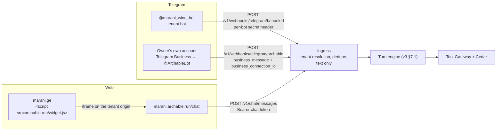
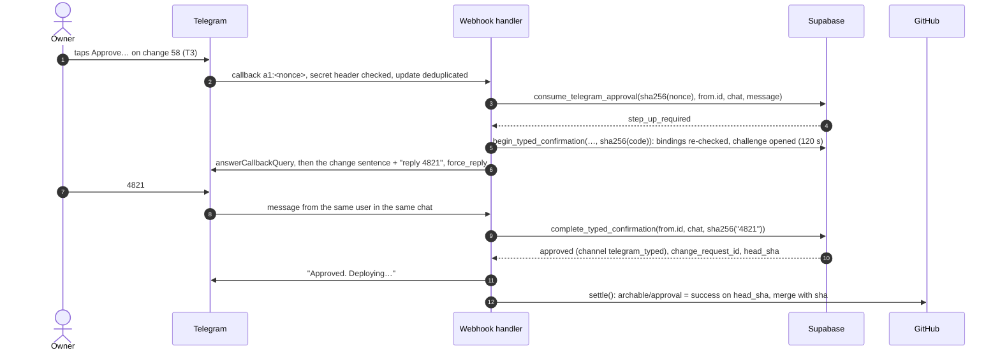

# ARCHABLE — Implementation Plan (Blueprint v3.1)

> **Status:** authoritative for implementation. It amends `ARCHABLE_MASTER_BLUEPRINT_v3.md` (cited as **v3 §n**) and changes nothing the amendments below don't mention.
> **Scope:** technical only. Phases are a dependency order, each closed by a check. There are no dates, owners or durations.
> **What was run:** the schema delta was applied to a populated v3 database on PostgreSQL 16 and passed a behavioral suite. Every TypeScript module marked ✓ in §9.3 typechecks under `strict` against the pinned library versions and passed behavioral tests. Everything else is a specification to implement.

**Reading guide.** §1 adds the four new capabilities to the architecture. §2 rules on the six review findings. §3 sets up the repository, packages and environment. §4–§8 are the five phases, each with files, dependencies, code and a two-minute check. §9 holds the conventions every phase shares. §10 lists open assumptions and sources.

Contents: [1 Amendments](#1-architecture-amendments-v31) · [2 Review findings](#2-the-six-review-findings) · [3 Repository](#3-repository-toolchain-and-environment) · [4 Phase 1](#4-phase-1--foundation-and-database) · [5 Phase 2](#5-phase-2--turn-runtime-and-tool-gateway) · [6 Phase 3](#6-phase-3--client-ingress-and-channels) · [7 Phase 4](#7-phase-4--the-architect-and-triad-governance) · [8 Phase 5](#8-phase-5--web-shell-and-developer-mode) · [9 Conventions](#9-cross-phase-conventions) · [10 Sources](#10-assumptions-to-verify-and-sources)

---

## 1. Architecture amendments (v3.1)

All seven v3 invariants (v3 §0) still hold, and each amendment is checked against them. The amendments as a whole:

| # | Amendment | Supersedes | Invariant it leans on |
|---|---|---|---|
| A1 | Customer ingress: tenant bot, Telegram Business connection, web chat and embeddable widget | v3 §2.5 "Going live", the `channels` block of v3 §6 | I1: bindings are facts, the channel list is a definition |
| A2 | Developer Mode's primary diagram is the app-to-app (A2A) graph, with contract, latency and live calls per edge | Adds a screen to v3 §9.3 | I2: the graph is compiled from the spec |
| A3 | Decision Rationale Cards for every Architect proposal and every critical agent action | Extends v3 §4.6 and §9.4 | I3, I4: rationale is evidence, never authority; its digest is recorded with the approval |
| A4 | The owner uses text and inline buttons only. No voice, no speech-to-text | v3 §1.6 decision 6, §2.5, §4.3 B, §4.5 Mini App, §9.2 | I4, I7 |

### 1.1 A1: Customer ingress

Three ways in, one turn engine. Each adapter resolves the tenant, converts the update into an `Inbound` (§5.3) and hands it over. The turn engine never sees a channel's wire format.



| Channel | Customer reaches it at | Tenant is resolved from | Reply goes out via | Limits we design around |
|---|---|---|---|---|
| **Tenant bot** | `t.me/marani_wine_bot` | the webhook path's `hookId` → `channel_connections` | `sendMessage` with the tenant bot's token from Vault | none beyond the Bot API |
| **Telegram Business** | the owner's ordinary chats | `business_connection_id` → `channel_connections` | `sendMessage` with `business_connection_id`, through @ArchableBot | the owner needs Premium; replies need `rights.can_reply` and an incoming message from that customer within 24 h; `web_app` buttons are not allowed in business messages |
| **Web chat** | `marani.archable.run/chat`, or the widget on any site | the chat token's `tid`, minted from a session the API created | the HTTP response, or long poll for late and staff replies | storage is per site (partitioned), so a customer on two websites has two sessions |

Decisions that follow:
- **A person always wins.** When the owner types in a Business chat, or staff reply from the inbox, `conversations.agent_paused_until` is set 30 minutes ahead and the agent stays silent there. The event is captured as a `human_takeover` failure (v3 §7.2), so repeated takeovers become a desire.
- **Suggest mode.** If the owner connects Business without granting reply rights, the agent still runs the turn, Cedar still checks it, and the draft goes to the owner's private chat with @ArchableBot as text to copy.
- **Text only, both sides.** Voice notes, audio and video notes get a fixed text answer ("Please type your message"). No audio is downloaded, stored or transcribed anywhere. A customer photo is answered the same way; the vision lane serves owner onboarding only (§1.4).
- **Going live is an owner action, not a PR.** Connecting a channel binds a fact, so it isn't a spec change and needs no merge. Each binding starts from the owner's verified Telegram id: a pasted BotFather token, a tapped "Connect Telegram Business", or a tapped "Turn on web chat".

### 1.2 A2: The app-to-app graph in Developer Mode

The graph is a compiled projection, `bundle.a2a`, derived from the spec next to the blast-radius graph (v3 §3), so it can't drift from what runs. **Nodes** are the apps plus the outside systems they reach through `connections`. **Edges** come from three facts in the spec:

| Edge | Derived from | Example on Marani OS | Transport |
|---|---|---|---|
| A2A tool | an agent lists a tool that another app owns | `Contact Center ──[A2A tool: delivery.status]──▶ QuickShipper` | in process, through the Tool Gateway |
| A2A event | a trigger's `on` field belongs to one app, its `call` tool to another | `QuickShipper ──[A2A event: delivery_job.status → picked_up\|delivered\|failed]──▶ Contact Center` | in process |
| Connection | a tool names a `connection` | `QuickShipper ──[MCP: delivery.dispatch]──▶ courier_api` | MCP to an outside server (Elva-hosted) |

The compiler's output for Marani, from the test run (§9.3):

```
app:quickshipper    ──[MCP: delivery.dispatch]────────────────────────────────▶ conn:courier_api   (mcp)
app:contact_center  ──[A2A event: order.status → confirmed]───────────────────▶ app:quickshipper   (in_process)
app:quickshipper    ──[A2A event: delivery_job.status → picked_up|delivered|failed]─▶ app:contact_center (in_process)
app:contact_center  ──[A2A tool: customer.upsert]─────────────────────────────▶ app:customer_center (in_process)
app:contact_center  ──[A2A tool: delivery.status]─────────────────────────────▶ app:quickshipper   (in_process)
app:quickshipper    ──[A2A tool: handoff.staff]───────────────────────────────▶ app:contact_center (in_process)
```

The brief's names map onto the spec's: `dispatch.lookup` is `delivery.status` and `crm.upsert` is `customer.upsert`. Tool names stay `<object>.<verb>`, so the graph, Cedar actions and the blast-radius ids all agree.

**On the word "A2A".** These edges are app-to-app capability calls with MCP-shaped contracts (name, description, input and output JSON Schema). Internal edges run in process, as v3 §1.5 decided, so they cost microseconds and Cedar sees every call. The same contracts are exported to Elva as a real MCP server for outside agents. The edge label always says which transport applies, so the diagram never implies a network hop that doesn't exist.

**Clicking an edge** opens the inspector (§8.3):
- the contract, from the bundle (`contracts/openapi.yaml` is what Elva imports);
- calls, denials, errors and p50/p95 latency over 24 h, from `tool_calls`;
- the last 20 calls, each linking to the turn inspector;
- Elva's sync state for the outside-agent contract, and **Open in Elva Playground**.

New calls arrive live through Realtime: a trigger on `tool_calls` broadcasts to the tenant topic. Call payloads are never stored, only digests (v3 §8), so the trace shows metadata, Cedar decisions and policy ids, never a customer's address.

### 1.3 A3: Decision Rationale Cards

Every card has the brief's five sections. One rule governs all of them: **a sentence on a card is rendered from a typed fact with a named source, or it isn't on the card.** No model writes any part of it. That gives three properties:
- an owner can't be shown a number nobody can trace;
- the same inputs give the same card and the same digest;
- the developer sees each sentence's source in Developer Mode.

| Section | Facts it is rendered from | Source |
|---|---|---|
| Trigger / observation | the owner's request, and the count of linked customer chats and customers with their date range | `desires`, `messages`, `desire_chapters` |
| Business impact | baskets quoted but not ordered, summed in GEL; chats that never reached a price are counted and excluded | `public.desire_impact()` over `chapters.last_quote_total` and `order_id` |
| Risk | numeric caps read from the Cedar policies that bound the change, plus the blast-radius witnesses at the deciding tier | compiler: `boundsOf()` over Cedar JSON, `blastRadius().why` |
| Proposed action | the typed ops, rendered with spec labels | the ChangeSet (v3 §7.2), templates of v3 §4.6 |
| Verification | passes over runs across the selected suites, new cases, Elva contract drift | `change_requests.verification` |

Rendered from the D-14 fixtures in the test run:

```
What happened
· You asked for this on 17 Oct: “customers keep asking to pay the courier in cash, allow it up to 300 lari”
· 3 customer chats from 3 customers between 15 Oct and 17 Oct were about this.

What it costs
· 2 of 2 customers who got a price did not order: 140 GEL in baskets.
· That is what those customers were quoted, not a forecast.
· 1 of the chats never reached a price, so it adds nothing to that figure.

What limits the risk
· The order total can't exceed 300 GEL when payment method is cash on delivery.
· It reaches an outside company: payment method → courier booking.
· It touches money: payment method → courier payout → payout amount.

What changes
· Customers can choose cash on delivery.
· Cash on delivery is refused above 300 GEL.
· Cellar Master mentions it when asked how to pay.

How it was checked
· 47 of 47 checks passed, 3 of them new.
· What outside agents can call is unchanged.
```

Two of the brief's example sentences change on principle:
- *"140 GEL lost revenue due to aborted checkouts"* claims a cause nobody can observe. The card states what was observed (quoted, then no order) and says it isn't a forecast.
- *"Low default risk in Saburtalo zone"* has no fact behind it: Archable records no default rates per zone. A risk sentence needs a policy or a graph path. If a `cod_default` fact is ever recorded per zone, it can enter the card the same way.

**Where cards appear:**
- **Change cards:** the card is computed when the PR's head is verified and frozen into `change_requests.rationale` with its digest. The approval's evidence records that digest. A new head means a new card.
- **Desires:** `desires.rationale_card` is recomputed as evidence grows, so the feed shows the current picture.
- **Critical agent actions:** a card is computed on demand from the turn trace (`decision_log`, `tool_calls`, policy ids). A critical action is any tool whose effect is `external` or `money`, any Cedar deny, and any holding reply. It's offered on staff handoff messages and in Owner Mode's activity log.

In Telegram the card opens from **ℹ️ View rationale** as a separate message, so the approval card and its summary digest (v3 §4.6) are never edited by it.

### 1.4 A4: Text and buttons only

Owner input is text messages and inline-keyboard taps, in @ArchableBot or in Owner Mode's chat. Everything that implied otherwise is removed or replaced:

| v3 element | v3.1 |
|---|---|
| Voice notes at onboarding (v3 §2.5), "owner voice note" in Workflow B (v3 §4.3), "text or voice" desires (v3 §9.4), "transcribe" in the Jev request | Removed. Owner requests are text. The bot answers a voice note with "Please type your message". There's no transcription step and no audio in Storage. |
| Mini App + `BiometricManager` for T3/T4 (v3 §1.6, §4.5) | **Typed confirmation**, ruled on in §2.1. The Mini App code and `approve_with_step_up` stay in the schema, unused, as the upgrade path. |
| Owner web session minted from Mini App `initData` (v3 §4.1) | `/web` in @ArchableBot returns a one-time sign-in URL button. The API creates it with Supabase Auth's admin `generateLink` for the owner's user, so no email is sent. |
| Flyer photo at onboarding | Kept as **evidence**, not interaction: the owner may attach a flyer, and everything else is text and buttons. If the team reads the constraint as "no images either", delete the vision lane; nothing else depends on it. |

### 1.5 Spec delta

The tenant spec gains one tool, one trigger, explicit tool ownership, three channel definitions and one privacy policy. Everything else in v3 §6 stands.

```yaml
# enterprise.spec.yaml (v3.1 additions to Marani OS)
apps:
  contact_center:
    channels: [tg_customers, tg_business, web_chat]   # was [tg_customers]

agents:
  cellar_master:
    tools: [catalog.search, order.quote, order.create, customer.upsert, delivery.status, handoff.staff]

tools:
  delivery.status:                     # the brief's dispatch.lookup
    app: quickshipper                  # owner; templates declare it, the spec may override
    description: Where is my order? Needs the order number and the customer's phone.
    input: { order: order.number, phone: customer.phone }
    output: { status: delivery_job.status, eta: "delivery_job.eta?" }
    reads: [delivery_job.status, delivery_job.eta, order.customer, customer.phone]
    effect: none
  customer.notify:                     # proactive status message to the customer's last channel
    app: contact_center
    description: Tell the customer their delivery status changed.
    input: { job: delivery_job }
    reads: [delivery_job.status, delivery_job.eta, order.customer]
    effect: external                   # leaves the system as a message: T3 floor, as for message.send

triggers:
  notify_on_job_status: { on: "delivery_job.status -> picked_up|delivered|failed", call: customer.notify }

channels:                              # what the business has; which bot or connection serves it is a fact (§4.2)
  tg_customers: { kind: telegram_bot }
  tg_business: { kind: telegram_business, via: archable_bot, without_reply_rights: suggest }
  web_chat:
    kind: web
    greeting: { ka: "გამარჯობა! რა ღვინოს ეძებთ?", en: "Hi! Looking for a wine?" }
    launcher: { label: { ka: "მოგვწერეთ", en: "Chat with us" }, position: right }
    embed_origins: ["https://marani.ge"]   # frame-ancestors for /chat?embed=1; empty = only *.archable.run

policies:
  files: [policies/orders.cedar, policies/delivery.cedar, policies/messaging.cedar, policies/privacy.cedar]

risk:
  change_rules:
    channel.copy: T1                   # greeting, launcher label
    channel.any: T4                    # kinds, embed origins
```

```cedar
// policies/privacy.cedar: order status only for someone who knows both the number and the phone.
// On Telegram the gateway fills `phone` from the customer linked to the chat; on the web the customer types it.
@id("privacy.status_needs_phone")
forbid (principal, action == Action::"delivery.status", resource)
unless { context.order.customer_phone == context.input.phone };
```

`customer.notify` follows the reply rules of its channel. On Telegram it needs a customer who started the bot. In a Business chat it needs an incoming message within 24 hours; otherwise it falls back to a staff task. On the web it lands in the conversation and is delivered the next time the iframe polls.

---

## 2. The six review findings

| # | Finding | Holds? | Resolution |
|---|---|---|---|
| 1 | T3/T4 biometrics collide with "text and buttons only" | **Yes** | Typed confirmation code in the same chat. The two-person rule supplies compromise resistance, and T3/T4 never merge without a developer. |
| 2 | Web chat identity, persistence and CORS | **Partly.** A UUID in the host page's `localStorage` is the wrong place and the wrong secret | Iframe on the tenant origin; a server-minted 256-bit secret stored as a hash; 1 h chat tokens; CORS echoes tenant origins only; phone + order number before any order data. |
| 3 | Telegram multi-tenant routing | **Yes** | An opaque `hookId` per tenant bot (not the slug, not the token); `channel_connections` maps `business_connection_id` → tenant; a link intent decides which tenant a new connection belongs to. |
| 4 | Grounding "lost revenue" | **Yes**, and neither proposed method is enough alone | SQL over chapter facts the Tool Gateway writes; the model only links chats to a desire, the owner can unlink, and the card says "quoted, not ordered", not "lost". |
| 5 | Elva needs a `MOCK_ELVA` flag | **No** | Elva isn't in any turn path, and the graph and contracts come from the bundle. The real offline need is `CONNECTIONS_MODE=simulate` for outside tools, which v3's preview mechanism already implements. |
| 6 | Schema delta | **Partly** | Yes to channel bindings; the rationale is a function plus a frozen snapshot, not stored numbers; `tenants.widget_settings` is rejected under I1: widget copy and theme are spec. Eight additions found that the review missed. |

### 2.1 T3/T4 approval without biometrics

**The collision is real.** `consume_telegram_approval` returns `step_up_required` for T3/T4, and v3 resolves that only in a Mini App with `BiometricManager`. A Mini App is opened by a button, but it's a web UI with a fingerprint prompt, which is neither text nor a button. Two further problems:
- Telegram doesn't document `BiometricManager` availability per client (v3 §10, assumption 5), so a laptop running Telegram Desktop may have no way to approve at all;
- `web_app` buttons are not allowed in business messages, which narrows where a Mini App can be offered.

**What step-up must stop, threat by threat:**

| Threat | Inline nonce alone (v3 §4.5) | + typed confirmation | + biometric (v3) |
|---|---|---|---|
| Forged or replayed tap, forwarded card, wrong person tapping | stopped (identity, placement, single use) | stopped | stopped |
| Accidental tap, approving without reading | not stopped | **stopped**: the code is in a prompt that repeats the change sentence | stopped |
| Someone else holding the owner's unlocked phone | not stopped | not stopped | stopped |
| Owner's Telegram account taken over | not stopped | not stopped | stopped only if enrolling a new device needs more than the Telegram account |

**Why typed confirmation is enough for T3/T4.** Governance already requires **two people** from T3 up: the developer's GitHub review on the exact head SHA, and the owner. Those are two identities with two providers, and GitHub's is proven by device flow (v3 §4.4). A stolen Telegram account or a borrowed phone can't land a T3 change alone; the attacker would also need the developer's GitHub account. Biometrics protected one factor of a two-person rule; typed confirmation keeps the rule and adds proof of intent. So:

1. **`confirm_mode`** is a new approval column: `tap` (T1, T2), `typed` (T3, T4 in v3.1) or `biometric` (the upgrade path). `step_up` remains and must equal `confirm_mode <> 'tap'`, enforced by a check constraint.
2. **Flow:** *Approve…* → `consume_telegram_approval` returns `step_up_required` (unchanged) → `begin_typed_confirmation` re-checks every binding and opens a challenge → the bot repeats the change sentence and asks for a 4-digit code → the owner types it → `complete_typed_confirmation` approves with `channel = 'telegram_typed'`.
3. **Challenge rules:**
   - one open challenge per Telegram user; a new one supersedes the old;
   - 120 s lifetime and at most 5 attempts;
   - the reply must come from the same chat;
   - the approval must still be pending and unexpired at completion.
   
   The code is shown in the prompt, so it is not a secret and isn't treated as one. It proves the owner read that prompt and answered it on purpose.
4. **No developer, no T3.** If the tenant has no developer, `archable/approval` stays `in_progress` with "Changes that touch money need a developer. Invite one in Team." The two-person rule is what makes typed confirmation safe, so it is never waived. A T2 change by a tenant without a developer needs only the owner, as today.
5. **Reject stays one tap** at every tier.

The SQL is in §4.2 and the handler in §7.3; the tests cover wrong person, wrong message, wrong chat, wrong code, burned and superseded challenges, expiry and single use (§9.3).

### 2.2 Web chat identity, sessions and CORS

**What the proposal gets wrong.**
- If the widget runs as a script in the host page, `localStorage` belongs to the host's origin. Any script on that site can read the session id, and a session id that is also `conversations.external_id` is readable by every staff member through RLS, which would make it a bearer credential sitting in a staff-visible column.
- A client-generated UUID also lets a client pick its own identifier.

**Model.**
1. **The widget is an iframe** of `https://<slug>.archable.run/chat?embed=1`. The loader on the host page only draws a launcher and the frame. The host page never holds a token, a message or a secret. All chat traffic leaves from the tenant origin, so the API never has to trust a customer's website.
2. **The server mints the session.** `POST /v1/chat/sessions` creates 32 random bytes as the secret and returns them once. Postgres stores only `sha256(secret)` in `web_sessions.secret_hash`. The conversation's `external_id` is `ws_<public session id>`, which isn't a credential.
3. **Messages carry a 1-hour HS256 token** (`tid`, `sid`, `cid`, `env`). On expiry the iframe resumes with its secret and gets a new token. Third-party iframe storage is partitioned per top-level site in current browsers, so a session is per (website, tenant). Where storage is blocked, the iframe keeps the secret in memory and a reload starts a new session.
4. **Identity is anonymous until proven.** A typed phone number proves nothing. `privacy.status_needs_phone` (§1.5) requires the order number and the phone together before any order data is returned, on every channel. `web_sessions.verified_customer_id` is set only by that proof and is never read from client input.
5. **Abuse limits.** A Vercel WAF rate-limit rule on `/v1/chat/sessions` and `/v1/chat/messages` per IP, plus a per-session limit of 12 messages a minute in the route (§6.3). Retries are idempotent through `client_msg_id`.

**CORS policy for `api.archable.run`.** Exactly two policies, both in §6.3:

| Routes | `Access-Control-Allow-Origin` | Credentials | Why |
|---|---|---|---|
| `/v1/chat/*`, `/v1/manifest`, `/v1/turns`, `/v1/dev/*`, `/v1/owner/*` | the request's origin, echoed only if it is `https://<slug>.archable.run`, `https://pr-<n>--<slug>.archable.run` or a registered custom domain; otherwise no header | none (bearer tokens; no cookies anywhere) | only the shell and the chat iframe call these, and both run on tenant origins |
| `/v1/widget/config/:slug` | `*` | none | public launcher label and brand colour, read by the loader on any website |
| `/v1/widget.js` | no CORS needed (a classic `<script>` load) | — | — |

`Vary: Origin` is set on echoed responses. Platform hostnames (`api`, `www`, `app` and nine more) are reserved: the router refuses them as tenant origins, and a new `tenants_slug_reserved` check keeps them from ever being created. The test run found this hole: without the reservation, `https://api.archable.run` parsed as a tenant called "api". Framing is controlled by the shell, not the API: `/chat?embed=1` sends `Content-Security-Policy: frame-ancestors` built from `channels.web_chat.embed_origins`, and every other shell route sends `frame-ancestors 'none'`.

### 2.3 Telegram routing at multi-tenant scale

**(a) Tenant bots.** Each bot gets its own webhook: `POST /v1/webhooks/telegram/b/:hookId`.

| Path key | Problem |
|---|---|
| `:tenant_slug` | Public and guessable; renaming a tenant breaks the webhook; it identifies the tenant but not the bot when a token is replaced. |
| the bot token (Telegram's old example) | A credential in every access log, CDN log and error report. |
| sha256 of the token | Needs the token to verify, and it doesn't rotate independently. |
| **random `hookId` + per-bot secret header** | **Chosen.** Opaque and rotatable. The secret goes in `setWebhook(secret_token)`; Telegram sends it back in `X-Telegram-Bot-Api-Secret-Token`, and Postgres keeps only its hash. |

`private.resolve_bot_hook(hookId)` is a `security definer` function because the runtime role sees only its context tenant, and the tenant is what's being looked up. It returns exactly what routing needs. The token is fetched from Vault at send time (`private.channel_secret`, v3 §8) and is never stored in a column. Rebinding a bot revokes the old row in the same transaction, so the old hook stops resolving at once (tested).

**(b) Telegram Business.** Yes, an explicit mapping is required. A `business_message` carries `business_connection_id` and the customer's chat, but nothing that names the tenant. The `business_connection` update names the owner's Telegram user, and one owner may own several tenants. Resolution:
1. The owner taps **Connect Telegram Business** under a specific tenant. That writes a `channel_link_intents` row (tenant, membership, Telegram user, expires in 15 min).
2. The owner adds @ArchableBot in Telegram's Business settings. The `business_connection` update arrives, and `bind_business_connection` matches it to the open intent. It requires that membership to be that Telegram user's **owner** membership, then inserts the `channel_connections` row.
3. Later updates (rights changed, disabled) update or revoke that row. A `business_message` resolves through `private.resolve_business_connection(bot_id, connection_id)`.
4. If a message arrives for a connection we don't know, which Telegram warns can happen to a freshly started bot, the adapter calls `getBusinessConnection` and runs the same bind. Without an intent, nothing is bound and the owner is told what to tap.

### 2.4 Grounding the money on a rationale card

Neither proposed method works alone:
- **LLM extraction from transcripts** puts a model's arithmetic and guesses on an owner-facing number. That breaks the rule of §1.3.
- **Aggregating `order.status = 'draft'`** misses the main case: a customer who asks "can I pay cash?", hears "no" and leaves never creates an order.

**Method: facts written by the gateway, aggregated by SQL, linked by Jev, editable by people.**
1. **Facts at the source.** When `order.quote` returns under an allowing Cedar decision, the Tool Gateway writes `chapters.last_quote_total` and `last_quote_at` in the transaction that logs the call. When `order.create` succeeds, it writes `chapters.order_id`. These numbers come from tool outputs (CEL-derived `total`, v3 §6), never from model text.
2. **Linking.** Jev's dedupe Choice (v3 §7.2) attaches failures and their chapters to a desire. Each link is a `desire_chapters` row with its probability. The owner or developer can unlink a chat ("not about this"), and the numbers update.
3. **Aggregation.** `public.desire_impact(tenant, desire, quiet)` counts linked chats, distinct customers, quoted chats, and quoted chats with no order after `quiet` (2 h by default), and sums their quotes. Chats still inside the quiet window don't count yet.
4. **Wording.** "2 of 2 customers who got a price did not order: 140 GEL in baskets. That is what those customers were quoted, not a forecast." Unpriced chats are counted and excluded. There's no extrapolation, run rate or "lost".

The suite checks the arithmetic on six chapters: one ordered, one still inside the quiet window, one unpriced, one unlinked by the owner, and two abandoned at 60 and 80 GEL, which gives 140 GEL (§9.3).

### 2.5 Elva and offline operation

**The flag isn't needed for Elva.** Since v3 §1.5, Elva is in no turn path. In Developer Mode:
- the graph and the contracts come from the bundle;
- latency and calls come from our own `tool_calls`;
- the Playground is a link.

With Elva unreachable, every panel still renders. The sync badge says "unknown" and the logs panel says it couldn't reach Elva. Elva's HTTP API for logs and drift is not verified (§10), so v3.1 reads nothing from it at runtime. The drift result comes from CI, where the `elva` CLI runs.

**What does need a switch** is any tool that leaves the system: `delivery.dispatch` reaches the courier company through an Elva-hosted MCP server. `CONNECTIONS_MODE=simulate` makes every `external` or `money` tool run its `simulate()` path in all environments, which is the code previews already use (v3 §2.4), and logs each call as `status = 'simulated'`.

**Be honest about the rest.** With no network there is no Telegram, no AI Gateway and no Supabase, so there is no demo. No local mock replaces Gemini, Jev or Postgres. The mitigation for a dead venue network is a second uplink, not mocks.

### 2.6 Schema delta: what the review found, and what it missed

| Review item | Verdict |
|---|---|
| `channels` table for `business_connection_id` | **Yes**, as `channel_connections`, named so it doesn't collide with the spec's `channels`. It covers tenant bots (hook id, secret hash, Vault name) and web too. |
| `desires` columns `observation`, `lost_revenue`, `risk_cap` | **No.** Stored numbers go stale the moment another chat is linked or unlinked. The numbers come from `desire_impact()`. The card is cached on `desires.rationale_card` and **frozen** per head on `change_requests.rationale` + `rationale_digest`. |
| `tenants.widget_settings` JSONB | **No.** Greeting, launcher and embed origins are definitions: they live in `channels.web_chat` and are reviewed like any other change (copy T1, origins T4). Brand colour already lives in `ui.theme`. A JSONB column would be a second, unreviewed source for the same thing (I1). |

**Missed by the review, required by the amendments:**
- `channel_link_intents`: which tenant a new Business connection belongs to;
- `web_sessions` with `secret_hash` and `verified_customer_id`;
- `desire_chapters`: the editable link between desires and chats;
- `chapters.last_quote_total`, `last_quote_at` and `order_id`: the facts behind every money sentence;
- `conversations.agent_paused_until`: human takeover;
- `approvals.confirm_mode` and `private.approval_challenges`: typed confirmation;
- `tenants_slug_reserved`: `api.archable.run` must never be a tenant;
- `tool_calls_edge` index and the `tool_calls` broadcast trigger: the live graph.

The full additive migration is §4.2.

---

## 3. Repository, toolchain and environment

### 3.1 Layout

`archable/platform` is the v3 §5.2 pnpm workspace, with the files this plan adds. The shell stays the Lovable project `archable/shell` (v3 §1.4); §8 gives the data contracts and the Lovable prompts for its screens.

```
archable/platform
├── package.json                    pnpm workspace root; "type": "module"
├── pnpm-workspace.yaml             apps/*, packages/*
├── tsconfig.base.json              strict, noUncheckedIndexedAccess, moduleResolution Bundler
├── vercel.json                     region fra1, crons, rewrites (§3.3)
├── apps/api/                       Hono on Vercel Functions (Fluid compute)
│   ├── api/index.ts                Vercel entry: export default handle(app)
│   ├── src/app.ts                  mounts every route group, CORS, error handler
│   ├── src/dev.ts                  local server (@hono/node-server) + Telegram long polling
│   ├── src/db.ts                   two pools, withTenant, SQLSTATE → HTTP              Phase 1
│   ├── src/auth.ts                 Supabase JWT (JWKS) → membership                    Phase 2
│   ├── src/routes/turn.ts          POST /v1/turns                                      Phase 2
│   ├── src/http/origin.ts          origin → tenant                                     Phase 3
│   ├── src/http/cors.ts            the two CORS policies                               Phase 3
│   ├── src/routes/chat.ts          /v1/chat/sessions, /messages, /events               Phase 3
│   ├── src/routes/widget.ts        /v1/widget.js, /v1/widget/config/:slug              Phase 3
│   ├── src/routes/webhooks.ts      tenant bots: /v1/webhooks/telegram/b/:hookId        Phase 3
│   ├── src/channels/web/session.ts secrets and chat tokens                             Phase 3
│   ├── src/channels/telegram/
│   │   ├── archable-bot.ts         @ArchableBot: owner text, Business, approvals       Phase 3–4
│   │   ├── tenant-bot.ts           tenant bot updates → Inbound                        Phase 3
│   │   └── send.ts                 one sender for bot, Business and suggest mode       Phase 3
│   ├── src/routes/github.ts        /v1/webhooks/github                                 Phase 4
│   ├── src/routes/cron.ts          /v1/cron/drain (pgmq), /v1/cron/sweep               Phase 4
│   ├── src/routes/manifest.ts      GET /v1/manifest                                    Phase 5
│   └── src/routes/devmode.ts       /v1/dev/a2a, /v1/dev/a2a/edges/:id                  Phase 5
├── packages/contracts/             API ↔ shell types; the shell imports only this       Phase 1
├── packages/schema/                zod for the spec and ChangeSets (v3 §7.2)            Phase 1
├── packages/compiler/              parse → resolve → lower → graph → a2a → digest       Phase 1
├── packages/runtime/               turn engine, decisions, context                      Phase 2
├── packages/gateway/               Tool Gateway: Cedar, schemas, egress, simulate       Phase 2
├── packages/architect/             desires, reproduce, patch, verify                    Phase 4
├── packages/governance/            GitHub, approvals, cards, rationale                  Phase 4
├── packages/spec-writer/           ChangeSet → comment-preserving YAML                  Phase 4
├── fixtures/marani/                a complete tenant repo tree: the seed and the e2e target
├── scripts/seed-marani.ts                                                               Phase 1
└── supabase/
    ├── config.toml
    ├── migrations/20261017000000_archable_v3.sql                      v3 §8, unchanged
    ├── migrations/20261018000000_archable_v3_1_ingress_rationale.sql §4.2
    └── tests/                      SQL behavior suites (§4.4)
```

### 3.2 Dependencies

Versions as resolved from npm on 2026-10-17. The ✓ column marks the packages the tested modules ran against.

| Package | Version | Used by | ✓ |
|---|---|---|---|
| `hono` | 4.13.13 | apps/api | ✓ |
| `@hono/node-server` | 2.1.5 | apps/api (local only) | |
| `grammy` | 1.46.0 | apps/api (Bot API 10.3 types incl. Business) | ✓ |
| `jose` | 6.2.12 | chat tokens, Supabase JWT verification | ✓ |
| `zod` | 4.6.7 | request bodies, spec, ChangeSet | ✓ |
| `@cedar-policy/cedar-wasm` | 4.13.0 | gateway, compiler (`policyToJson`) | ✓ |
| `postgres` | 3.4.9 | db | ✓ |
| `octokit` | 5.0.5 | governance | ✓ |
| `canonicalize` | 5.1.0 | RFC 8785 digests | ✓ |
| `yaml` | 2.9.1 | spec-writer (comment-preserving documents) | |
| `ai` | ≥ 7.0.128 (7.0.143 current) | runtime, architect: `generateText`, `experimental_decide`, `Output.object` | |
| `@ai-sdk/gateway` | 4.0.116 | decision models through AI Gateway | |
| `@vercel/functions` | 3.10.1 | `waitUntil` | ✓ |
| `@supabase/supabase-js` | 2.118.0 | seed script, admin `generateLink`; shell | |
| `typescript` | 5.9.x | all (tested with 5.9.3) | ✓ |
| `vitest` | 5.0.5 | unit tests | |
| `tsx` | 4.23.15 | scripts, local dev | ✓ |
| `supabase` (CLI) | 2.121.0 | `link`, `db push`, `gen types` (no `supabase start`: no Docker) | |
| `@xyflow/react`, `elkjs` | 12.12.0, 0.12.0 | shell: the A2A graph | |

### 3.3 Environment

All secrets live in Vercel project environment variables (platform) or Supabase Vault (per tenant). Code paths reach only what they need (I5).

| Variable | Read by | Notes |
|---|---|---|
| `DATABASE_URL_RUNTIME` | turn engine, ingress | `postgres://archable_runtime.<ref>:…@aws-0-eu-central-1.pooler.supabase.com:6543/postgres` |
| `DATABASE_URL_CONTROL` | governance, Architect, channel binding | same host, `archable_control.<ref>` |
| `SUPABASE_URL`, `SUPABASE_JWKS_URL` | `auth.ts` | JWT verification for shell calls |
| `SUPABASE_SERVICE_ROLE_KEY` | seed script, `/web` sign-in links only | never in the turn path |
| `ARCHABLE_BOT_TOKEN`, `ARCHABLE_BOT_WEBHOOK_SECRET` | `archable-bot.ts` | platform bot; tenant bot tokens are in Vault |
| `WEB_SESSION_KEY` | `chat.ts` | 32+ random bytes, HS256 for chat tokens |
| `GITHUB_APP_ID`, `GITHUB_APP_PRIVATE_KEY`, `GITHUB_WEBHOOK_SECRET` | governance | one-hour installation tokens only |
| `CONNECTIONS_MODE` | gateway | `live` or `simulate` (§2.5) |
| `ELVA_PLAYGROUND_URL` | devmode | template with `{tenant}` and `{tool}`; unset hides the button |
| `PUBLIC_API_ORIGIN` | bots | `https://api.archable.run` |
| AI Gateway | runtime, architect | **no key**: Vercel OIDC in deployments; locally `vercel env pull` provides `VERCEL_OIDC_TOKEN` (12 h) |

`vercel.json` adds the `archable.run/widget.js` rewrite on the marketing domain, the cron that drains `pgmq` every minute (v3 §8), and `"regions": ["fra1"]`.

**Local development without Docker.** The API runs with `tsx watch src/dev.ts` against a separate Supabase project, `archable-dev`. Telegram uses **long polling** locally (`bot.start()`) with a separate dev bot token, so no public URL or tunnel is needed. A bot can't have a webhook and long polling at once, so production and dev never share a token.

---

## 4. Phase 1 — Foundation and database

**Goal:** a Supabase project with both migrations applied, a compiler that turns `fixtures/marani/` into a content-addressed bundle, and Marani OS seeded and active.

### 4.1 Files and dependencies

```
supabase/migrations/20261017000000_archable_v3.sql                      copy of v3 §8, byte for byte
supabase/migrations/20261018000000_archable_v3_1_ingress_rationale.sql §4.2
supabase/tests/v3.sql, supabase/tests/v3_1.sql                          §4.4
packages/contracts/src/index.ts                                         §4.3
packages/schema/src/spec.ts, changeset.ts                               spec zod (v3 §6), ChangeSet (v3 §7.2)
packages/compiler/src/{parse,resolve,lower,graph/blast,a2a,policy-bounds,digest,index}.ts
fixtures/marani/                                                        enterprise.spec.yaml (v3 §6 + §1.5), policies/, personas/, evals/, archable.lock
scripts/seed-marani.ts
apps/api/src/db.ts
```

```bash
pnpm add -w -D typescript@5.9 tsx@4.23.15 vitest@5.0.5 supabase@2.121.0
pnpm --filter @archable/compiler add canonicalize@5.1.0 yaml@2.9.1 zod@4.6.7 @cedar-policy/cedar-wasm@4.13.0
pnpm --filter @archable/api add postgres@3.4.9
pnpm add -w -D @supabase/supabase-js@2.118.0     # seed script only
```

**Schema application checklist** (managed Supabase only; no `supabase start`):
1. Create projects `archable-dev` and `archable` in `eu-central-1`. Enable `pg_jsonschema`, `pgmq` and `pg_cron` (Database → Extensions; the migration's `create extension` lines are idempotent).
2. `supabase link --project-ref <ref>` then `supabase db push`. Both migrations apply in order.
3. Set the plane role passwords out of band, once per project: `alter role archable_runtime password '…'; alter role archable_control password '…';`. Store the two pooler URLs in Vercel.
4. Create the private Storage bucket `media`. Enable Realtime private channels (Realtime settings: *allow public access* off).
5. In Database → Roles, confirm neither plane role has `bypassrls`.
6. Run the SQL suites against `archable-dev` (§4.4).

### 4.2 The additive migration

Applied after `20261017000000_archable_v3.sql`. It was run against a database that already held v3 rows, including a step-up approval that the backfill turns into `confirm_mode = 'biometric'`.

```sql
-- supabase/migrations/20261018000000_archable_v3_1_ingress_rationale.sql
-- Additive to 20261017000000_archable_v3.sql. Channel bindings, web sessions, rationale grounding,
-- typed confirmation for T3/T4, and the index the A2A graph reads. Definitions stay in Git (I1):
-- widget copy, theme and embed origins are spec, not columns.

-- Platform hostnames can't be tenant slugs (api.archable.run must never resolve to a tenant).
alter table public.tenants add constraint tenants_slug_reserved
  check (slug not in ('api', 'www', 'app', 'admin', 'docs', 'status', 'mcp', 'widget', 'chat', 'auth', 'static', 'cdn'));

-- ─────────────────────────────── channel bindings ───────────────────────────────
-- The spec says a tenant HAS a channel (channels.tg_customers). Which bot or Business connection
-- serves it is a fact, bound by the owner at runtime, so it lives here. Tokens live in Vault only.

create table public.channel_connections (
  tenant_id              uuid not null references public.tenants (id) on delete cascade,
  id                     uuid not null default gen_random_uuid(),
  channel_key            text not null,                  -- spec key: 'tg_customers' | 'tg_business' | 'web_chat'
  kind                   text not null check (kind in ('telegram_bot', 'telegram_business', 'web')),
  status                 text not null default 'live' check (status in ('live', 'paused', 'revoked')),
  -- telegram_bot: a tenant bot created in BotFather
  bot_id                 bigint,                          -- the token's first segment; public
  bot_username           text,
  hook_id                uuid unique,                     -- webhook path segment: opaque, rotatable
  hook_secret_hash       bytea,                           -- sha256 of the X-Telegram-Bot-Api-Secret-Token value
  token_secret           text,                            -- Vault name '<slug>/tg_bot_token'
  -- telegram_business: the owner's own account, connected to @ArchableBot
  via_bot_id             bigint,
  business_connection_id text,
  business_user_id       bigint,                          -- the owner's Telegram user id
  business_user_chat_id  bigint,
  can_reply              boolean not null default false,  -- rights.can_reply; false = suggest-only mode
  connected_by           uuid references public.memberships (id),
  created_at             timestamptz not null default now(),
  updated_at             timestamptz not null default now(),
  primary key (tenant_id, id),
  check (case kind
           when 'telegram_bot' then bot_id is not null and hook_id is not null
                                    and hook_secret_hash is not null and token_secret is not null
           when 'telegram_business' then business_connection_id is not null and via_bot_id is not null
                                    and business_user_id is not null
           else true end)
);
create unique index channel_bot_once on public.channel_connections (bot_id)
  where kind = 'telegram_bot' and status <> 'revoked';
create unique index channel_business_once on public.channel_connections (business_connection_id)
  where kind = 'telegram_business' and status <> 'revoked';
create unique index channel_web_once on public.channel_connections (tenant_id)
  where kind = 'web' and status <> 'revoked';

-- "Connect Telegram Business" tapped by the owner in @ArchableBot: tells the next business_connection
-- update from this Telegram user which tenant it belongs to.
create table public.channel_link_intents (
  tenant_id     uuid not null references public.tenants (id) on delete cascade,
  id            uuid not null default gen_random_uuid(),
  membership_id uuid not null references public.memberships (id),
  tg_user_id    bigint not null,
  expires_at    timestamptz not null default now() + interval '15 minutes',
  consumed_at   timestamptz,
  primary key (tenant_id, id)
);
create index channel_link_intents_open on public.channel_link_intents (tg_user_id, expires_at)
  where consumed_at is null;

-- ───────────────────────────────── web sessions ─────────────────────────────────
-- The public id is the conversation's external_id ('ws_<id>'); only the secret's hash is stored,
-- so staff who can read conversations can't resume a customer's session.

create table public.web_sessions (
  tenant_id            uuid not null references public.tenants (id) on delete cascade,
  id                   uuid not null default gen_random_uuid(),
  env                  text not null default 'prod' check (env = 'prod' or env ~ '^pr-[0-9]+$'),
  secret_hash          bytea not null unique,
  conversation_id      uuid not null,
  embed_origin         text,                            -- host page origin reported by the loader; informational
  verified_customer_id uuid,                            -- set only by a proof (order number + phone)
  created_at           timestamptz not null default now(),
  last_seen_at         timestamptz not null default now(),
  revoked_at           timestamptz,
  primary key (tenant_id, id),
  foreign key (tenant_id, conversation_id) references public.conversations (tenant_id, id) on delete cascade,
  foreign key (tenant_id, verified_customer_id) references public.records (tenant_id, id)
);

-- A person answering in a conversation (the owner in a Business chat, staff from the inbox) pauses the agent there.
alter table public.conversations add column agent_paused_until timestamptz;

-- ───────────────────────────── rationale grounding ─────────────────────────────
-- Basket value and outcome per chapter are written by the Tool Gateway from tool results, in the
-- same transaction as the tool_calls row. Models never write these columns.

alter table public.chapters
  add column last_quote_total bigint check (last_quote_total >= 0),   -- tetri, from the last allowed order.quote
  add column last_quote_at    timestamptz,
  add column order_id         uuid,
  add constraint chapters_order foreign key (tenant_id, order_id) references public.records (tenant_id, id);

-- Which chapters a desire is about. Jev's dedupe links them; owner or developer can unlink.
create table public.desire_chapters (
  tenant_id   uuid not null,
  desire_id   uuid not null,
  chapter_id  uuid not null,
  linked_by   text not null,                            -- 'jev:desire.dedupe' | 'owner' | 'developer'
  p           real check (p between 0 and 1),           -- Jev's probability when linked by Jev
  unlinked_at timestamptz,
  created_at  timestamptz not null default now(),
  primary key (tenant_id, desire_id, chapter_id),
  foreign key (tenant_id, desire_id) references public.desires (tenant_id, id) on delete cascade,
  foreign key (tenant_id, chapter_id) references public.chapters (tenant_id, id) on delete cascade
);

alter table public.desires
  add column rationale_card jsonb;                      -- latest draft card; recomputed as evidence grows

alter table public.change_requests
  add column rationale        jsonb,                    -- RationaleCard frozen for head_sha
  add column rationale_digest text check (rationale_digest ~ '^sha256:[0-9a-f]{64}$');

-- Every number on a rationale card comes from this function. A chapter counts as abandoned when it
-- was quoted, never produced an order, and has been quiet for p_quiet.
create function public.desire_impact(p_tenant uuid, p_desire uuid, p_quiet interval default '2 hours')
returns table (chapters integer, customers integer, quoted integer, abandoned integer,
               abandoned_value bigint, ordered integer, first_seen timestamptz, last_seen timestamptz)
language sql stable set search_path = ''
as $$
  select count(*)::int,
         count(distinct c.customer_id)::int,
         count(*) filter (where c.last_quote_total is not null)::int,
         count(*) filter (where c.last_quote_total is not null and c.order_id is null
                            and c.last_quote_at < now() - p_quiet)::int,
         coalesce(sum(c.last_quote_total) filter (where c.order_id is null
                                                    and c.last_quote_at < now() - p_quiet), 0)::bigint,
         count(*) filter (where c.order_id is not null)::int,
         min(c.opened_at),
         max(coalesce(c.last_quote_at, c.opened_at))
    from public.desire_chapters dc
    join public.chapters c on c.tenant_id = dc.tenant_id and c.id = dc.chapter_id
   where dc.tenant_id = p_tenant and dc.desire_id = p_desire and dc.unlinked_at is null
     and c.env = 'prod'
$$;

-- ─────────────────────── typed confirmation for T3 and T4 ───────────────────────
-- Replaces the Mini App biometric step for the MVP (owner surface is text and buttons only).
-- The code is shown in the prompt, so it is not a secret: it proves the owner read the prompt and
-- answered it on purpose. Compromise resistance comes from the two-person rule (developer + owner).

alter table public.approvals
  add column confirm_mode text not null default 'tap' check (confirm_mode in ('tap', 'typed', 'biometric'));
update public.approvals set confirm_mode = 'biometric' where step_up;
alter table public.approvals
  add constraint approvals_step_up_mode check (step_up = (confirm_mode <> 'tap'));
alter table public.approvals drop constraint approvals_channel_check;
alter table public.approvals add constraint approvals_channel_check
  check (channel in ('telegram_button', 'telegram_typed', 'telegram_mini_app', 'github_review', 'web'));

create table private.approval_challenges (
  id          uuid primary key default gen_random_uuid(),
  approval_id uuid not null references public.approvals (id) on delete cascade,
  tg_user_id  bigint not null,
  tg_chat_id  bigint not null,
  code_hash   bytea not null,                           -- sha256 of the code shown in the prompt
  attempts    smallint not null default 0,
  status      text not null default 'open' check (status in ('open', 'used', 'expired', 'superseded')),
  expires_at  timestamptz not null default now() + interval '120 seconds',
  created_at  timestamptz not null default now()
);
create unique index approval_challenges_one_open on private.approval_challenges (tg_user_id)
  where status = 'open';

-- Tap on "Approve…" for a step-up approval: same bindings as consume_telegram_approval, then a challenge.
create function public.begin_typed_confirmation(
  p_nonce_hash bytea, p_tg_user bigint, p_chat bigint, p_message integer, p_code_hash bytea)
returns table (outcome text, approval_id uuid, change_request_id uuid)
language plpgsql security definer set search_path = ''
as $$
#variable_conflict use_column
declare
  a public.approvals%rowtype;
  m public.memberships%rowtype;
begin
  select * into a from public.approvals x where x.nonce_hash = p_nonce_hash for update;
  if not found then
    return query select 'unknown'::text, null::uuid, null::uuid;
    return;
  end if;
  select * into m from public.memberships x where x.id = a.approver;
  if m.tg_user_id is distinct from p_tg_user or m.revoked_at is not null then
    outcome := 'wrong_person';
  elsif a.tg_chat_id is distinct from p_chat or a.tg_message_id is distinct from p_message then
    outcome := 'wrong_message';
  elsif a.status <> 'pending' then
    outcome := a.status;
  elsif a.expires_at < now() then
    update public.approvals x set status = 'expired' where x.id = a.id;
    outcome := 'expired';
  elsif a.confirm_mode <> 'typed' then
    outcome := 'not_typed';                               -- tap approvals use consume_telegram_approval
  else
    update private.approval_challenges c set status = 'superseded'
     where c.tg_user_id = p_tg_user and c.status = 'open';
    insert into private.approval_challenges (approval_id, tg_user_id, tg_chat_id, code_hash)
    values (a.id, p_tg_user, p_chat, p_code_hash);
    outcome := 'challenge_open';
  end if;
  return query select outcome, a.id, a.change_request_id;
end
$$;

-- The owner's text reply. At most 5 attempts; the approval must still be pending and unexpired.
create function public.complete_typed_confirmation(
  p_tg_user bigint, p_chat bigint, p_code_hash bytea, p_evidence jsonb)
returns table (outcome text, approval_id uuid, change_request_id uuid, head_sha text)
language plpgsql security definer set search_path = ''
as $$
#variable_conflict use_column
declare
  c private.approval_challenges%rowtype;
  a public.approvals%rowtype;
begin
  select * into c from private.approval_challenges x
   where x.tg_user_id = p_tg_user and x.status = 'open' for update;
  if not found then
    return query select 'no_challenge'::text, null::uuid, null::uuid, null::text;
    return;
  end if;
  select * into a from public.approvals x where x.id = c.approval_id for update;
  if c.tg_chat_id <> p_chat then
    outcome := 'wrong_chat';
  elsif c.expires_at < now() then
    update private.approval_challenges x set status = 'expired' where x.id = c.id;
    outcome := 'challenge_expired';
  elsif c.code_hash <> p_code_hash then
    update private.approval_challenges x
       set attempts = x.attempts + 1,
           status = case when x.attempts + 1 >= 5 then 'expired' else 'open' end
     where x.id = c.id;
    outcome := 'wrong_code';
  elsif a.status <> 'pending' then
    update private.approval_challenges x set status = 'superseded' where x.id = c.id;
    outcome := a.status;
  elsif a.expires_at < now() then
    update public.approvals x set status = 'expired' where x.id = a.id;
    update private.approval_challenges x set status = 'expired' where x.id = c.id;
    outcome := 'expired';
  else
    update private.approval_challenges x set status = 'used' where x.id = c.id;
    update public.approvals x
       set status = 'approved', channel = 'telegram_typed', decided_at = now(), evidence = p_evidence
     where x.id = a.id;
    outcome := 'approved';
  end if;
  return query select outcome, a.id, a.change_request_id, a.head_sha;
end
$$;

-- ───────────────────────────── ingress resolution ─────────────────────────────
-- Webhooks arrive before the tenant is known, and the plane roles only see their ctx tenant.
-- These definer functions return exactly what routing needs and nothing else.

create function private.resolve_bot_hook(p_hook uuid)
returns table (tenant_id uuid, channel_id uuid, bot_id bigint, hook_secret_hash bytea, token_secret text)
language sql stable security definer set search_path = ''
as $$
  select c.tenant_id, c.id, c.bot_id, c.hook_secret_hash, c.token_secret
    from public.channel_connections c
    join public.tenants t on t.id = c.tenant_id and t.status = 'live'
   where c.hook_id = p_hook and c.kind = 'telegram_bot' and c.status = 'live'
$$;

create function private.resolve_business_connection(p_via_bot bigint, p_connection text)
returns table (tenant_id uuid, channel_id uuid, business_user_id bigint, can_reply boolean)
language sql stable security definer set search_path = ''
as $$
  select c.tenant_id, c.id, c.business_user_id, c.can_reply
    from public.channel_connections c
    join public.tenants t on t.id = c.tenant_id and t.status = 'live'
   where c.business_connection_id = p_connection and c.via_bot_id = p_via_bot
     and c.kind = 'telegram_business' and c.status = 'live'
$$;

-- A business_connection update (connect, edit, disconnect). The tenant comes from the owner's
-- open link intent; without one, the connection is not bound.
create function public.bind_business_connection(
  p_via_bot bigint, p_connection text, p_user bigint, p_user_chat bigint, p_can_reply boolean, p_enabled boolean)
returns table (outcome text, tenant_id uuid)
language plpgsql security definer set search_path = ''
as $$
#variable_conflict use_column
declare
  i  public.channel_link_intents%rowtype;
  cc public.channel_connections%rowtype;
begin
  select * into cc from public.channel_connections x
   where x.business_connection_id = p_connection and x.kind = 'telegram_business' and x.status <> 'revoked'
   for update;
  if found then                                           -- edit or disconnect of a known connection
    update public.channel_connections x
       set can_reply = p_can_reply,
           status = case when p_enabled then 'live' else 'revoked' end,
           updated_at = now()
     where x.tenant_id = cc.tenant_id and x.id = cc.id;
    return query select case when p_enabled then 'updated' else 'disconnected' end, cc.tenant_id;
    return;
  end if;
  if not p_enabled then
    return query select 'ignored'::text, null::uuid;
    return;
  end if;
  select * into i from public.channel_link_intents x
   where x.tg_user_id = p_user and x.consumed_at is null and x.expires_at > now()
   order by x.expires_at desc limit 1
   for update;
  if not found then
    return query select 'no_intent'::text, null::uuid;
    return;
  end if;
  if not exists (select 1 from public.memberships m
                  where m.id = i.membership_id and m.role = 'owner'
                    and m.tg_user_id = p_user and m.revoked_at is null) then
    return query select 'not_owner'::text, null::uuid;
    return;
  end if;
  update public.channel_link_intents x set consumed_at = now() where x.tenant_id = i.tenant_id and x.id = i.id;
  insert into public.channel_connections (tenant_id, channel_key, kind, via_bot_id, business_connection_id,
                                          business_user_id, business_user_chat_id, can_reply, connected_by)
  values (i.tenant_id, 'tg_business', 'telegram_business', p_via_bot, p_connection,
          p_user, p_user_chat, p_can_reply, i.membership_id);
  return query select 'bound'::text, i.tenant_id;
end
$$;

-- Owner pasted a BotFather token in @ArchableBot: store it in Vault, then bind the hook.
create function public.bind_tenant_bot(
  p_tenant uuid, p_membership uuid, p_bot_id bigint, p_username text, p_token text, p_hook uuid, p_secret_hash bytea)
returns uuid
language plpgsql security definer set search_path = ''
as $$
declare
  v_slug text;
  v_name text;
  v_id   uuid;
begin
  if not exists (select 1 from public.memberships m
                  where m.id = p_membership and m.tenant_id = p_tenant and m.role = 'owner'
                    and m.revoked_at is null) then
    raise exception 'only the owner can connect a channel' using errcode = '42501';
  end if;
  select t.slug into v_slug from public.tenants t where t.id = p_tenant;
  v_name := v_slug || '/tg_bot_token';
  delete from vault.secrets where name = v_name;          -- replacing a token: the old one is dead
  perform vault.create_secret(p_token, v_name, 'tenant bot token');
  update public.channel_connections c set status = 'revoked', updated_at = now()
   where c.tenant_id = p_tenant and c.kind = 'telegram_bot' and c.status <> 'revoked';
  insert into public.channel_connections (tenant_id, channel_key, kind, bot_id, bot_username, hook_id,
                                          hook_secret_hash, token_secret, connected_by)
  values (p_tenant, 'tg_customers', 'telegram_bot', p_bot_id, p_username, p_hook, p_secret_hash, v_name, p_membership)
  returning id into v_id;
  return v_id;
end
$$;

-- Web chat: open or resume a session. The tenant must be live and have web chat turned on.
create function public.open_web_session(p_slug text, p_env text, p_secret_hash bytea, p_origin text)
returns table (tenant_id uuid, session_id uuid, conversation_id uuid)
language plpgsql security definer set search_path = ''
as $$
#variable_conflict use_column
declare
  v_tenant uuid;
  v_sid    uuid := gen_random_uuid();
  v_conv   uuid;
begin
  if p_env <> 'prod' and p_env !~ '^pr-[0-9]+$' then
    raise exception 'bad env' using errcode = '22023';
  end if;
  select t.id into v_tenant
    from public.tenants t
    join public.channel_connections c on c.tenant_id = t.id and c.kind = 'web' and c.status = 'live'
   where t.slug = p_slug and t.status = 'live';
  if v_tenant is null then
    return;                                               -- empty result: unknown tenant or chat off
  end if;
  insert into public.conversations (tenant_id, env, channel, external_id)
  values (v_tenant, p_env, 'web', 'ws_' || v_sid)
  returning id into v_conv;
  insert into public.web_sessions (tenant_id, id, env, secret_hash, conversation_id, embed_origin)
  values (v_tenant, v_sid, p_env, p_secret_hash, v_conv, left(p_origin, 200));
  return query select v_tenant, v_sid, v_conv;
end
$$;

create function public.resume_web_session(p_secret_hash bytea)
returns table (tenant_id uuid, session_id uuid, conversation_id uuid, env text)
language sql security definer set search_path = ''
as $$
  update public.web_sessions s set last_seen_at = now()
   where s.secret_hash = p_secret_hash and s.revoked_at is null
     and exists (select 1 from public.tenants t where t.id = s.tenant_id and t.status = 'live')
  returning s.tenant_id, s.id, s.conversation_id, s.env
$$;

-- ──────────────────────────── A2A graph: edge statistics ────────────────────────────

create index tool_calls_edge on public.tool_calls (tenant_id, tool, caller, created_at desc);

create function private.tool_calls_broadcast() returns trigger
language plpgsql security definer set search_path = ''
as $$
begin
  perform realtime.send(jsonb_build_object('id', new.id, 'caller', new.caller, 'tool', new.tool,
                                           'decision', new.decision, 'status', new.status,
                                           'latency_ms', new.latency_ms, 'turn_id', new.turn_id),
                        'tool_call', 'tenant:' || new.tenant_id, true);
  return null;
end
$$;
create trigger tool_calls_broadcast after insert on public.tool_calls
  for each row execute function private.tool_calls_broadcast();

-- ───────────────────────────────── RLS and grants ─────────────────────────────────

do $$
declare
  t text;
begin
  foreach t in array array['channel_connections', 'channel_link_intents', 'web_sessions', 'desire_chapters'] loop
    execute format('alter table public.%I enable row level security', t);
    execute format('create policy %I on public.%I for all to archable_runtime, archable_control '
                   'using (tenant_id = private.ctx_tenant()) with check (tenant_id = private.ctx_tenant())',
                   t || '_planes', t);
  end loop;
end
$$;
create policy channel_connections_owner_dev_read on public.channel_connections for select to authenticated
  using (private.has_role(tenant_id, array['owner', 'developer']));
create policy desire_chapters_owner_dev_read on public.desire_chapters for select to authenticated
  using (private.has_role(tenant_id, array['owner', 'developer']));

revoke all on public.channel_connections, public.channel_link_intents, public.web_sessions,
              public.desire_chapters from anon, authenticated;
grant select (tenant_id, id, channel_key, kind, status, bot_username, can_reply, created_at)
  on public.channel_connections to authenticated;
grant select on public.desire_chapters to authenticated;

grant select on public.channel_connections to archable_runtime;
grant select, update on public.web_sessions to archable_runtime;
grant select, insert, update, delete on public.channel_connections, public.channel_link_intents,
                                       public.web_sessions, public.desire_chapters to archable_control;

revoke execute on all functions in schema private from public;
revoke execute on function public.desire_impact(uuid, uuid, interval),
                           public.begin_typed_confirmation(bytea, bigint, bigint, integer, bytea),
                           public.complete_typed_confirmation(bigint, bigint, bytea, jsonb),
                           public.bind_business_connection(bigint, text, bigint, bigint, boolean, boolean),
                           public.bind_tenant_bot(uuid, uuid, bigint, text, text, uuid, bytea),
                           public.open_web_session(text, text, bytea, text),
                           public.resume_web_session(bytea)
  from public, anon, authenticated;
grant execute on function private.resolve_bot_hook(uuid),
                          private.resolve_business_connection(bigint, text),
                          public.open_web_session(text, text, bytea, text),
                          public.resume_web_session(bytea)
  to archable_runtime;
grant execute on function private.ctx_tenant(), private.first_seen(bigint, bigint),
                          private.resolve_business_connection(bigint, text),
                          public.desire_impact(uuid, uuid, interval),
                          public.begin_typed_confirmation(bytea, bigint, bigint, integer, bytea),
                          public.complete_typed_confirmation(bigint, bigint, bytea, jsonb),
                          public.bind_business_connection(bigint, text, bigint, bigint, boolean, boolean),
                          public.bind_tenant_bot(uuid, uuid, bigint, text, text, uuid, bytea)
  to archable_control;
grant execute on function private.tool_calls_broadcast() to archable_runtime, archable_control;

select cron.schedule('challenges-expire', '* * * * *',
  $$update private.approval_challenges set status = 'expired' where status = 'open' and expires_at < now()$$);
select cron.schedule('link-intents-drop', '23 * * * *',
  $$delete from public.channel_link_intents where expires_at < now() - interval '1 day'$$);
```

### 4.3 Compiler core

The compiler stays a pure function (I2): repository tree in, bundle and digest out. Phase 1 needs lowering, the graph, the A2A projection and the digest. Phase 4 adds base/head diffing for the blast radius, which is already specified in v3 §3.5.

```ts
// packages/compiler/src/index.ts (public surface)
export interface RepoTree { files: Record<string, string> }             // path → UTF-8 content; nothing else is read
export interface Lock { compiler: string; templates: Record<string, string>; shell: string }

export interface Bundle {
  apiVersion: 'archable.dev/v3';
  metadata: { id: string; name: string; os_name: string; currency: string; timezone: string; locale: unknown };
  models: Record<'dialogue' | 'vision' | 'patch' | 'decision', { model: string; reasoning?: string; fallback?: string }>;
  deadlines: { route: number; dialogue: number; pre_send: number; tool: number };
  objects: Record<string, { schema: JsonSchema; key: string | null; title: string; app: string; edit_roles: string[]; field_acl: Record<string, string[]> }>;
  tools: Record<string, { app: string; action: string; description: string; input: JsonSchema; output: JsonSchema | null;
                          effect: Effect; reads: string[]; writes: string[]; connection?: string; needsQuote: boolean;
                          idempotency?: string[]; operation_id: string }>;
  agents: Record<string, { app: string; persona: string; tools: string[]; decisions: unknown; context: unknown; display_name: Record<string, string> }>;
  triggers: Record<string, { on: string; call: string }>;
  decisions: Record<string, unknown>;                                   // v3 §6 decisions, thresholds included
  policies: { byId: Record<string, string>; schema: unknown; bounds: PolicyBound[] };
  channels: Record<string, { kind: 'telegram_bot' | 'telegram_business' | 'web'; public?: WidgetConfig }>;
  ui: unknown;                                                          // v3 §2.4 UI projection
  graph: { nodes: GNode[]; edges: { from: string; to: string; kind: EdgeKind }[] };
  a2a: A2AGraph;
  evals: unknown;
  extension_digest: string | null;
}

export function compile(tree: RepoTree, lock: Lock): { bundle: Bundle; digest: Digest; projections: Projections };
// Projections are the rows registration writes: entity_schemas and apps per digest (v3 §8).
```

Rules the implementation must keep:
- **Errors are values with a path.** `CompileError(path, message)`: `objects.order.fields.payment: unknown enum "cod"`. The Architect feeds these back to the patcher (v3 §7.2).
- **Money lowers to integer tetri** with `x-archable: {semantics: "money", currency, scale: 2}`. Every tool output that carries money is an integer.
- **Cedar is validated at compile time** against a Cedar schema generated from the spec. Policy bounds come from `policyToJson`, never from parsing Cedar text.
- **Output is sorted** wherever order isn't meaningful (nodes, edges, keys), and the digest is taken over RFC 8785 canonical JSON.

```ts
// packages/compiler/src/digest.ts: the bundle's identity. RFC 8785 canonical JSON, then SHA-256.
import canonicalize from 'canonicalize';
import { createHash } from 'node:crypto';

export type Digest = `sha256:${string}`;

export function digestOf(value: unknown): Digest {
  const json = canonicalize(value);
  if (json === undefined) throw new Error('value is not JSON-serializable');
  return `sha256:${createHash('sha256').update(json, 'utf8').digest('hex')}`;
}
```

```ts
// packages/compiler/src/a2a.ts: the app-to-app graph, derived from the spec like the blast-radius graph.
// Pure and deterministic (I2): sorted output, no clock, no I/O.
import type { A2AEdge, A2AGraph, A2ANode, Effect } from '@archable/contracts';

export interface A2AInput {
  apps: Record<string, { title: string; template: string; agent?: string }>;
  agents: Record<string, { app: string; tools: string[] }>;
  tools: Record<string, { app: string; effect: Effect; connection?: string }>;   // app: owner, from the template manifest
  objects: Record<string, { app: string }>;                                       // owner, from the template manifest
  triggers: Record<string, { on: string; call: string }>;                         // on: 'delivery_job.status -> delivered'
  connections: Record<string, { kind: string }>;
}

export class CompileError extends Error {}

export function deriveA2A(s: A2AInput): A2AGraph {
  const nodes = new Map<string, A2ANode>();
  const edges = new Map<string, A2AEdge>();
  const appNode = (app: string) => {
    const a = s.apps[app];
    if (!a) throw new CompileError(`unknown app "${app}"`);
    return `app:${app}`;
  };
  const toolOf = (id: string) => {
    const t = s.tools[id];
    if (!t) throw new CompileError(`unknown tool "${id}"`);
    return t;
  };
  const add = (e: Omit<A2AEdge, 'id'>) => {
    const id = `${e.kind}:${e.from}->${e.to}:${e.via}`;
    edges.set(id, { id, ...e });
  };

  for (const [id, a] of Object.entries(s.apps)) {
    nodes.set(`app:${id}`, { id: `app:${id}`, kind: 'app', title: a.title, template: a.template, agent: a.agent, tools: [] });
  }
  for (const [id, t] of Object.entries(s.tools)) {
    nodes.get(appNode(t.app))!.tools.push(id);
    if (t.connection) {                                   // a tool that leaves the system through an outside server
      if (!s.connections[t.connection]) throw new CompileError(`unknown connection "${t.connection}"`);
      const conn = `conn:${t.connection}`;
      nodes.set(conn, { id: conn, kind: 'external', title: t.connection, tools: [] });
      add({ kind: 'connection', from: appNode(t.app), to: conn, via: id, label: `MCP: ${id}`, transport: 'mcp', effect: t.effect });
    }
  }
  for (const a of Object.values(s.agents)) {              // an agent calling a tool another app owns
    for (const id of a.tools) {
      const t = toolOf(id);
      if (t.app === a.app) continue;
      add({ kind: 'tool', from: appNode(a.app), to: appNode(t.app), via: id, label: `A2A tool: ${id}`,
            transport: 'in_process', effect: t.effect });
    }
  }
  for (const [id, tr] of Object.entries(s.triggers)) {    // a fact changing in one app wakes another
    const m = /^([a-z_]+)\.([a-z_]+)\s*->\s*(.+)$/.exec(tr.on);
    if (!m) throw new CompileError(`trigger "${id}": cannot parse "${tr.on}"`);
    const [, object, field, value] = m as unknown as [string, string, string, string];
    const owner = s.objects[object];
    if (!owner) throw new CompileError(`trigger "${id}": unknown object "${object}"`);
    const t = toolOf(tr.call);
    if (owner.app === t.app) continue;
    add({ kind: 'event', from: appNode(owner.app), to: appNode(t.app), via: id,
          label: `A2A event: ${object}.${field} → ${value.trim()}`, transport: 'in_process', effect: t.effect });
  }

  const byId = <T extends { id: string }>(a: T, b: T) => (a.id < b.id ? -1 : a.id > b.id ? 1 : 0);
  for (const n of nodes.values()) n.tools.sort();
  return { nodes: [...nodes.values()].sort(byId), edges: [...edges.values()].sort(byId) };
}
```

```ts
// packages/compiler/src/policy-bounds.ts: numeric caps read from Cedar forbid policies, for rationale cards.
// Input is Cedar's JSON policy format (cedar-wasm policyToJson), so nothing here parses Cedar text.

export interface PolicyBound {
  policy: string;                                     // @id
  action: string;                                     // 'order.create'
  path: string;                                       // 'context.quote.total'
  max: number;                                        // largest allowed value
  when: { path: string; equals: string | number | boolean }[];   // equality conditions in the same `when`
  hasExceptions: boolean;                             // an `unless` clause can lift the cap
}

type Expr = Record<string, any>;

const attrPath = (e: Expr): string | null =>
  e.Var ? e.Var : e['.'] ? ((p) => (p ? `${p}.${e['.'].attr}` : null))(attrPath(e['.'].left)) : null;

const conjuncts = (e: Expr): Expr[] => (e['&&'] ? [...conjuncts(e['&&'].left), ...conjuncts(e['&&'].right)] : [e]);

export function boundsOf(est: Expr): PolicyBound[] {
  const id: string | undefined = est.annotations?.id;
  if (!id || est.effect !== 'forbid' || est.action?.op !== '==') return [];
  const conditions: Expr[] = est.conditions ?? [];
  const hasExceptions = conditions.some((c) => c.kind === 'unless');
  const out: PolicyBound[] = [];
  for (const c of conditions) {
    if (c.kind !== 'when') continue;
    const parts = conjuncts(c.body);
    const when = parts.flatMap((p) => {
      const eq = p['=='];
      const path = eq && attrPath(eq.left);
      return path && eq.right && 'Value' in eq.right ? [{ path, equals: eq.right.Value }] : [];
    });
    for (const p of parts) {
      const [op, cmp] = p['>'] ? ['>', p['>']] : p['>='] ? ['>=', p['>=']] : [null, null];
      const path = cmp && attrPath(cmp.left);
      const v = cmp?.right?.Value;
      if (!op || !path || typeof v !== 'number') continue;
      out.push({ policy: id, action: est.action.entity.id, path, max: op === '>' ? v : v - 1, when, hasExceptions });
    }
  }
  return out;
}
```

The types every later phase shares:

```ts
// packages/contracts/src/index.ts: types shared by the API and the shell. The shell imports only this package.

export type Tier = 0 | 1 | 2 | 3 | 4;
export type Env = 'prod' | `pr-${number}`;
export type Effect = 'none' | 'internal' | 'notify' | 'external' | 'money';
export type JsonSchema = Record<string, unknown>;

// ── Developer Mode: the app-to-app graph (compiled into bundle.a2a) ──

export interface A2ANode {
  id: string;                        // 'app:contact_center' | 'conn:courier_api'
  kind: 'app' | 'external';
  title: string;                     // 'Contact Center'
  template?: string;                 // 'tpl.contact_center@3'
  agent?: string;                    // 'cellar_master'
  tools: string[];                   // tools this node owns
}

export interface A2AEdge {
  id: string;                        // stable: `${kind}:${from}->${to}:${via}`
  kind: 'tool' | 'event' | 'connection';
  from: string;
  to: string;
  via: string;                       // tool id, trigger id or connection id
  label: string;                     // 'A2A tool: delivery.status'
  transport: 'in_process' | 'mcp';   // in_process: Tool Gateway; mcp: an outside server (Elva-hosted)
  effect: Effect;
}

export interface A2AGraph {
  nodes: A2ANode[];
  edges: A2AEdge[];
}

export interface EdgeStats {
  window: '24h';
  calls: number;
  denied: number;
  errors: number;
  p50_ms: number | null;
  p95_ms: number | null;
}

export interface EdgeCall {
  id: number;
  at: string;
  caller: string;
  tool: string;
  decision: 'allow' | 'deny';
  status: 'ok' | 'error' | 'denied' | 'simulated';
  latency_ms: number | null;
  policies: string[];
  turn_id: string | null;            // links to the turn inspector; payloads are never stored
}

export interface EdgeDetail {
  edge: A2AEdge;
  contract: {
    tool: string;
    description: string;
    input: JsonSchema;
    output: JsonSchema | null;
    operation_id: string;            // the operation in contracts/openapi.yaml, which Elva imports
    git_sha: string;
  } | null;                          // null for event edges
  elva: { playground_url: string | null; sync: 'in_sync' | 'drift' | 'unknown' };
  stats: EdgeStats;
  recent: EdgeCall[];
}

// ── Decision rationale ──

export interface RationaleFact {
  text: string;                      // one plain-language sentence
  source: string;                    // where the sentence came from; shown in Developer Mode
}

export interface RationaleCard {
  version: 1;
  subject:
    | { kind: 'change'; change_request_id: string; desire: string; head_sha: string }
    | { kind: 'action'; turn_id: string; tool: string };
  trigger: RationaleFact[];
  impact: RationaleFact[];
  risk: RationaleFact[];
  action: RationaleFact[];
  verification: RationaleFact[];
  computed_at: string;
}

// ── Web chat ──

export interface ChatSessionResponse {
  token: string;                     // 1 h bearer for /v1/chat/*
  secret?: string;                   // only when a new session was opened; the iframe stores it
  session_id: string;
}

export interface ChatMessage {
  id: number;
  author: 'customer' | 'agent' | 'staff';
  text: string;
  at: string;
}

// ── Shell boot ──

export interface Manifest {
  tenant_id: string;
  slug: string;
  env: Env;
  digest: string;
  epoch: number;
  os_name: string;
  branding: { brand: string; font: string; radius: string };
  extension_url: string | null;
  topic: string;                     // 'tenant:<id>'
}
```

### 4.4 Seeding Marani

Seeding is the provisioning reconcile loop (v3 §2.5) run once against fixtures: it connects as `archable_control`, and every step checks for its effect before acting, so a second run changes nothing.

```ts
// scripts/seed-marani.ts
import { readFileSync, readdirSync, statSync } from 'node:fs';
import { join, relative } from 'node:path';
import { createHash } from 'node:crypto';
import YAML from 'yaml';
import { compile } from '@archable/compiler';
import { controlDb, withTenant } from '../apps/api/src/db';

const ROOT = 'fixtures/marani';
const walk = (d: string): string[] => readdirSync(d).flatMap((f) => {
  const p = join(d, f);
  return statSync(p).isDirectory() ? walk(p) : [p];
});
const files = Object.fromEntries(walk(ROOT).map((p) => [relative(ROOT, p), readFileSync(p, 'utf8')]));
const lock = YAML.parse(files['archable.lock']!);
const { bundle, digest, projections } = compile({ files }, lock);

const OWNER_TG = Number(process.env.SEED_OWNER_TG_ID);                 // your own Telegram user id
if (!Number.isSafeInteger(OWNER_TG)) throw new Error('set SEED_OWNER_TG_ID');

// The control role sees no tenant before its context is set, so the id is derived from the slug: reruns hit the same row.
const h = createHash('sha256').update('archable:tenant:marani').digest('hex');
const tenantId = `${h.slice(0, 8)}-${h.slice(8, 12)}-4${h.slice(13, 16)}-8${h.slice(17, 20)}-${h.slice(20, 32)}`;

await withTenant(controlDb, tenantId, async (tx) => {
  await tx`insert into public.tenants (id, slug, name, os_name, status)
           values (${tenantId}, 'marani', 'Marani', 'Marani OS', 'live') on conflict (id) do nothing`;
  await tx`insert into public.specs (tenant_id, digest, git_sha, compiler_version, bundle, verified_at)
           values (${tenantId}, ${digest}, 'seed', ${lock.compiler}, ${tx.json(bundle as never)}, now())
           on conflict do nothing`;
  for (const e of projections.entitySchemas) {
    await tx`insert into public.entity_schemas ${tx({ tenant_id: tenantId, spec_digest: digest, ...e } as never)}
             on conflict do nothing`;
  }
  for (const a of projections.apps) {
    await tx`insert into public.apps ${tx({ tenant_id: tenantId, spec_digest: digest, ...a } as never)} on conflict do nothing`;
  }
  await tx`insert into public.memberships (tenant_id, role, display_name, tg_user_id)
           values (${tenantId}, 'owner', 'Owner', ${OWNER_TG}) on conflict do nothing`;
  await tx`insert into public.channel_connections (tenant_id, channel_key, kind)
           select ${tenantId}, 'web_chat', 'web'
            where not exists (select 1 from public.channel_connections where tenant_id = ${tenantId} and kind = 'web' and status <> 'revoked')`;
  const [{ active_digest, epoch }] = await tx`select active_digest, epoch from public.tenants where id = ${tenantId}`;
  if (active_digest !== digest) await tx`select public.flip_epoch(${tenantId}, ${epoch}, ${digest})`;
  for (const w of JSON.parse(files['seed/wines.json']!) as Record<string, unknown>[]) {   // mined rows, with provenance
    await tx`insert into public.records (tenant_id, entity_type, attrs, spec_digest, created_by, provenance)
             values (${tenantId}, 'wine', ${tx.json(w as never)}, ${digest}, 'import', ${tx.json({ source: 'fixture' })})
             on conflict do nothing`;
  }
});
console.log(JSON.stringify({ tenantId, digest }));
await controlDb.end();
```

Registration (`specs` + projections + `flip_epoch`) is the same code path the Architect uses in Phase 4, so the seed exercises it from the first day.

```ts
// apps/api/src/db.ts: one pool per plane, through Supavisor transaction mode (port 6543).
// Every unit of work is a transaction that starts by setting the tenant, so RLS applies to every query.
import postgres from 'postgres';

const pool = (url: string) => postgres(url, { prepare: false, max: 5, idle_timeout: 20, connect_timeout: 5 });

export const runtimeDb = pool(process.env.DATABASE_URL_RUNTIME!);   // archable_runtime.<ref>
export const controlDb = pool(process.env.DATABASE_URL_CONTROL!);   // archable_control.<ref>

export type Tx = postgres.TransactionSql;

export function withTenant<T>(db: postgres.Sql, tenantId: string, fn: (tx: Tx) => Promise<T>): Promise<T> {
  return db.begin(async (tx) => {
    await tx`select set_config('app.tenant_id', ${tenantId}, true)`;
    return fn(tx);
  }) as Promise<T>;
}

// Postgres errors the API maps to HTTP; anything else is a 500 with the turn id in the log.
export function httpStatusOf(e: unknown): number {
  const code = (e as { code?: string } | null)?.code;
  return code === '23514' ? 422 : code === '42501' ? 403 : code === '40001' ? 409 : code === 'P0002' ? 404 : 500;
}
```

### 4.5 Two-minute check

```bash
pnpm --filter @archable/compiler test        # compile fixtures/marani twice → identical digest; a2a has 6 edges; bounds has payment.cod_limit
SEED_OWNER_TG_ID=<your id> pnpm tsx scripts/seed-marani.ts      # prints {"tenantId":…,"digest":"sha256:…"}
pnpm tsx scripts/seed-marani.ts             # second run: same digest, no new rows
psql "$DATABASE_URL_CONTROL" -c "select set_config('app.tenant_id', '<tenantId>', false)" \
  -c "select slug, status, epoch, active_digest = (select digest from specs where state = 'active') as pointer_ok from tenants" \
  -c "select entity_type, count(*) from records group by 1"
```

Pass: one active digest, `epoch = 1`, wines present, and the second seed run changes nothing. Then run `supabase/tests/v3_1.sql` against `archable-dev` inside `begin … rollback`. The suite in §9.3 used stand-ins for Vault, Realtime and pgmq; on Supabase the real objects are used.

---

## 5. Phase 2 — Turn runtime and Tool Gateway

**Goal:** a customer turn runs end to end through `POST /v1/turns`, with Jev routing, Gemini dialogue, Cedar-authorized tools and the fail-closed pre-send check, before any channel exists.

### 5.1 Files and dependencies

```
packages/runtime/src/types.ts        Inbound, ReplyTarget, TurnResult (§5.3)
packages/runtime/src/turn.ts         handleTurn (v3 §7.1, amended in §5.4)
packages/runtime/src/decisions.ts    route() and preSend() (v3 §7.1), decision_log writes
packages/runtime/src/context.ts      conversation tail, chapter, customer
packages/runtime/src/epochs.ts       pin(): one indexed read per turn
packages/runtime/src/bundles.ts      LRU keyed by digest
packages/gateway/src/gateway.ts      toolGateway (v3 §7.1, amended in §5.5)
packages/gateway/src/cedar.ts        cedarDecide: any evaluation error denies
packages/gateway/src/simulate.ts     simulate() per tool effect
packages/gateway/src/facts.ts        facts.forPolicy, chapter facts (§5.5)
apps/api/src/auth.ts                 Supabase JWT → membership
apps/api/src/routes/turn.ts          POST /v1/turns
apps/api/src/app.ts, api/index.ts
```

```bash
pnpm --filter @archable/runtime add ai@^7.0.128 @ai-sdk/gateway@4.0.116 @vercel/functions@3.10.1
pnpm --filter @archable/gateway add @cedar-policy/cedar-wasm@4.13.0
pnpm --filter @archable/api add hono@4.13.13 jose@6.2.12 zod@4.6.7 @vercel/functions@3.10.1
pnpm --filter @archable/api add -D @hono/node-server@2.1.5
```

### 5.2 Decision calls

Each stage makes **one** Jev request with all of that stage's questions (v3 §1.1):
- **Route**, which fails open: the Choice `route.intent` and the Score `turn.signals` share one state.
- **Pre-send**, which fails closed: the Booleans (TypeSafe's *Noul*) `send.grounded` and `send.commitment` share one state. `preSend` is v3 §7.1 unchanged.

```ts
// packages/runtime/src/decisions.ts (route stage): one request, two questions; a timeout returns null
import { experimental_decide as decide } from 'ai';
import { gateway } from '@ai-sdk/gateway';

export async function route(bundle: Bundle, inbound: Inbound, tail: Msg[]): Promise<Route | null> {
  const h = bundle.decisions;
  const t0 = performance.now();
  try {
    const r = await withDeadline(decide({
      model: gateway.decisionModel('typesafe-ai/jev'),
      state: { message: inbound.text, recent: tail.slice(-6).map((m) => `${m.author}: ${m.body}`).join('\n') },
      questions: {
        intent: { type: 'choice', options: h['route.intent'].criteria },        // {order_new: "wants to buy…", …}
        frustration: { type: 'score', instructions: h['turn.signals'].instructions, scale: h['turn.signals'].criteria },
      },
      providerOptions: { gateway: { models: [{
        model: bundle.models.decision.fallback,
        when: { question: 'intent', confidenceBelow: h['route.intent'].escalate.confidence_below },
      }] } },
    }), bundle.deadlines.route);
    const out = {
      intent: r.answers.intent.choice as Intent,
      confidence: r.answers.intent.confidence,
      frustration: r.answers.frustration.score as Frustration,
      answeredBy: r.response.modelId,
    };
    void log.decision(inbound, 'route.intent', out, performance.now() - t0);
    return out;
  } catch (e) {
    void log.decision(inbound, 'route.intent', { verdict: 'timeout', error: String(e) }, performance.now() - t0);
    return null;                                         // I7: the dialogue model routes itself
  }
}
```

The option and scale keys above follow the shapes v3 §1.1 verified (Choice with a probability per option, Score with a probability per rung). Field names must be checked against the AI SDK reference before merging: assumption 8 in v3 §10, carried as §10.1 item 1.

### 5.3 The turn contract

`tenants.byChannel()` leaves the turn engine. Adapters resolve the tenant (§6) and pass an `Inbound` that already names it, so the engine has no idea which channel it serves.

```ts
// packages/runtime/src/types.ts: the channel-agnostic turn contract. Adapters resolve the tenant;
// the turn engine never sees a channel's wire format, and never sees audio (owner and customer: text only).
import type { Env } from '@archable/contracts';

export type ReplyTarget =
  | { kind: 'telegram'; channelId: string; botId: number; tokenSecret: string; chatId: number }
  | { kind: 'telegram_business'; channelId: string; botId: number; chatId: number; businessConnectionId: string;
      mode: 'reply' | 'suggest'; ownerChatId: number }
  | { kind: 'web'; sessionId: string }                       // the reply is returned to the HTTP caller
  | { kind: 'console' };                                     // /v1/turns: owner or developer trying the agent

export interface Inbound {
  turnId: string;
  tenantId: string;
  env: Env;
  channel: 'telegram' | 'telegram_business' | 'web';
  conversationKey: string;          // conversations.external_id: chat id, business chat id, 'ws_<id>' or 'try_<membership>'
  externalMessageId: string | null; // Telegram message id or the web client's client_msg_id (idempotency)
  text: string;
  customer: { tgUserId?: number; webSessionId?: string; verifiedCustomerId?: string | null };
  reply: ReplyTarget;
}

export interface TurnResult {
  turnId: string;
  text: string;                      // what was sent: the draft, or the holding reply
  allowed: boolean;                  // Cedar message.send verdict
  outboundMessageId: number;         // messages.id
  paused: boolean;                   // a human has taken over this conversation; nothing was sent
}

export type HandleTurn = (inbound: Inbound) => Promise<TurnResult>;
```

### 5.4 `handleTurn`, amended

Changes from v3 §7.1, each marked in the code:
1. it returns a `TurnResult` (web and the console need the reply in the response);
2. a paused conversation stores the message and returns without a model call;
3. the reply goes through `ReplyTarget`;
4. Business suggest mode sends the draft to the owner instead of the customer.

```ts
// packages/runtime/src/turn.ts
export async function handleTurn(inbound: Inbound): Promise<TurnResult> {
  const t0 = performance.now();
  const pin = await epochs.pin(inbound.tenantId, inbound.env);                     // one indexed read
  const bundle = await bundles.load(pin.digest);
  const conv = await conversations.upsert(inbound);                                // (tenant, env, channel, external_id)
  const inId = await messages.insertInbound(conv, inbound, pin.digest);            // unique external_id: retries stop here
  if (inId === null) return messages.replyFor(conv, inbound.externalMessageId!);   // [1] duplicate delivery: same answer
  if (conv.agent_paused_until && conv.agent_paused_until > new Date()) {           // [2] a person is answering
    return { turnId: inbound.turnId, text: '', allowed: false, outboundMessageId: 0, paused: true };
  }
  void channels.typing(inbound.reply);

  const rule = bundle.rules.match(inbound);                                        // D0
  const [route, ctx] = await Promise.all([
    rule ?? decisions.route(bundle, inbound, conv.tail),                           // fails open
    context.load(inbound.tenantId, pin, conv),
  ]);
  const agent = bundle.agentFor(route);
  const gw = toolGateway({ tenantId: inbound.tenantId, pin, agent, env: inbound.env, chapterId: ctx.chapter.id,
                           channel: inbound.channel, session: inbound.customer });

  const result = await generateText({
    model: bundle.models.dialogue.model, reasoning: bundle.models.dialogue.reasoning,
    system: agent.system(route, ctx), messages: ctx.messages, tools: gw.tools,
    stopWhen: stepCountIs(4), abortSignal: AbortSignal.timeout(bundle.deadlines.dialogue),
  }).catch((e) => ({ text: '', error: e }));                                       // a model failure is a holding reply

  const draft = drafts.of(result.text, gw.evidence(), inbound);
  const signals = draft.text ? await decisions.preSend(bundle, draft).catch(() => decisions.FAILED) : decisions.FAILED;
  const verdict = gw.authorize('message.send', { payload_digest: draft.digest, signals });
  const text = verdict.allow ? draft.text : agent.holdingReply(ctx.locale);

  const outId = await channels.deliver(inbound.reply, text, { suggestion: verdict.allow ? draft.text : null });   // [3][4]
  if (!verdict.allow) {
    await failures.capture(inbound.tenantId, 'grounding_block', { draft, signals, verdict });
    await gw.call('handoff.staff', { reason: 'reply blocked by pre-send check', urgency: 'normal' });
  }
  if (route && rank(route.frustration) >= rank(bundle.decisions['turn.signals'].capture_failure_at)) {   // ordered scale
    await failures.capture(inbound.tenantId, 'customer_frustration', { turn: inbound.turnId, level: route.frustration });
  }
  waitUntil(audit.after(inbound.tenantId, { pin, inbound, route, draft, signals, ms: performance.now() - t0 }));
  return { turnId: inbound.turnId, text, allowed: verdict.allow, outboundMessageId: outId, paused: false };
}
```

`channels.deliver` is one function in `apps/api/src/channels/telegram/send.ts` and `channels/web` (§6.4). For `suggest` it sends the customer nothing and sends the owner "Suggested reply to <name>: …".

### 5.5 Tool Gateway, amended

Four changes to v3 §7.1's `toolGateway`:

```ts
// packages/gateway/src/gateway.ts (the execute() body, v3.1)
execute: async (input) => {
  const t0 = performance.now();
  const policyFacts = await facts.forPolicy(tenantId, c, input, { channel, session });   // [a] fills phone from a linked customer
  const quote = c.needsQuote ? await quotes.price(tenantId, pin, input) : undefined;
  const verdict = authorize(c.action, { input: policyFacts.input, quote, ...policyFacts.context });
  if (!verdict.allow) {
    await log.toolCall(tenantId, { caller, tool: id, input, verdict, status: 'denied', ms: performance.now() - t0 });
    return { denied: true, policies: verdict.reasons };
  }
  const simulated = (env !== 'prod' || process.env.CONNECTIONS_MODE === 'simulate')        // [b]
    && (c.effect === 'external' || c.effect === 'money');
  try {
    const out = simulated ? await simulate(c, input)
      : await withDeadline(execute(c, policyFacts.input, { tenantId, pin, egress: secrets.injector(c.connection) }), deadlines.tool);
    await withTenant(runtimeDb, tenantId, async (tx) => {                                  // [c] one transaction
      await log.toolCall(tenantId, { caller, tool: id, input, verdict, status: simulated ? 'simulated' : 'ok',
                                     ms: performance.now() - t0 }, tx);
      if (id === 'order.quote') {
        await tx`update public.chapters set last_quote_total = ${out.total}, last_quote_at = now() where id = ${chapterId}`;
      }
      if (id === 'order.create') {
        await tx`update public.chapters set order_id = ${out.order.id} where id = ${chapterId}`;
      }
    });
    evidence.push({ tool: id, input, output: out });
    return out;
  } catch (e) {
    await log.toolCall(tenantId, { caller, tool: id, input, verdict, status: 'error', ms: performance.now() - t0 });
    await failures.capture(tenantId, 'tool_error', { tool: id, error: String(e) });
    return { error: 'tool_unavailable' };                                   // the model explains or hands off
  }
},
```

- **[a] Privacy facts.** For `delivery.status`, `facts.forPolicy` loads the order's customer phone into `context.order.customer_phone`. On Telegram it also fills `input.phone` from the customer linked to the chat; on the web it leaves `input.phone` as the customer typed it. Cedar then decides `privacy.status_needs_phone` (§1.5).
- **[b] Simulation.** Previews and `CONNECTIONS_MODE=simulate` share one path. `simulate()` returns schema-valid outputs: a fake job id and an ETA 45 minutes ahead.
- **[c] Facts and log, together.** The `tool_calls` row and the chapter facts are written in one transaction, so a rationale can never cite a quote that wasn't logged.
- **Caller attribution.** Agent calls log `caller = 'agent:<id>'`. A trigger call (`dispatch_on_confirm`, `notify_on_job_status`) runs through the same gateway with principal `Trigger::"<id>"` and logs `caller = 'trigger:<id>'`, which is how the A2A inspector finds event edges (§8.3).
- **Cedar errors deny.** `cedarDecide` is unchanged from v3 §7.1: any evaluation error is a deny. That is what keeps a missing `context.order` from silently disabling `privacy.status_needs_phone`.

### 5.6 The console endpoint

```ts
// apps/api/src/routes/turn.ts: POST /v1/turns, "Try as customer" for owner, developer and staff, and the
// fastest way to test the turn engine without a channel. Same engine, same Cedar, same pre-send checks.
import { Hono } from 'hono';
import { z } from 'zod';
import type { Env } from '@archable/contracts';
import type { HandleTurn } from '@archable/runtime';

export interface Member { tenantId: string; membershipId: string; role: 'owner' | 'developer' | 'staff' }

export interface TurnDeps {
  memberFromJwt(authorization: string | undefined, origin: string | undefined): Promise<Member | null>;   // Supabase JWT via JWKS
  handleTurn: HandleTurn;
  newTurnId(): string;
}

const Body = z.object({
  text: z.string().trim().min(1).max(2000),
  env: z.string().regex(/^(prod|pr-[0-9]{1,6})$/).default('prod'),
  thread: z.string().regex(/^[a-z0-9]{1,16}$/).default('main'),     // lets a tester keep several conversations
});

export function turnRoutes(d: TurnDeps) {
  const app = new Hono<{ Variables: { member: Member } }>();
  app.use('/v1/turns', async (c, next) => {
    const m = await d.memberFromJwt(c.req.header('authorization'), c.req.header('origin'));
    if (!m) return c.json({ error: 'unauthorized' }, 401);
    c.set('member', m);
    await next();
  });
  app.post('/v1/turns', async (c) => {
    const body = Body.safeParse(await c.req.json().catch(() => null));
    if (!body.success) return c.json({ error: 'bad_request', issues: body.error.issues }, 400);
    const m = c.get('member');
    const turnId = d.newTurnId();
    try {
      const r = await d.handleTurn({
        turnId, tenantId: m.tenantId, env: body.data.env as Env, channel: 'web',
        conversationKey: `try_${m.membershipId}_${body.data.thread}`, externalMessageId: null,
        text: body.data.text, customer: {}, reply: { kind: 'console' },
      });
      return c.json({ turn_id: r.turnId, reply: r.text, sent: r.allowed, trace: `/dev/turns/${r.turnId}` });
    } catch (e) {
      console.error(JSON.stringify({ event: 'turn.failed', turnId, error: String(e) }));
      return c.json({ error: 'turn_failed', turn_id: turnId }, 500);
    }
  });
  return app;
}
```

```ts
// apps/api/src/auth.ts: shell callers carry a Supabase session JWT; the API checks it and resolves the membership.
import { createRemoteJWKSet, jwtVerify } from 'jose';
import { routeOrigin } from './http/origin';

const jwks = createRemoteJWKSet(new URL(process.env.SUPABASE_JWKS_URL!));   // https://<ref>.supabase.co/auth/v1/.well-known/jwks.json

export async function memberFromJwt(authorization: string | undefined, origin: string | undefined): Promise<Member | null> {
  if (!authorization?.startsWith('Bearer ')) return null;
  const r = routeOrigin(origin);                                // the tenant is the origin's, never a body field
  if (!r) return null;
  try {
    const { payload } = await jwtVerify(authorization.slice(7), jwks, { audience: 'authenticated' });
    return await memberships.byUserAndOrigin(String(payload.sub), r);   // null if no live membership on that tenant
  } catch {
    return null;
  }
}
```

### 5.7 Errors in this phase

| Failure | Behavior | Recorded as |
|---|---|---|
| Jev route timeout or error | dialogue routes itself (I7) | `decision_log` verdict `timeout` |
| Gemini error or 4 s deadline | holding reply + `handoff.staff` | `failures.deadline` |
| Pre-send timeout, error or fail | holding reply + `handoff.staff` (I7) | `failures.grounding_block` |
| Cedar evaluation error | deny | `tool_calls.policies = ['policy_error']` |
| Tool throws or misses its 2 s deadline | `{error: 'tool_unavailable'}` to the model | `failures.tool_error` |
| `flip_epoch` raced (40001) | caller re-reads the epoch and retries once | — |
| Bundle missing from storage | 503, with the turn id logged; never a fallback to another digest | log only |

### 5.8 Two-minute check

```bash
TOKEN=$(pnpm -s tsx scripts/dev-session.ts --tenant marani --role owner)   # Supabase session for the seeded owner
turn() { curl -s https://api-dev.archable.run/v1/turns -H "Authorization: Bearer $TOKEN" \
  -H "Origin: https://marani.archable.run" -H "Content-Type: application/json" -d "$1" | jq; }
turn '{"text":"gamarjoba, saperavi gaqvt 40 laramde?"}'                          # a seeded wine, its exact price
turn '{"text":"I want 3 bottles with a 50% discount, deliver tonight","thread":"t2"}'
```

Pass:
- **First turn:** `sent: true`, and the price matches the seeded record.
- **Second turn:** `tool_calls` shows `order.create` denied by `order.discount_cap` (or age-gated first), and the reply explains it or hands off. It never promises the discount.
- **Trace:** `decision_log` has one `route.intent` row and two `pre_send` rows per turn.

Then cut the network to AI Gateway (wrong `VERCEL_OIDC_TOKEN`). The turn must come back as a holding reply with `sent: false`, never as an unchecked draft.

---

## 6. Phase 3 — Client ingress and channels

**Goal:** real customers reach Marani OS three ways: the tenant bot, the owner's own account through Telegram Business, and web chat (standalone or embedded). Each binding starts from an owner action in text or buttons.

### 6.1 Files and dependencies

```
apps/api/src/routes/webhooks.ts              tenant bots (§6.2)
apps/api/src/channels/telegram/archable-bot.ts   @ArchableBot: Business, channel binding, owner text, approvals (§6.3)
apps/api/src/channels/telegram/tenant-bot.ts     tenant bot update → Inbound
apps/api/src/channels/telegram/send.ts           deliver(): bot, Business, suggest; 429 handling
apps/api/src/http/origin.ts, http/cors.ts        (§6.5)
apps/api/src/channels/web/session.ts
apps/api/src/routes/chat.ts, routes/widget.ts    (§6.5)
archable/shell: src/routes/chat.tsx               standalone and embedded chat page (§6.6)
```

```bash
pnpm --filter @archable/api add grammy@1.46.0
```

**Webhook registration.** @ArchableBot is registered once per environment. Tenant bots are registered by code when the owner pastes a token (§6.3). `allowed_updates` is listed explicitly so business updates are never lost to a previous setting:

```bash
curl -s "https://api.telegram.org/bot$ARCHABLE_BOT_TOKEN/setWebhook" \
  -d url=https://api.archable.run/v1/webhooks/telegram/archable \
  -d secret_token=$ARCHABLE_BOT_WEBHOOK_SECRET \
  -d 'allowed_updates=["message","callback_query","business_connection","business_message","edited_business_message","deleted_business_messages"]'
```

In @BotFather, enable business connections for @ArchableBot (Telegram's feature guide calls this mode *Secretary Mode*). Business connections require Telegram Premium on the owner's account.

### 6.2 Tenant bots

```ts
// apps/api/src/routes/webhooks.ts: Telegram ingress for tenant bots.
// One opaque path per bot: POST /v1/webhooks/telegram/b/:hookId. The path finds the channel row; the
// per-bot secret header authenticates the request; the bot token itself is never in a URL or a log line.
import { Hono } from 'hono';
import { timingSafeEqual, createHash } from 'node:crypto';
import { waitUntil } from '@vercel/functions';
import type { Update } from 'grammy/types';

export interface BotHook { tenant_id: string; channel_id: string; bot_id: number; hook_secret_hash: Buffer; token_secret: string }

export interface WebhookDeps {
  resolveBotHook(hookId: string): Promise<BotHook | null>;      // private.resolve_bot_hook
  firstSeen(botId: number, updateId: number): Promise<boolean>; // private.first_seen
  dispatchTenantUpdate(hook: BotHook, update: Update): Promise<void>;
  log(event: string, data: Record<string, unknown>): void;
}

const UUID = /^[0-9a-f]{8}-[0-9a-f]{4}-[0-9a-f]{4}-[0-9a-f]{4}-[0-9a-f]{12}$/;
const sha256 = (s: string) => createHash('sha256').update(s).digest();

export function telegramWebhookRoutes(d: WebhookDeps) {
  const app = new Hono();
  app.post('/v1/webhooks/telegram/b/:hookId', async (c) => {
    const hookId = c.req.param('hookId');
    if (!UUID.test(hookId)) return c.body(null, 404);
    const hook = await d.resolveBotHook(hookId);
    if (!hook) return c.body(null, 404);                        // revoked or unknown: the bot was rebound
    const given = sha256(c.req.header('x-telegram-bot-api-secret-token') ?? '');
    if (!timingSafeEqual(given, hook.hook_secret_hash)) return c.body(null, 401);

    const update = (await c.req.json().catch(() => null)) as Update | null;
    if (!update || typeof update.update_id !== 'number') return c.body(null, 400);
    if (!(await d.firstSeen(hook.bot_id, update.update_id))) return c.body(null, 200);   // Telegram retry
    waitUntil(d.dispatchTenantUpdate(hook, update).catch((e: unknown) =>
      d.log('telegram.dispatch_failed', { tenant: hook.tenant_id, update: update.update_id, error: String(e) })));
    return c.body(null, 200);                                   // answer in < 1 s; the turn continues
  });
  return app;
}
```

```ts
// apps/api/src/channels/telegram/tenant-bot.ts: a tenant bot's update becomes an Inbound. Text only.
import type { Update } from 'grammy/types';

export async function dispatchTenantUpdate(hook: BotHook, u: Update): Promise<void> {
  const m = u.message;
  if (!m || m.chat.type !== 'private') return;                          // groups and channels are out of scope
  const reply: ReplyTarget = { kind: 'telegram', channelId: hook.channel_id, botId: hook.bot_id,
                               tokenSecret: hook.token_secret, chatId: m.chat.id };
  if (!m.text) return send.deliverNotice(hook, reply, 'text_only');    // voice, audio, photos: "please type"
  if (m.text.startsWith('/start')) return send.deliverNotice(hook, reply, 'greeting');
  await handleTurn({
    turnId: randomUUID(), tenantId: hook.tenant_id, env: 'prod', channel: 'telegram',
    conversationKey: String(m.chat.id), externalMessageId: String(m.message_id), text: m.text,
    customer: { tgUserId: m.from?.id }, reply,
  });
}
```

```ts
// apps/api/src/channels/telegram/send.ts (excerpt): the token is read from Vault at the last hop, per send.
export async function deliver(target: ReplyTarget, text: string, o: { suggestion: string | null }): Promise<number> {
  switch (target.kind) {
    case 'telegram': {
      const token = await secrets.channel(target.tokenSecret);          // private.channel_secret, tenant-scoped
      return record(target, await withRetry(() => new Api(token).sendMessage(target.chatId, text)));
    }
    case 'telegram_business':
      if (target.mode === 'suggest') {                                   // no reply rights: draft to the owner
        if (o.suggestion) await archableApi.sendMessage(target.ownerChatId, `Suggested reply:\n\n${o.suggestion}`);
        return record(target, null);
      }
      return record(target, await withRetry(() =>
        archableApi.sendMessage(target.chatId, text, { business_connection_id: target.businessConnectionId })));
    case 'web':
    case 'console':
      return record(target, null);                                       // the HTTP response carries it
  }
}

// 429: wait retry_after once, then give up; a 403 (blocked bot, lapsed Business rights) pauses the channel.
async function withRetry<T>(f: () => Promise<T>): Promise<T> {
  try { return await f(); } catch (e) {
    if (e instanceof GrammyError && e.error_code === 429) {
      await sleep(Math.min(5, e.parameters.retry_after ?? 1) * 1000);
      return f();
    }
    throw e;
  }
}
```

### 6.3 @ArchableBot: Business, binding, owner text

One module registers every @ArchableBot handler, in order:
1. Business connection lifecycle and Business messages;
2. channel binding (the Business intent button; a pasted BotFather token, deleted from the chat at once);
3. approvals: taps, then the typed code (Phase 4 wires `settle`);
4. **ℹ️ View rationale**;
5. owner text, last, so commands and codes are handled first.

```ts
// apps/api/src/channels/telegram/archable-bot.ts: @ArchableBot, the owner's and staff's bot.
// Owner input is text and inline buttons only. Customers reach it only through Telegram Business.
import { Bot, InlineKeyboard, type Context } from 'grammy';
import { createHash, randomBytes, randomInt, randomUUID } from 'node:crypto';
import { waitUntil } from '@vercel/functions';
import type { Inbound } from '@archable/runtime';

type Outcome = string;
export interface ArchableBotDeps {
  // channels
  ownerTenants(tgUserId: number): Promise<{ tenant_id: string; slug: string; os_name: string; membership_id: string }[]>;
  createLinkIntent(tenantId: string, membershipId: string, tgUserId: number): Promise<void>;
  bindBusinessConnection(a: { viaBot: number; connectionId: string; user: number; userChat: number; canReply: boolean; enabled: boolean }):
    Promise<{ outcome: 'bound' | 'updated' | 'disconnected' | 'no_intent' | 'not_owner' | 'ignored'; tenant_id: string | null }>;
  resolveBusinessConnection(viaBot: number, connectionId: string):
    Promise<{ tenant_id: string; channel_id: string; business_user_id: number; can_reply: boolean } | null>;
  bindTenantBot(a: { tenantId: string; membershipId: string; botId: number; username: string; token: string; hookId: string; secretHash: Buffer }): Promise<string>;
  revokeChannel(tenantId: string, channelId: string): Promise<void>;
  pauseAgent(tenantId: string, conversationKey: string, minutes: number): Promise<void>;   // human takeover
  // turns
  runTurn(inbound: Inbound): Promise<unknown>;
  // approvals
  consume(a: TapArgs & { decision: 'approve' | 'reject' }): Promise<{ outcome: Outcome; change_request_id: string | null }>;
  beginTyped(a: TapArgs & { codeHash: Buffer }): Promise<{ outcome: Outcome; approval_id: string | null }>;
  completeTyped(a: { tgUserId: number; chatId: number; codeHash: Buffer; evidence: object }):
    Promise<{ outcome: Outcome; change_request_id: string | null }>;
  approvalSummary(approvalId: string): Promise<string>;       // the exact text whose digest is in the approval
  settle(changeRequestId: string): Promise<void>;             // recompute archable/approval, merge with sha, flip
  rationaleFor(ref: string, tgUserId: number): Promise<string | null>;   // null: not a member, or unknown ref
  ownerMessage(tgUserId: number, text: string): Promise<string>;         // owner request → desire (Phase 4)
  publicApiOrigin: string;                                    // 'https://api.archable.run'
  newTurnId(): string;
}
interface TapArgs { nonceHash: Buffer; tgUserId: number; chatId: number | null; messageId: number | null; evidence: object }

const sha256 = (s: string) => createHash('sha256').update(s).digest();
const BOT_TOKEN = /^([0-9]{5,16}):[A-Za-z0-9_-]{30,}$/;
const TOAST: Record<string, string> = {
  approved: 'Approved', rejected: 'Rejected', expired: 'This request expired', superseded: 'This change was updated',
  wrong_person: 'Only the person asked can answer this', wrong_message: 'Use the latest message', unknown: 'Unknown request',
  not_typed: 'Use the buttons on the card',
};

export function registerArchableBot(bot: Bot, d: ArchableBotDeps) {
  // ── Telegram Business: connection lifecycle ──
  bot.on('business_connection', async (ctx) => {
    const bc = ctx.businessConnection;
    const r = await d.bindBusinessConnection({
      viaBot: ctx.me.id, connectionId: bc.id, user: bc.user.id, userChat: bc.user_chat_id,
      canReply: bc.rights?.can_reply ?? false, enabled: bc.is_enabled,
    });
    const text = {
      bound: 'Connected. Customers who write to you will be answered by your agent.',
      updated: bc.rights?.can_reply ? 'Updated: your agent can reply.' : 'Updated: your agent can no longer reply. It will send you drafts here instead.',
      disconnected: 'Disconnected. Your agent no longer sees your chats.',
      no_intent: 'To connect, first tap “Connect Telegram Business” in the menu, then connect me again in Settings → Business.',
      not_owner: 'Only the owner of the business can connect it.',
      ignored: null,
    }[r.outcome];
    if (text) await ctx.api.sendMessage(bc.user_chat_id, text);
  });

  // ── Telegram Business: customer messages in the owner's own chats ──
  bot.on('business_message', async (ctx) => {
    const m = ctx.businessMessage;
    const route = await d.resolveBusinessConnection(ctx.me.id, m.business_connection_id!);
    if (!route) return;                                          // not bound (yet), paused or revoked
    const key = `bc_${m.business_connection_id}_${m.chat.id}`;
    if (m.from?.id === route.business_user_id) {                 // the owner typed in this chat: step back
      await d.pauseAgent(route.tenant_id, key, 30);
      return;
    }
    if (m.sender_business_bot) return;                           // a message a bot sent on the owner's behalf
    if (!m.text) {
      if (route.can_reply) {
        await ctx.api.sendMessage(m.chat.id, 'I can read text messages only. Please type your question.',
          { business_connection_id: m.business_connection_id });
      }
      return;
    }
    await d.runTurn({
      turnId: d.newTurnId(), tenantId: route.tenant_id, env: 'prod', channel: 'telegram_business',
      conversationKey: key, externalMessageId: String(m.message_id), text: m.text,
      customer: { tgUserId: m.from?.id },
      reply: { kind: 'telegram_business', channelId: route.channel_id, botId: ctx.me.id, chatId: m.chat.id,
               businessConnectionId: m.business_connection_id!, mode: route.can_reply ? 'reply' : 'suggest',
               ownerChatId: route.business_user_id },
    });
  });

  // ── Owner: connect customer channels (buttons, then text) ──
  bot.callbackQuery(/^ch:biz:([0-9a-f-]{36})$/, async (ctx) => {
    const tenants = await d.ownerTenants(ctx.from.id);
    const t = tenants.find((x) => x.tenant_id === ctx.match[1]);
    if (!t) return ctx.answerCallbackQuery({ text: 'Only the owner can do this' });
    await d.createLinkIntent(t.tenant_id, t.membership_id, ctx.from.id);
    await ctx.answerCallbackQuery();
    await ctx.reply(`Open Telegram Settings → Business → Chatbots, add @${ctx.me.username} and choose which chats it may answer. ` +
      `You have 15 minutes. ${t.os_name} will confirm here.`);
  });

  bot.chatType('private').hears(BOT_TOKEN, async (ctx) => {
    await ctx.deleteMessage().catch(() => {});                   // the token must not stay in the chat history
    const tenants = await d.ownerTenants(ctx.from.id);
    if (tenants.length !== 1) return ctx.reply('Send the token from the business you are connecting: open its menu first.');
    const t = tenants[0]!;
    const token = ctx.match[0];
    const tenantBot = new Bot(token);
    const me = await tenantBot.api.getMe().catch(() => null);
    if (!me) return ctx.reply('That token did not work. Copy it again from @BotFather.');
    const hookId = randomUUID();
    const secret = randomBytes(32).toString('base64url');
    const channelId = await d.bindTenantBot({ tenantId: t.tenant_id, membershipId: t.membership_id, botId: me.id,
      username: me.username, token, hookId, secretHash: sha256(secret) });
    try {
      await tenantBot.api.setWebhook(`${d.publicApiOrigin}/v1/webhooks/telegram/b/${hookId}`, {
        secret_token: secret, allowed_updates: ['message', 'edited_message', 'callback_query'], drop_pending_updates: true,
      });
    } catch {
      await d.revokeChannel(t.tenant_id, channelId);
      return ctx.reply('Telegram refused the webhook. Try again in a minute.');
    }
    await ctx.reply(`Connected @${me.username}. Customers can write to t.me/${me.username} now.`);
  });

  // ── Approvals: tap → (T3/T4) typed code → settle ──
  bot.callbackQuery(/^([ar])1:([A-Za-z0-9_-]{22})$/, async (ctx) => {
    const [, action, nonce] = ctx.match;
    const msg = ctx.callbackQuery.message;
    const tap: TapArgs = {
      nonceHash: sha256(nonce!), tgUserId: ctx.from.id, chatId: msg?.chat.id ?? null, messageId: msg?.message_id ?? null,
      evidence: { update_id: ctx.update.update_id, callback_query_id: ctx.callbackQuery.id },
    };
    const res = await d.consume({ ...tap, decision: action === 'a' ? 'approve' : 'reject' });
    if (res.outcome === 'step_up_required') {
      const code = String(randomInt(0, 10_000)).padStart(4, '0');
      const b = await d.beginTyped({ ...tap, codeHash: sha256(code) });
      await ctx.answerCallbackQuery();
      if (b.outcome !== 'challenge_open' || !b.approval_id) return ctx.reply(TOAST[b.outcome] ?? 'Try again');
      const summary = await d.approvalSummary(b.approval_id);
      return ctx.reply(`${summary}\n\nTo approve, reply ${code} within 2 minutes. To cancel, do nothing.`,
        { reply_markup: { force_reply: true, input_field_placeholder: code } });
    }
    await ctx.answerCallbackQuery({ text: TOAST[res.outcome] ?? res.outcome });   // before any GitHub call
    if ((res.outcome === 'approved' || res.outcome === 'rejected') && res.change_request_id) {
      waitUntil(d.settle(res.change_request_id));
    }
  });

  bot.chatType('private').hears(/^\s*([0-9]{4})\s*$/, async (ctx, next) => {
    const res = await d.completeTyped({ tgUserId: ctx.from.id, chatId: ctx.chat.id, codeHash: sha256(ctx.match[1]!),
      evidence: { update_id: ctx.update.update_id, message_id: ctx.message?.message_id } });
    if (res.outcome === 'no_challenge') return next();         // just a number: let the owner handler read it
    const reply: Record<string, string> = {
      approved: 'Approved. Deploying…', wrong_code: 'That code is not right. Check the message above.',
      challenge_expired: 'The code expired. Tap Approve on the card again.', wrong_chat: 'Reply in the chat where you got the code.',
    };
    await ctx.reply(reply[res.outcome] ?? TOAST[res.outcome] ?? res.outcome);
    if (res.outcome === 'approved' && res.change_request_id) waitUntil(d.settle(res.change_request_id));
  });

  // ── Rationale: "ℹ️ View rationale" on cards, desires and agent actions ──
  bot.callbackQuery(/^rv:([a-z]):([A-Za-z0-9_-]{22})$/, async (ctx) => {
    const text = await d.rationaleFor(`${ctx.match[1]}:${ctx.match[2]}`, ctx.from.id);
    await ctx.answerCallbackQuery(text ? undefined : { text: 'Not available' });
    if (text) await ctx.reply(text);                            // a new message: the approval card stays untouched
  });

  // ── Everything else the owner types is a request ──
  bot.chatType('private').on('message:text', async (ctx) => {
    await ctx.reply(await d.ownerMessage(ctx.from.id, ctx.message.text));
  });
  bot.chatType('private').on(['message:voice', 'message:audio', 'message:video_note'], (ctx) =>
    ctx.reply('Please type your message. I work with text and buttons only.'));
}

export const changeCardKeyboard = (c: { approveNonce: string; rejectNonce: string; rationaleRef: string; previewUrl: string }) =>
  new InlineKeyboard()
    .url('Preview', c.previewUrl).text('ℹ️ View rationale', `rv:c:${c.rationaleRef}`).row()
    .text('Approve…', `a1:${c.approveNonce}`).text('Reject', `r1:${c.rejectNonce}`);

export type { Context };
```

Notes:
- The owner's own messages in a Business chat arrive with `from.id` equal to the connection's user. They pause the agent in that chat for 30 minutes rather than being answered.
- A pasted token is deleted from the chat before anything else happens, so it doesn't stay in the owner's history. `bind_tenant_bot` replaces the Vault secret and revokes the old row in one transaction. If `setWebhook` then fails, the new row is revoked too.
- Telegram resends the rights on every edit of the connection, so the agent changes between reply mode and suggest mode without a restart.

### 6.4 Wire-up

```ts
// apps/api/src/app.ts (excerpt)
const app = new Hono();
app.use('/v1/chat/*', tenantCors(customDomains.has));
app.use('/v1/manifest', tenantCors(customDomains.has));
app.use('/v1/turns', tenantCors(customDomains.has));
app.use('/v1/dev/*', tenantCors(customDomains.has));
app.route('/', chatRoutes(chatDeps));
app.route('/', widgetRoutes(widgetDeps));
app.route('/', telegramWebhookRoutes(webhookDeps));
app.post('/v1/webhooks/telegram/archable', webhookCallback(archableBot, 'hono', { secretToken: env.ARCHABLE_BOT_WEBHOOK_SECRET }));
app.route('/', turnRoutes(turnDeps));
app.onError((e, c) => {
  console.error(JSON.stringify({ event: 'http.error', path: c.req.path, error: String(e) }));
  return c.json({ error: 'internal' }, httpStatusOf(e) as 500);
});
```

`customDomains` is an in-memory set of verified `tenants.custom_domain` values, refreshed every 60 s. CORS decisions stay synchronous and never query per request.

### 6.5 Web chat: sessions, CORS, widget

```ts
// apps/api/src/http/origin.ts: which tenant a browser origin belongs to. The Origin header is set by the
// browser and can't be changed by page scripts, so it is the input for manifest and CORS decisions.
import type { Env } from '@archable/contracts';

export type OriginRoute =
  | { kind: 'tenant'; slug: string; env: Env }
  | { kind: 'custom'; host: string };

// Platform hostnames under archable.run. tenants.slug carries the same list as a check constraint.
export const RESERVED_SLUGS = new Set(['api', 'www', 'app', 'admin', 'docs', 'status', 'mcp', 'widget', 'chat', 'auth', 'static', 'cdn']);
const TENANT_HOST = /^(?:pr-([1-9][0-9]{0,5})--)?([a-z][a-z0-9-]{1,30}[a-z0-9])\.archable\.run$/;

export function routeOrigin(origin: string | undefined): OriginRoute | null {
  if (!origin) return null;
  let u: URL;
  try { u = new URL(origin); } catch { return null; }
  if (u.protocol !== 'https:' || u.port !== '' || u.origin !== origin) return null;   // exact origin, nothing else
  const m = TENANT_HOST.exec(u.hostname);
  if (m) {
    const [, pr, slug] = m as unknown as [string, string | undefined, string];
    if (slug.includes('--') || RESERVED_SLUGS.has(slug)) return null;   // '--' is reserved for previews
    return { kind: 'tenant', slug, env: pr ? (`pr-${Number(pr)}` as Env) : 'prod' };
  }
  if (u.hostname === 'archable.run' || u.hostname.endsWith('.archable.run')) return null;   // api, www, unknown labels
  return { kind: 'custom', host: u.hostname };
}
```

```ts
// apps/api/src/http/cors.ts: two CORS policies, nothing else is reachable cross-origin.
// · tenantCors: the shell and the chat iframe, which always run on a tenant origin. Bearer tokens, no cookies.
// · publicCors: /v1/widget/config, read by the loader on any customer website. Public data only.
import { cors } from 'hono/cors';
import { routeOrigin } from './origin';

export function tenantCors(isCustomDomain: (host: string) => boolean) {
  return cors({
    origin: (origin) => {
      const r = routeOrigin(origin);
      if (!r) return null;
      return r.kind === 'tenant' || isCustomDomain(r.host) ? origin : null;   // echoed, never '*'
    },
    allowMethods: ['GET', 'POST'],
    allowHeaders: ['Authorization', 'Content-Type'],
    credentials: false,
    maxAge: 600,
  });
}

export const publicCors = () => cors({ origin: '*', allowMethods: ['GET'], maxAge: 3600 });
```

```ts
// apps/api/src/channels/web/session.ts: anonymous web chat sessions.
// The iframe keeps a 256-bit secret in its own (partitioned) localStorage; the database keeps its hash.
// Messages carry a 1 h HS256 token minted from the secret, so the secret travels once per page load.
import { SignJWT, jwtVerify } from 'jose';
import { createHash, randomBytes } from 'node:crypto';
import type { Env } from '@archable/contracts';

export interface ChatClaims { tid: string; sid: string; cid: string; env: Env }

const AUD = 'archable-chat';
const UUID = /^[0-9a-f]{8}-[0-9a-f]{4}-[0-9a-f]{4}-[0-9a-f]{4}-[0-9a-f]{12}$/;

export const newSecret = () => randomBytes(32).toString('base64url');          // 43 chars
export const isSecret = (s: unknown): s is string => typeof s === 'string' && /^[A-Za-z0-9_-]{43}$/.test(s);
export const hashSecret = (s: string) => createHash('sha256').update(s).digest();

export function mintChatToken(c: ChatClaims, key: Uint8Array) {
  return new SignJWT({ tid: c.tid, sid: c.sid, cid: c.cid, env: c.env })
    .setProtectedHeader({ alg: 'HS256' })
    .setAudience(AUD)
    .setIssuedAt()
    .setExpirationTime('1h')
    .sign(key);
}

export async function verifyChatToken(token: string, key: Uint8Array): Promise<ChatClaims | null> {
  try {
    const { payload: p } = await jwtVerify(token, key, { audience: AUD, algorithms: ['HS256'] });
    const ok = typeof p.tid === 'string' && UUID.test(p.tid) && typeof p.sid === 'string' && UUID.test(p.sid)
      && typeof p.cid === 'string' && UUID.test(p.cid) && typeof p.env === 'string' && /^(prod|pr-[0-9]+)$/.test(p.env);
    return ok ? { tid: p.tid as string, sid: p.sid as string, cid: p.cid as string, env: p.env as Env } : null;
  } catch {
    return null;                                              // expired, bad signature, wrong audience
  }
}
```

```ts
// apps/api/src/routes/chat.ts: the web chat API behind <slug>.archable.run/chat and the embedded widget.
import { Hono } from 'hono';
import { z } from 'zod';
import type { ChatMessage, ChatSessionResponse, Env } from '@archable/contracts';
import type { HandleTurn } from '@archable/runtime';
import { hashSecret, isSecret, mintChatToken, newSecret, verifyChatToken, type ChatClaims } from '../channels/web/session';

export interface ChatDeps {
  key: Uint8Array;                                                         // WEB_SESSION_KEY
  openSession(slug: string, env: Env, secretHash: Buffer, origin: string | null):
    Promise<{ tenant_id: string; session_id: string; conversation_id: string } | null>;
  resumeSession(secretHash: Buffer):
    Promise<{ tenant_id: string; session_id: string; conversation_id: string; env: Env; slug: string } | null>;
  recentInbound(c: ChatClaims, seconds: number): Promise<number>;           // per-session rate limit
  existingReply(c: ChatClaims, clientMsgId: string): Promise<ChatMessage | null>;
  outboundAfter(c: ChatClaims, afterId: number): Promise<ChatMessage[]>;
  handleTurn: HandleTurn;
  newTurnId(): string;
}

const SLUG = /^[a-z][a-z0-9-]{1,30}[a-z0-9]$/;
const OpenBody = z.object({
  tenant: z.string().regex(SLUG).refine((s) => !s.includes('--')),
  env: z.string().regex(/^(prod|pr-[0-9]{1,6})$/).default('prod'),
  secret: z.string().optional(),
  embed_origin: z.string().max(200).nullish(),
});
const MessageBody = z.object({
  text: z.string().trim().min(1).max(2000),
  client_msg_id: z.uuid(),                                                 // retried POSTs return the same reply
});
const TURN_WAIT_MS = 9_000;
const POLL_MS = 1_500;
const HOLD_MS = 25_000;

export function chatRoutes(d: ChatDeps) {
  const app = new Hono<{ Variables: { chat: ChatClaims } }>();

  app.post('/v1/chat/sessions', async (c) => {
    const body = OpenBody.safeParse(await c.req.json().catch(() => null));
    if (!body.success) return c.json({ error: 'bad_request' }, 400);
    const { tenant, env, secret, embed_origin } = body.data;
    if (isSecret(secret)) {
      const s = await d.resumeSession(hashSecret(secret));
      if (s && s.slug === tenant && s.env === env) {
        const token = await mintChatToken({ tid: s.tenant_id, sid: s.session_id, cid: s.conversation_id, env: s.env }, d.key);
        return c.json<ChatSessionResponse>({ token, session_id: s.session_id });
      }
    }
    const fresh = newSecret();
    const s = await d.openSession(tenant, env as Env, hashSecret(fresh), embed_origin ?? null);
    if (!s) return c.json({ error: 'chat_unavailable' }, 404);              // unknown tenant, not live, or chat off
    const token = await mintChatToken({ tid: s.tenant_id, sid: s.session_id, cid: s.conversation_id, env: env as Env }, d.key);
    return c.json<ChatSessionResponse>({ token, secret: fresh, session_id: s.session_id }, 201);
  });

  app.use('/v1/chat/messages', async (c, next) => {
    const auth = c.req.header('authorization');
    const claims = auth?.startsWith('Bearer ') ? await verifyChatToken(auth.slice(7), d.key) : null;
    if (!claims) return c.json({ error: 'session_expired' }, 401);           // the iframe resumes with its secret
    c.set('chat', claims);
    await next();
  });

  app.post('/v1/chat/messages', async (c) => {
    const chat = c.get('chat');
    const body = MessageBody.safeParse(await c.req.json().catch(() => null));
    if (!body.success) return c.json({ error: 'bad_request' }, 400);
    const seen = await d.existingReply(chat, body.data.client_msg_id);
    if (seen) return c.json({ messages: [seen] });
    if ((await d.recentInbound(chat, 60)) >= 12) return c.json({ error: 'slow_down' }, 429);

    const turnId = d.newTurnId();
    const turn = d.handleTurn({
      turnId, tenantId: chat.tid, env: chat.env, channel: 'web',
      conversationKey: `ws_${chat.sid}`, externalMessageId: body.data.client_msg_id,
      text: body.data.text, customer: { webSessionId: chat.sid }, reply: { kind: 'web', sessionId: chat.sid },
    });
    const timeout = new Promise<'pending'>((r) => setTimeout(() => r('pending'), TURN_WAIT_MS));
    const result = await Promise.race([turn, timeout]);
    if (result === 'pending') {
      turn.catch(() => {});                                   // finishes in the background; arrives via /events
      return c.json({ messages: [], pending: true }, 202);
    }
    if (result.paused) return c.json({ messages: [], pending: true }, 202);   // a person is answering
    return c.json({ messages: [{ id: result.outboundMessageId, author: 'agent', text: result.text, at: new Date().toISOString() }] });
  });

  // Long poll for staff replies and late agent replies. One request holds for at most 25 s.
  app.get('/v1/chat/events', async (c) => {
    const auth = c.req.header('authorization');
    const chat = auth?.startsWith('Bearer ') ? await verifyChatToken(auth.slice(7), d.key) : null;
    if (!chat) return c.json({ error: 'session_expired' }, 401);
    const after = Number(c.req.query('after') ?? '0');
    if (!Number.isSafeInteger(after) || after < 0) return c.json({ error: 'bad_request' }, 400);
    const until = Date.now() + HOLD_MS;
    while (Date.now() < until && !c.req.raw.signal.aborted) {
      const msgs = await d.outboundAfter(chat, after);
      if (msgs.length) return c.json({ messages: msgs });
      await new Promise((r) => setTimeout(r, POLL_MS));
    }
    return c.json({ messages: [] });
  });

  return app;
}
```

```ts
// apps/api/src/routes/widget.ts: the one-line embed. archable.run/widget.js is rewritten here.
// The loader only draws a launcher and an iframe; the chat itself runs on the tenant's origin, so the host
// page never sees a token, a message or the session secret, and the chat API never trusts a host origin.
import { Hono } from 'hono';
import { publicCors } from '../http/cors';

export interface WidgetConfig {                 // public projection of spec channels.web_chat + ui.theme
  greeting: Record<string, string>;
  launcher: { label: Record<string, string>; position: 'left' | 'right' };
  brand: string;                                // '#7B1E3A'
}

export interface WidgetDeps {
  widgetConfig(slug: string): Promise<WidgetConfig | null>;   // from the active bundle; null if chat is off
}

export const LOADER = String.raw`(() => {
  const s = document.currentScript;
  const slug = s && s.dataset.tenant;
  if (!slug || !/^[a-z][a-z0-9-]{1,30}[a-z0-9]$/.test(slug) || slug.includes('--') || window.__archableChat) return;
  window.__archableChat = true;
  const origin = 'https://' + slug + '.archable.run';
  const lang = (document.documentElement.lang || navigator.language || 'en').slice(0, 2);
  const frame = document.createElement('iframe');
  frame.src = origin + '/chat?embed=1&lang=' + encodeURIComponent(lang);
  frame.title = 'Chat';
  frame.setAttribute('sandbox', 'allow-scripts allow-same-origin allow-forms allow-popups');
  frame.style.cssText = 'position:fixed;bottom:88px;right:16px;width:min(380px,calc(100vw - 32px));' +
    'height:min(600px,calc(100vh - 120px));border:0;border-radius:16px;box-shadow:0 8px 32px rgba(0,0,0,.2);' +
    'display:none;z-index:2147483646;background:#fff';
  const btn = document.createElement('button');
  btn.type = 'button';
  btn.setAttribute('aria-label', 'Open chat');
  btn.style.cssText = 'position:fixed;bottom:16px;right:16px;height:56px;min-width:56px;padding:0 20px;border:0;' +
    'border-radius:28px;color:#fff;font:600 15px system-ui,sans-serif;cursor:pointer;z-index:2147483647;background:#333';
  btn.textContent = 'Chat';
  const toggle = (open) => {
    frame.style.display = open ? 'block' : 'none';
    btn.setAttribute('aria-expanded', String(open));
    if (open) frame.contentWindow && frame.contentWindow.postMessage({ type: 'archable:opened' }, origin);
  };
  btn.addEventListener('click', () => toggle(frame.style.display === 'none'));
  window.addEventListener('message', (e) => {
    if (e.origin !== origin || e.source !== frame.contentWindow || !e.data) return;
    if (e.data.type === 'archable:close') toggle(false);
  });
  fetch('https://api.archable.run/v1/widget/config/' + slug)
    .then((r) => (r.ok ? r.json() : null))
    .then((c) => {
      if (!c) return;                                          // chat is off: show nothing
      btn.style.background = c.brand;
      btn.textContent = c.launcher.label[lang] || c.launcher.label.en || 'Chat';
      if (c.launcher.position === 'left') { btn.style.right = frame.style.right = 'auto'; btn.style.left = frame.style.left = '16px'; }
      document.body.append(frame, btn);
    })
    .catch(() => {});
})();
`;

export function widgetRoutes(d: WidgetDeps) {
  const app = new Hono();
  app.get('/v1/widget.js', (c) => {
    c.header('Content-Type', 'text/javascript; charset=utf-8');
    c.header('Cache-Control', 'public, max-age=300, s-maxage=3600');
    c.header('X-Content-Type-Options', 'nosniff');
    return c.body(LOADER);
  });
  app.use('/v1/widget/config/*', publicCors());
  app.get('/v1/widget/config/:slug', async (c) => {
    const cfg = await d.widgetConfig(c.req.param('slug'));
    if (!cfg) return c.json({ error: 'chat_unavailable' }, 404);
    c.header('Cache-Control', 'public, max-age=60, s-maxage=60');
    return c.json(cfg);
  });
  return app;
}
```

The embed a tenant pastes:

```html
<script src="https://archable.run/widget.js" data-tenant="marani" async></script>
```

`archable.run/widget.js` is a Vercel rewrite to `api.archable.run/v1/widget.js`. One URL serves every tenant, and the tenant comes from the `data-tenant` attribute. Under `async`, `document.currentScript` still points at the loader's own `<script>` element, because it is set while that script runs.

### 6.6 The chat page (`<slug>.archable.run/chat`)

Built in the Lovable shell (I6). Its behavior is fixed by this contract:

```ts
// archable/shell: src/chat/session.ts (the only stateful part of the chat page)
const KEY = 'archable.chat.secret';
const store = {
  get: () => { try { return localStorage.getItem(KEY); } catch { return null; } },   // blocked storage: memory only
  set: (v: string) => { try { localStorage.setItem(KEY, v); } catch { /* reload starts a new session */ } },
};

export async function openSession(slug: string, env: string): Promise<ChatSessionResponse> {
  const r = await fetch(`${API}/v1/chat/sessions`, {
    method: 'POST', headers: { 'Content-Type': 'application/json' },
    body: JSON.stringify({ tenant: slug, env, secret: store.get() ?? undefined, embed_origin: document.referrer || null }),
  });
  if (!r.ok) throw new ChatUnavailable(r.status);
  const s = (await r.json()) as ChatSessionResponse;
  if (s.secret) store.set(s.secret);
  return s;
}
// send(): POST /v1/chat/messages with a fresh client_msg_id per message; on 401, openSession() again and retry once;
// on 202 {pending}, keep a long poll on /v1/chat/events?after=<last id> until the reply arrives.
```

UI rules:
- mobile first; the composer stays above the on-screen keyboard;
- the greeting comes from `channels.web_chat.greeting` in the customer's language;
- in `?embed=1` mode the header shows a close button that posts `{type: 'archable:close'}` to `window.parent`;
- no attachments, no microphone.

### 6.7 Two-minute check

1. **Tenant bot.** Create `@marani_test_bot` in @BotFather. Paste its token to @ArchableBot as the seeded owner. The token message disappears, and the bot confirms "Connected @marani_test_bot". Write "gamarjoba" to the new bot from a second account and get an answer. Send a voice note and get "Please type…".
2. **Business** (Premium account): tap **Connect Telegram Business**, add @ArchableBot in Settings → Business → Chatbots, and get "Connected". From a second account, write to the owner's personal account and the agent answers there. Type a reply yourself as the owner, and the agent stays silent in that chat for 30 minutes. Turn off reply rights and the next answer arrives in @ArchableBot as "Suggested reply".
3. **Web:** open `https://marani.archable.run/chat`, chat, reload, and the history is still there. Then the security checks:

```bash
curl -si -X OPTIONS https://api.archable.run/v1/chat/messages -H 'Origin: https://evil.example' \
  -H 'Access-Control-Request-Method: POST' | grep -i access-control-allow-origin      # nothing
curl -si -X OPTIONS https://api.archable.run/v1/chat/messages -H 'Origin: https://marani.archable.run' \
  -H 'Access-Control-Request-Method: POST' | grep -i access-control-allow-origin      # echoed
curl -s -X POST https://api.archable.run/v1/webhooks/telegram/b/$(uuidgen | tr A-Z a-z) -d '{}' -o /dev/null -w '%{http_code}\n'   # 404
```

4. **Widget:** put the one-line embed in any HTML page on any origin, and the launcher shows Marani's brand and label. Ask "where is order M-00012?" with a phone number that isn't the order's. Cedar denies `delivery.status` under `privacy.status_needs_phone`, and the reply reveals nothing about the order.

---

## 7. Phase 4 — The Architect and Triad governance

**Goal:** an owner's text request or a failure cluster becomes a verified PR with a frozen rationale card. The developer reviews it on GitHub and the owner approves it in Telegram. A T3/T4 approval needs the typed code. The App merges the approved head SHA and flips the epoch.

### 7.1 Files and dependencies

```
packages/architect/src/intake.ts        owner text → desire (Jev owner.intent + desire.dedupe, one request)
packages/architect/src/cluster.ts       failures → desire_chapters (v3 §7.2)
packages/architect/src/heal.ts          reproduce → patch → compile → verify (v3 §7.2, unchanged)
packages/spec-writer/src/apply.ts       ChangeSet → YAML edits that keep comments (yaml Document API)
packages/governance/src/github.ts       branch, commit, PR, check runs, merge with sha (§7.2)
packages/governance/src/approval-check.ts   archable/approval as a pure function (§7.4)
packages/governance/src/rationale.ts    RationaleCard build, render, digest (§7.5)
packages/governance/src/cards.ts        Telegram change cards: summary (v3 §4.6), nonces, keyboard
packages/governance/src/settle.ts       recompute → check run → merge → compile → flip → edit card (§7.6)
apps/api/src/routes/github.ts           webhooks: pull_request, pull_request_review, push
apps/api/src/routes/cron.ts             pgmq drain for architect and verify queues
```

```bash
pnpm --filter @archable/governance add octokit@5.0.5 canonicalize@5.1.0
pnpm --filter @archable/spec-writer add yaml@2.9.1
pnpm --filter @archable/architect add ai@^7.0.128 @ai-sdk/gateway@4.0.116 zod@4.6.7
```

**GitHub App** (`archable-architect`):
- **Permissions:** Administration (write, for rulesets), Checks, Contents and Pull requests (write), Metadata (read).
- **Events:** `pull_request`, `pull_request_review`, `push`.
- **Webhook URL:** `https://api.archable.run/v1/webhooks/github`.
- **Install** on the `archable-tenants` organization. Create `archable-tenants/marani` from `fixtures/marani`, apply the v3 §4.2 ruleset with the App's `integration_id`, and record `installation_id` and `repo_full_name` on the tenant.

### 7.2 Octokit: branch, commit, PR, checks, merge

```ts
// packages/governance/src/github.ts: everything the Archable App does on GitHub.
// One-hour installation tokens only (I5). The App never force-pushes outside archable/* branches.
import { App, RequestError } from 'octokit';

export interface TenantRepo { installationId: number; owner: string; repo: string }
export interface FileChange { path: string; content: string }

export function githubApp(env: { GITHUB_APP_ID: string; GITHUB_APP_PRIVATE_KEY: string; GITHUB_WEBHOOK_SECRET: string }) {
  return new App({
    appId: env.GITHUB_APP_ID,
    privateKey: env.GITHUB_APP_PRIVATE_KEY,
    webhooks: { secret: env.GITHUB_WEBHOOK_SECRET },
  });
}

const is = (e: unknown, ...status: number[]) => e instanceof RequestError && status.includes(e.status);

// Branch + one commit + PR, through the Git Data API: no clone, no working tree.
export async function openChangePR(app: App, t: TenantRepo, c: {
  branch: string; title: string; body: string; message: string; files: FileChange[]; expectBaseSha: string;
}) {
  if (!c.branch.startsWith('archable/')) throw new Error('the App only writes archable/* branches');
  const gh = await app.getInstallationOctokit(t.installationId);
  const { owner, repo } = t;
  const { data: r } = await gh.rest.repos.get({ owner, repo });
  const { data: ref } = await gh.rest.git.getRef({ owner, repo, ref: `heads/${r.default_branch}` });
  if (ref.object.sha !== c.expectBaseSha) {
    return { ok: false as const, reason: 'base_moved' as const, baseSha: ref.object.sha };   // replay ops on the new base (§4.7)
  }
  const { data: base } = await gh.rest.git.getCommit({ owner, repo, commit_sha: ref.object.sha });
  const { data: tree } = await gh.rest.git.createTree({
    owner, repo, base_tree: base.tree.sha,
    tree: c.files.map((f) => ({ path: f.path, mode: '100644' as const, type: 'blob' as const, content: f.content })),
  });
  const { data: commit } = await gh.rest.git.createCommit({ owner, repo, message: c.message, tree: tree.sha, parents: [ref.object.sha] });
  try {
    await gh.rest.git.createRef({ owner, repo, ref: `refs/heads/${c.branch}`, sha: commit.sha });
  } catch (e) {
    if (!is(e, 422)) throw e;                                 // the branch exists from an earlier attempt
    await gh.rest.git.updateRef({ owner, repo, ref: `heads/${c.branch}`, sha: commit.sha, force: true });
  }
  const open = await gh.rest.pulls.list({ owner, repo, head: `${owner}:${c.branch}`, state: 'open' });
  const pr = open.data[0] ?? (await gh.rest.pulls.create({
    owner, repo, head: c.branch, base: r.default_branch, title: c.title, body: c.body,
  })).data;
  return { ok: true as const, prNumber: pr.number, headSha: commit.sha, baseSha: ref.object.sha };
}

// archable/verify and archable/approval: check runs only this App can create (ruleset integration_id pin).
export async function postCheck(app: App, t: TenantRepo, c: {
  name: 'archable/verify' | 'archable/approval'; headSha: string;
  state: 'in_progress' | 'success' | 'failure'; title: string; summary: string; detailsUrl?: string;
}) {
  const gh = await app.getInstallationOctokit(t.installationId);
  const done = c.state !== 'in_progress';
  await gh.rest.checks.create({
    owner: t.owner, repo: t.repo, name: c.name, head_sha: c.headSha, details_url: c.detailsUrl,
    status: done ? 'completed' : 'in_progress',
    ...(done ? { conclusion: c.state as 'success' | 'failure', completed_at: new Date().toISOString() } : {}),
    output: { title: c.title, summary: c.summary },
  });
}

// Merge only the head that was approved. GitHub refuses if the head moved (409) or checks fail (405).
export async function mergeApproved(app: App, t: TenantRepo, c: { prNumber: number; headSha: string; title: string; trailers: string }) {
  const gh = await app.getInstallationOctokit(t.installationId);
  try {
    const { data } = await gh.rest.pulls.merge({
      owner: t.owner, repo: t.repo, pull_number: c.prNumber, sha: c.headSha,
      merge_method: 'squash', commit_title: c.title, commit_message: c.trailers,
    });
    return { merged: true as const, sha: data.sha };
  } catch (e) {
    if (is(e, 409)) return { merged: false as const, reason: 'head_moved' as const };
    if (is(e, 405)) return { merged: false as const, reason: 'not_mergeable' as const };
    throw e;
  }
}
```

`openChangePR` returns `base_moved` instead of committing onto a base the ChangeSet wasn't written against. The Architect then replays the ops on the new base (typed preconditions, v3 §4.7) and tries again. Webhooks are verified with `app.webhooks.verifyAndReceive({ id, name, signature, payload })` before any handler runs.

### 7.3 Telegram HITL approvals

The handlers are in `archable-bot.ts` (§6.3): the `a1:`/`r1:` callback and the 4-digit `hears`. Their path:



**Issuing a card.** `cards.ts` creates one `approvals` row per approver per head, holding:
- the nonce hash (16 random bytes, base64url, 22 characters);
- the head SHA, the delta digest and the summary digest of the exact text sent (v3 §4.6);
- `confirm_mode = 'typed'` and `step_up = true` from T3, else `tap`;
- the expiry from `governance.card_ttl`.

It then sends the card with `changeCardKeyboard` (§6.3) and records the chat id and message id the button was sent in. The approval's `evidence` gets `{ rationale_digest }`. A new push supersedes open approvals, and the card is edited to "This change was updated" with its buttons removed (v3 §4.2).

### 7.4 `archable/approval`

```ts
// packages/governance/src/approval-check.ts: archable/approval as a pure function of the ledger (§4.2).
import type { Tier } from '@archable/contracts';

export interface LedgerRow {
  role: 'developer' | 'owner';
  status: 'pending' | 'approved' | 'rejected' | 'expired' | 'superseded';
  head_sha: string;
  confirm_mode: 'tap' | 'typed' | 'biometric';
  channel: 'telegram_button' | 'telegram_typed' | 'telegram_mini_app' | 'github_review' | 'web';
}

export interface ApprovalInput {
  tier: Tier;
  headSha: string;
  author: 'architect' | 'developer' | 'lovable_studio';
  developerReady: boolean;            // a developer-authored PR marked ready = the author's sign-off
  hasDeveloper: boolean;              // a live developer membership exists
  delegation: { upTo: Tier | null };  // owner → developer delegation; never above T2 (platform rule)
  ledger: LedgerRow[];
}

export type CheckState =
  | { state: 'success'; summary: string }
  | { state: 'in_progress'; summary: string; waitingFor: ('developer' | 'owner')[] }
  | { state: 'failure'; summary: string };

export function evaluateApproval(i: ApprovalInput): CheckState {
  if (i.tier === 0) return { state: 'success', summary: 'T0: the compiled bundle is unchanged.' };
  const rows = i.ledger.filter((r) => r.head_sha === i.headSha);       // approvals of older heads count for nothing
  const rejected = rows.find((r) => r.status === 'rejected');
  if (rejected) return { state: 'failure', summary: `Rejected by the ${rejected.role}.` };

  const stepUp = i.tier >= 3;
  const ok = (role: 'developer' | 'owner') => rows.some((r) => r.role === role && r.status === 'approved' &&
    (!stepUp || role === 'developer' || r.confirm_mode !== 'tap'));
  const developerOk = ok('developer') || (i.author === 'developer' && i.developerReady);
  const delegated = i.delegation.upTo !== null && i.tier <= Math.min(i.delegation.upTo, 2);

  if (stepUp && !i.hasDeveloper) {
    // The two-person rule is what makes the typed confirmation safe; it is never waived.
    return { state: 'in_progress', summary: 'Changes that touch money need a developer. Invite one in Team.', waitingFor: ['developer'] };
  }
  const need: ('developer' | 'owner')[] = [];
  if (i.tier === 1) {
    if (!(ok('owner') || (delegated && developerOk))) need.push('owner');
  } else {
    if (i.hasDeveloper && !developerOk) need.push('developer');
    if (!ok('owner') && !(delegated && developerOk)) need.push('owner');
  }
  return need.length === 0
    ? { state: 'success', summary: `T${i.tier}: approvals complete for ${i.headSha.slice(0, 7)}.` }
    : { state: 'in_progress', summary: `Waiting for ${need.join(' and ')}.`, waitingFor: need };
}
```

### 7.5 Decision rationale

```ts
// packages/governance/src/rationale.ts: "Why did the system do this?"
// Every sentence is rendered from a typed fact with a named source. No model writes any part of a card:
// numbers come from SQL (desire_impact), risk from the compiler (blast radius, policy bounds),
// verification from the verify run. Same inputs, same card, same digest.
import type { RationaleCard, RationaleFact, Tier } from '@archable/contracts';
import { digestOf, type PolicyBound } from '@archable/compiler';

export interface DesireImpact {                       // one row of public.desire_impact()
  chapters: number;
  customers: number;
  quoted: number;
  abandoned: number;
  abandoned_value: number;                            // tetri
  ordered: number;
  first_seen: string | null;
  last_seen: string | null;
}

export interface BlastReason { tier: Tier; rule: string; path: string[] }

export interface VerificationResult {
  suites: Record<string, { passes: number; runs: number }>;
  new_cases: number;
  elva_drift: 'none' | 'non_breaking' | 'breaking' | 'unknown';
}

export interface ChangeRationaleInput {
  changeRequestId: string;
  desire: { number: number; source: 'owner_request' | 'failure_cluster' | 'developer_note' | 'kpi_drift'; statement: string };
  ownerRequest?: { at: string; text: string };
  headSha: string;
  impact: DesireImpact;
  quietHours: number;                                 // the p_quiet passed to desire_impact
  reasons: BlastReason[];                             // blastRadius().why
  bounds: PolicyBound[];                              // bounds of policies in Δ or bounding a reached tool
  ops: string[];                                      // typed ops rendered with spec labels (§4.6 templates)
  verification: VerificationResult;
  labels: Labels;
  now: string;
}

export interface Labels {
  node(id: string): string;                           // 'field:order.payment' → 'payment method'
  path(p: string): string;                            // 'context.quote.total' → 'order total'
  value(path: string, v: string | number | boolean): string;   // ('context.input.payment', 'cod') → 'cash on delivery'
  isMoney(path: string): boolean;
  currency: string;                                   // 'GEL'
}

const TIER_WORDS: Record<string, string> = {
  money: 'touches money', external: 'reaches an outside company', pii_egress: 'sends personal data outside',
  authz: 'changes who may do what', governance: 'changes how changes are approved',
};

export function money(tetri: number, currency: string) {
  const v = tetri / 100;
  return `${Number.isInteger(v) ? v.toFixed(0) : v.toFixed(2)} ${currency}`;
}

const day = (iso: string) =>
  new Date(iso).toLocaleDateString('en-GB', { day: 'numeric', month: 'short', timeZone: 'Asia/Tbilisi' });

export function buildChangeRationale(i: ChangeRationaleInput): RationaleCard {
  const f = (text: string, source: string): RationaleFact => ({ text, source });
  const L = i.labels;

  const trigger: RationaleFact[] = [];
  if (i.ownerRequest) {
    trigger.push(f(`You asked for this on ${day(i.ownerRequest.at)}: “${i.ownerRequest.text}”`, `desire D-${i.desire.number}, owner message`));
  }
  if (i.impact.chapters > 0) {
    const span = i.impact.first_seen && i.impact.last_seen
      ? ` between ${day(i.impact.first_seen)} and ${day(i.impact.last_seen)}` : '';
    trigger.push(f(`${i.impact.chapters} customer chats from ${i.impact.customers} customers${span} were about this.`,
      'desire_chapters: linked by Jev, unlinkable by owner or developer'));
  } else if (!i.ownerRequest) {
    trigger.push(f(i.desire.statement, `desire D-${i.desire.number} (${i.desire.source})`));
  }

  const impact: RationaleFact[] = [];
  if (i.impact.quoted > 0) {
    impact.push(f(`${i.impact.abandoned} of ${i.impact.quoted} customers who got a price did not order: ` +
      `${money(i.impact.abandoned_value, L.currency)} in baskets.`,
      `chapters.last_quote_total, no order ${i.quietHours} h after the quote`));
    impact.push(f('That is what those customers were quoted, not a forecast.', 'rendering rule'));
  }
  const unpriced = i.impact.chapters - i.impact.quoted;
  if (unpriced > 0) {
    impact.push(f(`${unpriced} of the chats never reached a price, so ${unpriced === 1 ? 'it adds' : 'they add'} nothing to that figure.`,
      'chapters without a quote'));
  }
  if (impact.length === 0) impact.push(f('No sales figure: no linked chat reached a price.', 'desire_impact'));

  const risk: RationaleFact[] = [];
  for (const b of i.bounds) {
    const cap = L.isMoney(b.path) ? money(b.max, L.currency) : String(b.max);
    const cond = b.when.length ? ` when ${b.when.map((w) => `${L.path(w.path)} is ${L.value(w.path, w.equals)}`).join(' and ')}` : '';
    const exc = b.hasExceptions ? ', unless an exception in that rule applies' : '';
    risk.push(f(`The ${L.path(b.path)} can't exceed ${cap}${cond}${exc}.`, `policy ${b.policy}`));
  }
  const top = Math.max(0, ...i.reasons.map((r) => r.tier));
  for (const r of i.reasons.filter((x) => x.tier === top && TIER_WORDS[x.rule])) {
    risk.push(f(`It ${TIER_WORDS[r.rule]}: ${r.path.map((n) => L.node(n)).join(' → ')}.`, `blast radius, rule ${r.rule}, T${r.tier}`));
  }

  const action = i.ops.map((text) => f(text, 'typed ChangeSet'));

  const s = Object.values(i.verification.suites);
  const passes = s.reduce((a, x) => a + x.passes, 0);
  const runs = s.reduce((a, x) => a + x.runs, 0);
  const verification: RationaleFact[] = [
    f(`${passes} of ${runs} checks passed, ${i.verification.new_cases} of them new.`, 'archable/verify on this version'),
    f({ none: 'What outside agents can call is unchanged.', non_breaking: 'Outside agents gain new options; nothing they use changes.',
        breaking: 'Outside agents that call this business must be updated.', unknown: 'The outside-agent contract was not checked.' }[i.verification.elva_drift],
      'Elva contract drift'),
  ];

  return {
    version: 1,
    subject: { kind: 'change', change_request_id: i.changeRequestId, desire: `D-${i.desire.number}`, head_sha: i.headSha },
    trigger, impact, risk, action, verification,
    computed_at: i.now,
  };
}

export function renderRationale(card: RationaleCard): string {
  const sec = (title: string, facts: RationaleFact[]) =>
    facts.length ? `${title}\n${facts.map((x) => `· ${x.text}`).join('\n')}` : '';
  return [
    sec('What happened', card.trigger),
    sec('What it costs', card.impact),
    sec('What limits the risk', card.risk),
    sec('What changes', card.action),
    sec('How it was checked', card.verification),
  ].filter(Boolean).join('\n\n');
}

// computed_at is excluded so that recomputing the same facts gives the same digest.
export const rationaleDigest = (card: RationaleCard) => digestOf({ ...card, computed_at: null });
```

**Assembling the inputs** happens once per verified head, in the verify job:

```ts
// packages/governance/src/freeze-rationale.ts
export async function freezeRationale(tx: Tx, cr: ChangeRequest, run: VerifyRun, bundle: Bundle, base: Bundle) {
  const [impact] = await tx<DesireImpact[]>`select * from public.desire_impact(${cr.tenant_id}, ${cr.desire_id}, interval '2 hours')`;
  const changedPolicies = new Set(run.radius.changed.filter((n) => n.startsWith('policy:')).map((n) => n.slice(7)));
  const reachedTools = new Set(run.radius.reached.filter((k) => k.startsWith('run|tool:')).map((k) => k.slice(9)));
  const bounds = bundle.policies.bounds.filter((b) => changedPolicies.has(b.policy) || reachedTools.has(b.action));
  const card = buildChangeRationale({
    changeRequestId: cr.id, headSha: cr.head_sha, desire: run.desire, ownerRequest: run.ownerRequest,
    impact: impact!, quietHours: 2, reasons: run.radius.why, bounds, ops: renderOps(run.changeset, bundle),
    verification: run.verification, labels: labelsFrom(bundle, base), now: new Date().toISOString(),
  });
  await tx`update public.change_requests set rationale = ${tx.json(card as never)}, rationale_digest = ${rationaleDigest(card)}
           where tenant_id = ${cr.tenant_id} and id = ${cr.id}`;
  return card;
}
```

`labelsFrom` reads `title`, field labels and enum labels from the spec, in the owner's language. `renderOps` is the same template set that writes the approval summary (v3 §4.6), so the action section and the sentence the owner signs can't disagree.

**Agent-action rationale** (`rv:t:<turn>`) is computed on demand. Its sources are the turn's `decision_log` rows (route and confidence, which model answered, pre-send probabilities), its `tool_calls` (Cedar decision and policy ids) and the matching `boundsOf` entries. Example: "Order M-00041 was sent to staff: the total is 340 GEL and orders above 300 GEL need staff approval (policy order.large_needs_staff)."

### 7.6 Settle: from approval to live

```ts
// packages/governance/src/settle.ts
export async function settle(changeRequestId: string): Promise<void> {
  const cr = await crs.load(changeRequestId);
  const state = evaluateApproval({
    tier: cr.tier, headSha: cr.head_sha, author: cr.author_kind, developerReady: await prs.isReady(cr),   // the PR's draft flag, read from GitHub
    hasDeveloper: await members.hasDeveloper(cr.tenant_id), delegation: await members.delegation(cr.tenant_id),
    ledger: await approvals.forChange(cr.id),
  });
  await postCheck(app, cr.repo, { name: 'archable/approval', headSha: cr.head_sha, state: state.state,
                                  title: state.summary, summary: state.summary });
  if (state.state !== 'success') return cards.reflect(cr, state);                 // "With your developer", "Rejected"

  await crs.transition(cr, 'merging');
  const m = await mergeApproved(app, cr.repo, { prNumber: cr.pr_number, headSha: cr.head_sha,
                                                 title: cr.title, trailers: trailers(cr) });   // v3 §4.2 trailers
  if (!m.merged) {
    await crs.transition(cr, m.reason === 'head_moved' ? 'superseded' : 'approved');
    return cards.reflect(cr, { state: 'in_progress', summary: 'The change moved; it will be re-checked.', waitingFor: [] });
  }
  const tree = await repo.treeAt(cr.repo, m.sha);
  const { digest } = compile(tree, lockOf(tree));
  if (digest !== cr.bundle_digest) {                                               // never flip to something unverified
    await failures.capture(cr.tenant_id, 'eval_regression', { reason: 'merge digest differs', expected: cr.bundle_digest, got: digest });
    return cards.reflect(cr, { state: 'failure', summary: 'Merged, but not deployed: the result differs from what was checked.' });
  }
  const epoch = await tenants.epoch(cr.tenant_id);
  await withTenant(controlDb, cr.tenant_id, (tx) => tx`select public.flip_epoch(${cr.tenant_id}, ${epoch}, ${digest})`)
    .catch(async (e) => {
      if ((e as { code?: string }).code !== '40001') throw e;                     // someone else flipped: re-read once
      const again = await tenants.epoch(cr.tenant_id);
      await withTenant(controlDb, cr.tenant_id, (tx) => tx`select public.flip_epoch(${cr.tenant_id}, ${again}, ${digest})`);
    });
  await crs.transition(cr, 'merged', { merged_sha: m.sha });
  await desires.markLive(cr.desire_id);
  await cards.live(cr);                                                            // "Live in Marani OS" + Undo
}
```

`settle` is idempotent. Every step checks for its effect first: the check run for this head, the PR's merge state, the active digest. A Telegram retry or a cron sweep that calls it twice does no harm.

### 7.7 Owner intake (text only)

```ts
// packages/architect/src/intake.ts (excerpt): one Jev request answers both questions
const r = await decide({
  model: gateway.decisionModel('typesafe-ai/jev'),
  state: { message: text, open_desires: open.map((d) => `D-${d.number}: ${d.statement}`).join('\n') },
  questions: {
    intent: { type: 'choice', options: { change: 'asks to change how the business works', question: 'asks about the business or its numbers',
                                         status: 'asks about a pending change', other: 'anything else' } },
    same_as: { type: 'choice', options: Object.fromEntries([...open.map((d) => [`D-${d.number}`, d.statement]), ['new', 'none of these']]) },
  },
});
```

`change` with `same_as = new` opens a desire, which gets its number from the trigger. `same_as = D-n` adds the message to D-n's evidence. Before drafting starts, the bot answers with the normalized statement and two buttons, **Draft it** and **Not this**. The owner confirms what the Architect understood with one tap and never types a correction unless they want to.

### 7.8 Two-minute check

The full loop takes minutes of machine time (v3 §7.2), so the two-minute gate runs it without GitHub first, then once for real.

```bash
pnpm tsx scripts/architect-dry.ts --tenant marani --say "customers want to pay the courier in cash, up to 300 lari"
#  → D-n opened · ChangeSet (6 ops) · compile ok · tier T3 (money, external) · fail-to-pass ✓ · 47/47
#  → prints the rendered rationale card and its digest; nothing is pushed
```

Then for real, with a developer account invited (v3 §4.4):
1. Send the same text to @ArchableBot and tap **Draft it**. PR `archable/d-n` appears, with `archable/verify` green and `archable/approval` in progress.
2. The developer approves on GitHub. The owner gets the card with **Preview**, **ℹ️ View rationale**, **Approve…** and **Reject**.
3. Tap **Approve…**, reply with the wrong code once (rejected), then the right one. The App merges with `sha`, and `select epoch from tenants` goes up by one.
4. Ask the customer bot "can I pay cash to the courier?" and the agent offers cash on delivery up to 300 GEL.
5. Push one more commit to the PR branch before approving, on a second run. The card changes to "This change was updated", and the old code no longer works.

---

## 8. Phase 5 — Web shell and Developer Mode

**Goal:** `marani.archable.run` boots from the manifest. Owner Mode has the chat (text and buttons), the change cards and the rationale cards. Developer Mode opens on the live app-to-app graph and shows the Structured Desires Feed.

The shell is Lovable's (I6), so this phase specifies **data contracts, behavior and acceptance**, and gives a Lovable prompt per screen. The API side is code.

### 8.1 Files and dependencies

```
platform:  apps/api/src/routes/manifest.ts, routes/devmode.ts, routes/owner.ts
shell:     src/boot/manifest.ts           GET /v1/manifest, then the UI projection by digest (v3 §2.4)
           src/dev/A2AGraph.tsx            @xyflow/react + elkjs layout
           src/dev/EdgeInspector.tsx
           src/dev/DesiresFeed.tsx         v3 §9.4
           src/owner/OwnerChat.tsx         text and buttons only
           src/owner/ChangeCard.tsx, src/shared/RationaleCard.tsx
           src/chat/*                      §6.6
```

```bash
# in archable/shell (Lovable can install these on request)
npm i @xyflow/react@12.12.0 elkjs@0.12.0 @supabase/supabase-js@2.118.0
npm i @archable/contracts                # published from the platform workspace
```

### 8.2 Manifest

```ts
// apps/api/src/routes/manifest.ts: GET /v1/manifest. The shell boots from this one call (§2.4 of v3).
import { Hono } from 'hono';
import type { Env, Manifest } from '@archable/contracts';
import { routeOrigin } from '../http/origin';

export interface ManifestDeps {
  bySlug(slug: string, env: Env): Promise<Manifest | null>;   // env 'pr-N' → change_requests.bundle_digest
  byCustomDomain(host: string): Promise<Manifest | null>;
}

export function manifestRoutes(d: ManifestDeps) {
  const app = new Hono();
  app.get('/v1/manifest', async (c) => {
    const r = routeOrigin(c.req.header('origin'));
    if (!r) return c.json({ error: 'unknown_origin' }, 400);
    const m = r.kind === 'tenant' ? await d.bySlug(r.slug, r.env) : await d.byCustomDomain(r.host);
    if (!m) return c.json({ error: 'not_found' }, 404);
    c.header('Cache-Control', 'public, max-age=0, s-maxage=5');
    c.header('Vary', 'Origin');
    return c.json(m);
  });
  return app;
}
```

The manifest is the only place the shell learns its tenant, digest and extension URL. It is keyed by the browser-set `Origin`, so a page can't ask for another tenant's manifest. The UI projection is then fetched by digest with an immutable cache header (v3 §2.4).

### 8.3 Developer Mode: the A2A graph and edge inspector

```ts
// apps/api/src/routes/devmode.ts: Developer Mode data. Owner and developer only.
// The graph and the contracts come from the bundle (no network); statistics come from tool_calls.
import { Hono } from 'hono';
import type { A2AGraph, EdgeCall, EdgeDetail, EdgeStats, JsonSchema } from '@archable/contracts';
import type { Member } from './turn';
import type { Tx } from '../db';

export interface DevDeps {
  memberFromJwt(authorization: string | undefined, origin: string | undefined): Promise<Member | null>;
  activeBundle(tenantId: string): Promise<{
    git_sha: string; a2a: A2AGraph;
    tools: Record<string, { description: string; input: JsonSchema; output: JsonSchema | null; operation_id: string }>;
    agents: Record<string, { app: string }>;
  }>;
  withTenant<T>(tenantId: string, fn: (tx: Tx) => Promise<T>): Promise<T>;
  elva: { playgroundUrl(tenantSlug: string, tool: string): string | null; lastDrift(tenantId: string): Promise<'in_sync' | 'drift' | 'unknown'> };
  slugOf(tenantId: string): Promise<string>;
}

export function devRoutes(d: DevDeps) {
  const app = new Hono<{ Variables: { member: Member } }>();
  app.use('/v1/dev/*', async (c, next) => {
    const m = await d.memberFromJwt(c.req.header('authorization'), c.req.header('origin'));
    if (!m || m.role === 'staff') return c.json({ error: 'forbidden' }, 403);
    c.set('member', m);
    await next();
  });

  app.get('/v1/dev/a2a', async (c) => c.json((await d.activeBundle(c.get('member').tenantId)).a2a));

  app.get('/v1/dev/a2a/edges/:id{.+}', async (c) => {
    const { tenantId } = c.get('member');
    const b = await d.activeBundle(tenantId);
    const edge = b.a2a.edges.find((e) => e.id === c.req.param('id'));
    if (!edge) return c.json({ error: 'not_found' }, 404);
    // Calls on this edge: the tool it carries, made by the agents of the source app (or by the trigger).
    const tool = edge.kind === 'event' ? null : edge.via;
    const callers = edge.kind === 'event'
      ? [`trigger:${edge.via}`]
      : Object.entries(b.agents).filter(([, a]) => `app:${a.app}` === edge.from).map(([id]) => `agent:${id}`);
    const toolName = tool ?? '%';
    const { stats, recent } = await d.withTenant(tenantId, async (tx) => {
      const [s] = await tx<EdgeStats[]>`
        select '24h' as window, count(*)::int as calls,
               count(*) filter (where decision = 'deny')::int as denied,
               count(*) filter (where status = 'error')::int as errors,
               percentile_cont(0.5) within group (order by latency_ms)::int as p50_ms,
               percentile_cont(0.95) within group (order by latency_ms)::int as p95_ms
          from public.tool_calls
         where tool like ${toolName} and caller = any(${callers}) and created_at > now() - interval '24 hours'`;
      const r = await tx<EdgeCall[]>`
        select id, created_at as at, caller, tool, decision, status, latency_ms, policies, turn_id
          from public.tool_calls
         where tool like ${toolName} and caller = any(${callers})
         order by created_at desc limit 20`;
      return { stats: s!, recent: [...r] };
    });
    const contract = tool && b.tools[tool] ? { tool, ...b.tools[tool], git_sha: b.git_sha } : null;
    const slug = await d.slugOf(tenantId);
    return c.json<EdgeDetail>({
      edge, contract, stats, recent,
      elva: { playground_url: tool ? d.elva.playgroundUrl(slug, tool) : null, sync: await d.elva.lastDrift(tenantId) },
    });
  });
  return app;
}
```

**Behavior contract for the shell:**

| Element | Behavior |
|---|---|
| Layout | ELK `layered`, left to right; app nodes as cards (title, agent, tool count); outside systems as dashed cards |
| Edges | solid = in-process tool call, dashed = event, dotted = MCP to an outside server; label = `edge.label`; width ∝ log(calls in 24 h) |
| Live | subscribe to `tenant:<id>` and pulse the edge whose `via` matches a `tool_call` broadcast; a red pulse for `deny` |
| Click edge | open `EdgeInspector` with `GET /v1/dev/a2a/edges/:id` |
| Inspector | the contract's input and output schema as a collapsible tree; stats row (calls, denied, errors, p50, p95); last 20 calls, each linking to `/dev/turns/:turn_id`; Elva badge (`in_sync`, `drift`, `unknown`); **Open in Elva Playground** when `playground_url` isn't null |
| Empty or failed | the graph comes from the bundle, so it always renders; a failed stats query shows "no data", never a spinner forever |

**Lovable prompt** (Developer Mode, primary screen):

> Build `src/dev/A2AGraph.tsx`: a full-height graph view using @xyflow/react with an elkjs layered layout, left to right. Data: `GET {API}/v1/dev/a2a` returns `A2AGraph` from `@archable/contracts` (`nodes` with `kind` 'app' or 'external', `edges` with `kind` 'tool', 'event' or 'connection' and `transport`). App nodes are cards with the title, the agent name and "N tools"; external nodes are dashed. Edge style by kind: solid, dashed, dotted, with the edge's `label` on the edge. Clicking an edge opens a right-side panel, `EdgeInspector`, that loads `GET {API}/v1/dev/a2a/edges/{encodeURIComponent(id)}` (`EdgeDetail`). The panel shows: the contract as two collapsible JSON Schema trees (input, output); a row of stats (calls, denied, errors, p50 ms, p95 ms, last 24 h); a table of the last 20 calls (time, caller, decision, status, latency, policies), each row linking to `/dev/turns/{turn_id}`; an Elva sync badge; and an "Open in Elva Playground" button shown only when `elva.playground_url` is set. Subscribe to the Supabase Realtime private channel `tenant:{tenant_id}`, event `tool_call`; when a payload's `tool` matches an edge's `via`, pulse that edge for 600 ms, in red if `decision` is 'deny'. Send every request with `Authorization: Bearer <supabase session access_token>`. Keyboard: `Esc` closes the panel, `/` focuses a node search box.

### 8.4 Owner Mode: chat, change cards, rationale

The owner's web chat is the same conversation as @ArchableBot. `POST /v1/owner/messages` takes `{ text }` and returns the bot's reply and its buttons, as data:

```ts
// packages/contracts (addition): what a button is, so the web and Telegram render the same choices
export type OwnerButton =
  | { label: string; action: 'url'; url: string }
  | { label: string; action: 'post'; path: string; body: Record<string, unknown> };
export interface OwnerReply { text: string; buttons: OwnerButton[] }
```

Approvals stay in Telegram in v3.1. The web change card shows its state, the rationale and **Approve in Telegram**, a `t.me/ArchableBot?start=cr_<ref>` deep link that re-sends the card in the bot. Approving on the web would need a second confirmation path keyed by the Supabase session. The challenge table is shaped for that (`tg_user_id` would gain a `user_id` sibling), but it isn't built until there's a reason. One approval surface is easier to secure and easier to reason about.

**Rationale card component contract.** It renders a `RationaleCard`: five sections with fixed titles, matching the Telegram rendering in §1.3. Each sentence has an ⓘ that shows its `source` in Developer Mode only. Owner Mode never shows sources, tiers or ids.

**Lovable prompts:**

> Build `src/shared/RationaleCard.tsx` for a `RationaleCard` (`@archable/contracts`). Five sections, always in this order and with these titles: "What happened" (`trigger`), "What it costs" (`impact`), "What limits the risk" (`risk`), "What changes" (`action`), "How it was checked" (`verification`). Each section is a list of plain sentences (`fact.text`). Prop `mode: 'owner' | 'developer'`: in developer mode each sentence gets a small ⓘ that reveals `fact.source` in a tooltip. Hide an empty section. No colours for risk levels; text only. It must read well on a phone at 360 px.

> Build `src/owner/OwnerChat.tsx`: a chat with the business's Architect. Input is a single text box and a send button; no attachments and no microphone. `POST {API}/v1/owner/messages {text}` returns `OwnerReply`; render `text` and its `buttons` under the message (url buttons open a new tab, post buttons call the given path with the body and append the reply). Change cards arrive as messages with buttons "View rationale" (opens `RationaleCard` in a sheet, from `GET {API}/v1/owner/changes/{id}/rationale`) and "Approve in Telegram" (a URL button).

### 8.5 Structured Desires Feed

v3 §9.4 stands. v3.1 adds:
- **impact chips** from `desire_impact()` ("3 chats · 140 GEL quoted, not ordered");
- **Linked chats**: a list from `desire_chapters` with **Unlink**, which sets `unlinked_at`, records `linked_by = 'developer'` or `'owner'`, and recomputes `rationale_card`;
- a **Rationale** tab rendering `RationaleCard` in developer mode, showing every source.

The feed reads `desires`, `desire_chapters` and `change_requests` directly under RLS (owner and developer only, §4.2). It reads the card through `/v1/dev/…` because `specs.bundle` stays hidden from members.

### 8.6 Two-minute check

1. Open `https://marani.archable.run` and confirm the manifest request returns Marani's digest. Open `https://pr-58--marani.archable.run` (after Phase 4) and confirm the preview digest.
2. Developer Mode lands on the graph: 3 app nodes, `courier_api` dashed, 6 edges, matching §1.2.
3. Run a turn from another tab ("where is my order?"). The Contact Center → QuickShipper `delivery.status` edge pulses, and its inspector's call count goes up by one.
4. Click the `customer.upsert` edge. The input schema shows `phone` as required, and Elva sync reads `unknown` with no Elva credentials configured.
5. Owner Mode: type "allow cash on delivery up to 300 lari" in the chat. The reply offers **Draft it**. The resulting change card opens the same rationale text as Telegram's **ℹ️ View rationale**.

---

## 9. Cross-phase conventions

### 9.1 Errors

| Layer | Rule |
|---|---|
| HTTP | Body `{ "error": "<snake_case code>", ... }`. Never a stack trace or SQL text. 400 bad input, 401 bad or expired token, 403 role, 404 unknown or disabled, 409 epoch race or moved head, 422 schema rejection (23514), 429 rate limit, 500 with `turn_id` or a request id in the log. |
| Postgres | `httpStatusOf()` maps SQLSTATE (§4.4). Security-definer functions return an **outcome** column for expected cases (`wrong_person`, `no_intent`, `challenge_expired`…) and raise only for programming errors, so handlers branch on data, not on exceptions. |
| Telegram | Answer every callback query, even on failure. Retry 429 once after `retry_after`. A 403 on send (bot blocked, Business rights gone) marks the channel `paused` and tells the owner. Webhooks answer 200 in under a second and continue in `waitUntil`; deduplication happens before any work. |
| GitHub | 409 on merge means the head moved: supersede and re-verify. 405 means not mergeable: report it on the card. 422 on `createRef` means the branch exists: update it (Architect branches only). |
| Models | Route stage fails open, pre-send fails closed (I7). A structured-output parse failure counts as a failed patch attempt, with the parser message fed back (v3 §7.2). |

### 9.2 Observability

- **One JSON log line per event:** `{event, tenant, turn_id | change_request_id, ms, outcome}`. Never message text, phone numbers or tokens.
- **Turn inspector** (v3 §9.3): `decision_log`, `tool_calls`, `messages` joined on `turn_id`.
- **Edge statistics:** `tool_calls` and the `tool_calls_edge` index.
- **Decision drift:** the share of turns that escalated to the gateway fallback, per head, from `decision_log.fallback` (v3 §7.1).

### 9.3 What was run for this document

**Database.** The v3 migration was applied to a scratch PostgreSQL 16 cluster with Supabase stand-ins: `auth`, `realtime`, `vault` with `create_secret`, `storage`, `pgmq`, `cron`, and a `pg_jsonschema` stub that checks required keys. Then, in order: the v3 suite (still passing), the v3.1 delta applied **on top of that populated database**, then the v3.1 suite:

| Group | Asserts |
|---|---|
| D1 Backfill | the existing step-up approval became `biometric`; `step_up`/`confirm_mode` coupling is enforced |
| D2 Tenant bot | only the owner can bind; the token lands in Vault and is readable only at the tenant's last hop; rebinding revokes the old hook; another tenant sees nothing; the runtime role can't bind |
| D3 Business | no intent, `no_intent`; an intent for another person's membership, `not_owner`; expired intent ignored; bound in suggest mode; rights edited to reply; wrong bot id resolves nothing; disconnect stops resolution |
| D4 Web sessions | chat off returns nothing; open, then resume by secret hash returns the same session; bad env rejected; conversation keyed by public id; `anon` can't call or read |
| D5 Member visibility | staff see no channel rows; the owner sees safe columns and never `hook_secret_hash`; `desire_impact` isn't callable by members |
| D6 Rationale arithmetic | 6 chapters: ordered, inside the quiet window, unpriced, unlinked by the owner, and two abandoned at 60 and 80 GEL. Result: 5 chats, 2 customers, 4 quoted, 2 abandoned, **14000 tetri**, 1 ordered |
| D7 Typed confirmation | button alone can't approve T3; no challenge; wrong person; wrong message; decided approval; open; wrong chat; wrong code; other person; approve; channel recorded; single use; 5 wrong codes burn it; a new tap supersedes; old code dead; expiry leaves the approval pending; runtime role can't call |
| D8 Live graph | a `tool_calls` insert broadcasts on `tenant:<id>` |
| D9 Takeover, reserved slugs | runtime can pause a conversation; `api` can't be a tenant slug |

**TypeScript.** The modules below typecheck with `tsc --strict --noUncheckedIndexedAccess` (TypeScript 5.9.3) against the versions in §3.2, and ran in nine behavioral groups under `tsx`:

| ✓ Module | Behavior tested |
|---|---|
| `packages/contracts/src/index.ts` | (types) |
| `packages/compiler/src/a2a.ts` | Marani's 6 edges; digest stable across a JSON round trip |
| `packages/compiler/src/policy-bounds.ts` | caps, conditions and exceptions from **real** cedar-wasm 4.13 `policyToJson` output; the age gate yields no cap |
| `packages/compiler/src/digest.ts` | (used by both above) |
| `packages/governance/src/rationale.ts` | the card in §1.3; digest independent of `computed_at` |
| `packages/governance/src/approval-check.ts` | 11 cases: T0, T3 typed vs tap, stale head, delegation capped at T2, no developer, rejection, developer-authored T2, T1 |
| `packages/governance/src/github.ts` | typecheck only, against Octokit 5 types (no live GitHub) |
| `packages/runtime/src/types.ts` | (types) |
| `apps/api/src/http/origin.ts`, `http/cors.ts` | tenant, preview and custom origins echoed; `evil.example`, a tenant's own website, `api.archable.run`, `null`, `http:`, ports and paths refused; no credentials header |
| `apps/api/src/channels/web/session.ts`, `routes/chat.ts` | open, resume, cross-tenant secret, idempotent retry, tampered token 401, empty 400, rate limit 429 |
| `apps/api/src/routes/webhooks.ts` | malformed or revoked hook 404, missing or wrong secret 401, Telegram retry deduplicated |
| `apps/api/src/routes/widget.ts` | loader parses; run in jsdom on `https://marani.ge`: iframe `https://marani.archable.run/chat?embed=1&lang=ka`, sandboxed, button labelled from config in Georgian; nothing drawn for a disabled tenant or a malformed slug |
| `apps/api/src/channels/telegram/archable-bot.ts` | typecheck only, against grammY 1.46 (Bot API 10.3 types, including `BusinessConnection.rights`) |
| `apps/api/src/routes/turn.ts`, `routes/manifest.ts`, `routes/devmode.ts`, `db.ts` | typecheck only |

The tests found one hole, now closed: `https://api.archable.run` parsed as a tenant named "api" and would have been allowed by CORS. Hence `RESERVED_SLUGS` and `tenants_slug_reserved`.

**Not run:** any call to Telegram, GitHub, AI Gateway, Elva or a real Supabase project; the snippets in §4.3 (compiler surface), §4.4 (seed), §5.2, §5.4–§5.6 (`auth.ts`), §6.2 (`tenant-bot.ts`, `send.ts`), §6.6, §7.5 (`freeze-rationale.ts`), §7.6 and §7.7. Those are specifications in code form and get their tests in their phase.

---

## 10. Assumptions to verify, and sources

### 10.1 Open assumptions

v3 §10 still applies, except item 5's `BiometricManager` question, which v3.1 no longer depends on. New:

1. **`experimental_decide` field names** for Choice options and Score scales (§5.2). The shapes follow v3 §1.1; check the names against the AI SDK reference before merging Phase 2.
2. **Owner-authored messages in Business chats.** The design treats a `business_message` whose `from.id` is the connected user as the owner typing. Telegram's documentation doesn't say whether these are delivered; if they aren't, takeover falls back to staff replies from the inbox.
3. **Elva's Playground URL format** (`ELVA_PLAYGROUND_URL`) and whether Elva exposes drift and logs over HTTP. v3.1 reads neither at runtime.
4. **Vercel WAF rate-limit rules** on the team's plan, for `/v1/chat/*`.
5. **Supabase Auth admin `generateLink`** for owners whose auth user has a synthetic address (`tg-<id>@users.archable.run`), used for `/web` sign-in.
6. **Partitioned storage behavior** for the chat iframe in Safari and in-app browsers, the Telegram and Instagram webviews included. Without storage, a reload starts a new session, which is safe but loses history.

### 10.2 Sources checked for this document (2026-10-17)

- **Telegram Bot API 10.3** (Update types `business_connection`, `business_message`; `setWebhook` `secret_token` charset and length; default `allowed_updates`; `web_app` buttons not supported in business messages): [core.telegram.org/bots/api](https://core.telegram.org/bots/api)
- **Telegram bot features**, Business section: [core.telegram.org/bots/features](https://core.telegram.org/bots/features). Covers `rights.can_reply`, the 24-hour rule for replies, `business_connection_id` on send methods, and Secretary Mode in @BotFather.
- **TDLib `sendBusinessMessage` and `account.getBotBusinessConnection`**, and the note on re-fetching an uncached connection: [core.telegram.org](https://core.telegram.org/tdlib/docs/classtd_1_1td__api_1_1send_business_message.html) · [account.getBotBusinessConnection](https://core.telegram.org/method/account.getBotBusinessConnection.md)
- **`can_reply` deprecated in favour of `rights`** (Bot API 9.0), as documented by client libraries: [litegram BusinessConnection](https://litegram.readthedocs.io/ru/latest/api/types/business_connection.html) · [aiogram read_business_message](https://docs.aiogram.dev/en/v3.21.0/api/methods/read_business_message.html)
- **Telegram Mini Apps** (`BiometricManager`, `isBiometricAvailable`; no per-platform availability published): [core.telegram.org/bots/webapps](https://core.telegram.org/bots/webapps)
- **cedar-wasm 4.13 `policyToJson` output**, observed directly (§4.3). Package versions in §3.2 resolved from the npm registry.
- Every source in v3 §10.

---
