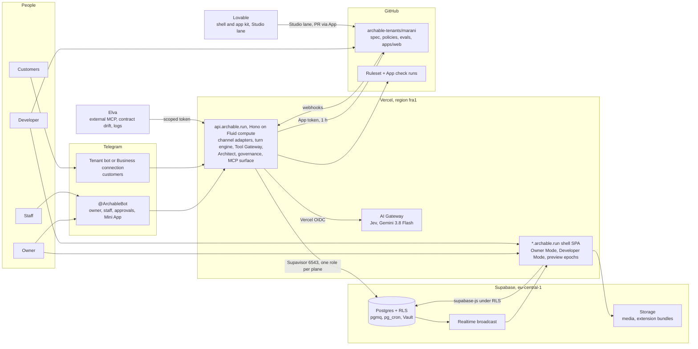
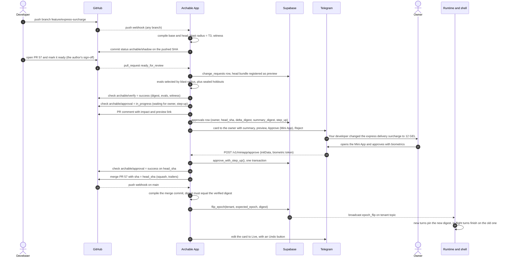
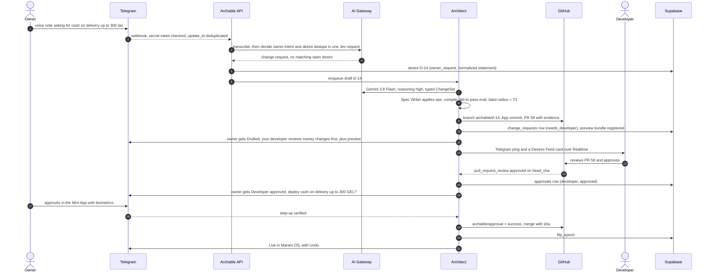
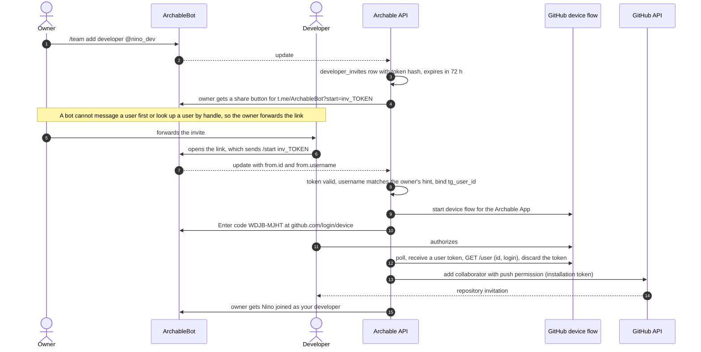
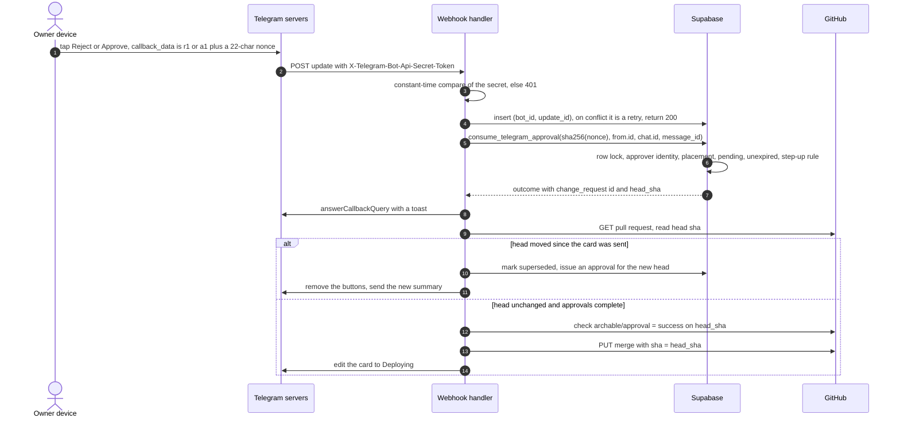

# ARCHABLE — Master Platform Blueprint v3.0

> **Status:** authoritative. Supersedes `jev_graph_noeds.md` (Blueprint v2.0) and every earlier draft. Amended by v3.1 (customer ingress, A2A graph, rationale cards, text-and-buttons owner surface) in `ARCHABLE_IMPLEMENTATION_PLAN.md` §1–§2.
> **Scope:** technical only. No pitch, no schedule.
> **Fact base:** third-party capabilities were checked on 2026-10-17; sources are in §10. Numbers labelled *budget* are design targets to measure, not measurements.

**Reading guide.** §0 states the invariants and what changed since v2.0. §1 reviews the stack and corrects the dossier where the products don't work the way it assumes. §2–§4 are the architecture: system layout, the blast-radius engine, the governance protocol. §5–§6 are the repository and the spec. §7–§8 are the runtime flows and the database. §9 specifies the two UIs.

Contents: [0 Invariants](#0-invariants) · [1 Critical review](#1-critical-review-of-the-stack-and-patterns) · [2 Architecture](#2-executive-system-architecture) · [3 Blast radius](#3-the-blast-radius-engine) · [4 Triad governance](#4-the-triad-governance-protocol) · [5 Repository](#5-repository-architecture) · [6 Spec](#6-the-enterprise-spec-v30) · [7 Data flow](#7-data-flow-and-latency-budget) · [8 Schema](#8-supabase-database-schema) · [9 Dual-mode UI](#9-developer-experience-and-dual-mode-ui) · [10 Sources](#10-assumptions-to-verify-and-sources)

---

## 0. Invariants

Seven rules. Every later section applies one of them, and a design that breaks one is wrong even if it demos well.

| # | Invariant | What it forces |
|---|---|---|
| I1 | **Git for definitions, Postgres for facts** | The spec, policies, personas, evals and UI code live in the tenant repo. Orders, customers, prices, messages and memberships live in Postgres. Nothing lives in both. |
| I2 | **Deterministic lowering** | Models write *above* the spec, as typed ChangeSets. The compiler lowers spec → bundle with no network, no clock and no model: same input, same digest. |
| I3 | **One authority per decision** | Cedar decides every tool call and every outbound message. Jev, Gemini and evals produce *evidence* for Cedar; none of them can permit or veto on its own. |
| I4 | **Approvals bind to content** | An approval names a head SHA, a delta digest and the digest of the exact text the approver read. If any of the three changes, the approval is void. |
| I5 | **Zero ambient credentials** | No long-lived key is reachable from code that doesn't need it: Vercel OIDC to AI Gateway, GitHub OIDC for CI uploads, one-hour GitHub App tokens, channel secrets read from Vault at the last hop. |
| I6 | **One writer per artifact type** | Gemini writes spec ChangeSets. Lovable writes React. The compiler writes `contracts/` and generated models. Humans may write anything. Two machines never author the same kind of file. |
| I7 | **Routing fails open, safety fails closed** | If the router is slow, the dialogue model routes itself. If a pre-send check is slow, errors or abstains, the draft is not sent. |

### 0.1 What changed since v2.0

| v2.0 | v3.0 | Why |
|---|---|---|
| Temporal workflows, Kafka facts, cells, ClickHouse | Postgres state machines advanced by webhooks; `pgmq` queues; `pg_cron`; SQL views | Managed primitives only. Thousands of tenants at tens of turns per minute fit one Postgres. |
| Decision cascade D0–D3 with self-hosted encoders | D0 rules in process, then Jev through AI Gateway with a gateway-level conditional fallback to Gemini | AI Gateway now does confidence-based escalation, so there is nothing to host. |
| `dep_edges` table + recursive CTE | Graph inside the content-addressed bundle; traversal in memory | Every consumer already holds the bundle; a table is a second copy that can drift. |
| Claude Opus 5.5 as the default model | Gemini 3.8 Flash on all three LLM lanes, through AI Gateway; the lane holder is chosen by the merged-PR index | Team decision. Behind the gateway a lane's model is a configuration string. |
| — | Triad governance with SHA-bound approvals as GitHub check runs | New in v3. |
| Vercel preview per PR (dossier) | Preview epochs on the shared shell: `pr-58--marani.archable.run` | Tenant repos aren't Vercel projects, and a spec change needs no build. |
| Lovable generates every tenant (dossier) | Lovable builds the shell and the app kit; the compiler instantiates tenants; Lovable is the extension lane | Lovable can't import a repo or connect GitHub through any API (§1.4). |
| Elva in the turn path (dossier) | In-process Tool Gateway; Elva at the edge | Latency, credential custody, and one contract source (§1.5). |

---

## 1. Critical review of the stack and patterns

Each component: verified facts, what the dossier gets wrong or leaves open, the decision.

### 1.1 Jev as System-1

**Verified.**
- Jev answers three typed question kinds against a shared `state`: **Boolean** (TypeSafe's name is *Noul*; the answer is P(true)), **Choice** (one option from a named set, with a probability per option) and **Score** (a position on an ordered scale, with a probability per rung). Several questions can share one state and are answered in **one round trip**.
- It can be called directly (TypeSafe API, `POST /v1/systemone`) or through **Vercel AI Gateway**: `POST https://ai-gateway.vercel.sh/v1/evaluate`, model `typesafe-ai/jev`, or `experimental_decide` in AI SDK `ai` ≥ 7.0.128. The gateway accepts a **Vercel OIDC token**, so functions on Vercel hold no key; existing TypeSafe credits are used through BYOK.
- **Decision fallbacks** in AI Gateway: one conditional object per request reruns the whole decision on a second model when a Choice/Score confidence is below a threshold (`confidenceBelow`) or a Boolean P(true) falls inside a band (`probabilityBetween`). Conditions combine with `any`, `all` and `atLeast`. Both stages are billed and run in sequence. A language-model fallback answers through structured output and returns no confidence.
- **Latency:** the dossier says < 150 ms. Independent tests measured **117–330 ms per call**, with a 163 ms network floor in one of them. No image input. No published calibration data. Serving region not published.

| Open issue | Decision |
|---|---|
| Dual authority: Jev says "not grounded", the dialogue model disagrees — who wins? | Neither. Jev's answers enter Cedar's `context.signals`, each bound to the SHA-256 of the exact draft it judged. Cedar is the only authority (I3). |
| < 150 ms is not a measured fact | Budget **200 ms p50 / 350 ms p95** per Jev request. Never put two Jev calls in series when one request can ask both questions (§7.1). |
| Probabilities are uncalibrated | Thresholds come from our own labelled turns (`evals/calibration`), per decision head, refreshed weekly. The escalation band is the range where our labelled errors live, not a guess. |
| Outage or slowness | Route stage fails open: the dialogue model routes itself. Pre-send stage fails closed: holding reply plus staff handoff (I7). |
| Georgian | Unknown, for Jev and for Gemini, in both Mkhedruli and the Latin "translit" that dominates chat. The calibration and golden sets carry both scripts plus Russian and English code-switching. |

Where Jev earns its place, in order of value: pre-send grounding and commitment checks on **every** reply; intent routing; deduplicating owner requests and failures into desires (a Choice over the open desires replaces a vector index); checking that an approval summary is faithful to the diff (§4.6); scoring failure severity.

### 1.2 Gemini 3.8 Flash ("High")

**Verified.** `gemini-3.8-flash`, stable since 2026-09-02. 1,048,576 input and 65,536 output tokens. Text, image, video, audio and PDF in. Thinking levels low, medium and high; `minimal` returns an error. Structured outputs and function calling. On AI Gateway it is `google/gemini-3.8-flash` at $0.75 / $3.75 per million input / output tokens, under a 50% discount that runs to 31 Dec 2026. AI SDK 7 sets thinking with the portable `reasoning` option.

| Dossier assumption | Assessment | Decision |
|---|---|---|
| "High" for everything | Thinking tokens come before the first answer token. High thinking on the customer lane taxes every turn for little gain on two-sentence replies. | Three lanes: **dialogue `low`**, **vision `medium`**, **patch `high`**. |
| Fast, fluent Georgian | No benchmark we trust, and translit Georgian is its own problem. | A Georgian golden set (both scripts) in `evals/contact_center` gates every model or prompt change. |
| Vision OCR on flyers | Telegram recompresses photos, small price text degrades, and vision models misread digits. | Take the largest `PhotoSize`; ask for "send as file" when OCR confidence is low; a price becomes a fact only if it appears verbatim in the model's own OCR text, with a bounding box, as provenance. |
| Flash as the patcher | A plausible patch isn't a correct patch. | The patcher emits a typed ChangeSet (≤ 12 ops) in spec space only. It must first write a test that fails on the current bundle, then make it pass without regressions (§7.2). |
| Structured JSON output | Provider-enforced schemas have complexity limits. | The ChangeSet schema is a flat discriminated union. If Google rejects it, AI SDK sends the JSON MIME type without the schema and validates on our side (`structuredOutputs: false`). |

**Merged-PR index (model-agnostic lanes).** Desires are assigned to the incumbent or a challenger model at random (90/10). For a model *m*: MPI(m) = Σ w·[merged ∧ not reverted within 7 days] / Σ w·[opened], with w = 1, 2, 4 for T1, T2, T3. The challenger takes the lane when the Wilson lower bound of its MPI over ≥ 30 PRs exceeds the incumbent's point estimate. Behind AI Gateway, that is a one-line change to `runtime.models.patch`.

### 1.3 Supabase

**Verified.** `pg_jsonschema` provides `json_matches_schema(schema json, instance json)` and `jsonb_matches_schema(schema json, instance jsonb)`. Realtime broadcasts from SQL with `realtime.send(payload, event, topic, private)`; private channels are authorized by RLS on `realtime.messages`; broadcasts are retained for three days.

| Pattern | Assessment | Decision |
|---|---|---|
| Pooled `records` with `attrs jsonb` and GIN `jsonb_path_ops` | Right call against EAV: one row per object, one index. But `jsonb_path_ops` only accelerates containment (`@>`) and jsonpath (`@?`, `@@`): not key existence, ranges or sorting. | Equality filters use `@>`. Each object's business key (`order.number`) gets a real `natural_key` column with a unique index. Range and sort on custom fields use per-tenant partial expression indexes, emitted by the compiler only for fields marked `index: range`. |
| "Writes are validated against the JSON Schema" in app code | The shell writes through supabase-js, so app-level validation is bypassable. | Validation is a `BEFORE` trigger that runs `jsonb_matches_schema` against the schema of the bundle the writer was pinned to (§8). |
| RLS by `tenant_id` | Right for browser sessions. Server runtimes usually escape it with `service_role`. | Two login roles without `BYPASSRLS`: `archable_runtime` (turns; tenant set per transaction) and `archable_control` (Architect, governance, epoch flips). `service_role` runs migrations only. RLS here protects against bugs (a missing `WHERE`), not against a compromised runtime. |
| Serverless connections | One direct connection per invocation exhausts Postgres. | Supavisor transaction mode (port 6543, `prepare: false`). Functions pinned to `fra1`, Supabase in `eu-central-1`: every query is one in-region round trip. |
| Realtime fan-out | Postgres Changes checks RLS once per subscriber per change. | Broadcast from SQL on private `tenant:<id>` topics for epoch flips, desires and change cards. |
| Queues and schedules | — | `pgmq` queues `architect`, `verify` and `audit`, drained by a one-minute Vercel Cron sweep plus an immediate `waitUntil` kick after each enqueue. `pg_cron` handles expiries. |

### 1.4 Lovable

**Verified.**
- Git sync is export-only: "You can't import an existing repository into Lovable." Connecting a project always creates a new repository.
- Lovable edits and syncs one branch at a time and can switch or create branches. A push to a protected branch is rejected, and Lovable falls back to a `lovable-sync` branch; Lovable's docs recommend working on a feature branch merged through normal review.
- The REST API manages existing projects (list, update, delete, publish, embed, analytics, security scans). "AI project creation and editing are available through the Lovable MCP server."
- The MCP server (`mcp.lovable.dev`) offers `create_project`, `remix_project`, `send_message`, `get_diff`, `read_file`, `deploy_project` and more. It authenticates with OAuth only; hosted clients need Lovable to approve their callback or a custom OAuth client. `create_project` and `send_message` spend real credits. **No tool connects GitHub**, and connectors are never added programmatically.

**What breaks in the dossier.** "Every time Archable generates a business OS, it uses Lovable's engine… and pushes the code into the tenant's monorepo" can't be an automated provisioning step:
1. Lovable can't attach to the tenant repo, and connecting GitHub is a manual UI action per project.
2. Generation would put minutes, credits and non-determinism on the onboarding critical path, which breaks I2.
3. A thousand LLM-written codebases can't receive a platform fix.

**Decision: Lovable builds the vocabulary; the compiler builds the tenant.**
1. The **Archable Shell and App Kit** (Contact Center, QuickShipper, Customer Center, Storage, Tasks, Analytics) is a Lovable project synced to `archable/shell`. It is both the hosted shell at `*.archable.run` and the published `@archable/shell` package. Every tenant runs Lovable-authored React.
2. Each tenant repo gets `apps/web` from `archable/tenant-template`: a real Vite + React + TypeScript + Tailwind app that renders the tenant's spec through `@archable/shell` and adds the tenant's own `src/extensions/`. `git clone && npm i && npm run dev` works against the tenant's preview environment.
3. **Studio lane** for bespoke UI: a per-tenant Lovable project remixed from the starter, owned by the developer (one manual GitHub connect, on its own repo). The Architect can drive it through `send_message`. The Archable App copies `src/extensions/**` from the studio repo into a PR on the monorepo, with the Lovable commit as provenance. Lovable is then the only machine that writes React (I6), and its output is governed like any other change.
4. **Exit:** `archable eject` vendors `@archable/shell` into `apps/web/src/shell`. With a repo transfer, the tenant owns all UI code and all definitions. The agent runtime stays a platform service that reads a documented bundle format.

### 1.5 Elva (Theneo)

**Verified.** Elva builds an API catalog by reading a repository (route registrations, validators, serializers), or imports existing specs and keeps them in sync on every commit. It defines per-audience contracts (partner, internal, public, AI agent) and flags drift and breaking changes per commit. It emits OpenAPI 3.1, docs, an MCP server, a Postman collection and a TypeScript SDK. It hosts MCP servers with scoped keys and per-tool authorization, and logs agent, key, tool, latency and outcome for every call. It has a Playground and a CLI (`elva mcp logs <slug>`). Its sample dashboard shows 138 ms average and 412 ms P95 per call; the free plan covers one repo and 1,000 tool calls a month.

| Dossier assumption | Problem | Decision |
|---|---|---|
| App-to-app calls go "via Elva" inside the customer turn | A network hop per tool call (hundreds of ms at P95), an outside availability dependency on every reply, and a second custodian of credentials. | Internal calls run in process through the Tool Gateway, using the same MCP tool schemas. No hops, and Cedar sees every call. |
| Elva generates the contracts | Archable's tools are declared in the spec. A contract inferred from code is a second source of truth. | The compiler emits `contracts/openapi.yaml`; Elva imports it. |
| — | — | Elva owns the edge: the tenant's **external MCP surface** for third-party agents, **contract-drift checks** on PRs (a breaking change for the AI-agent audience sets a T3 floor), the **Playground and live logs** in Developer Mode, and the **inbound direction**: wrapping a tenant's existing system (a courier or POS API) as an MCP server that the spec registers as a `connection`. |

### 1.6 Telegram approvals ("HMAC-signed callbacks")

**Verified.** Telegram does not sign `callback_data` (1–64 bytes), and the Bot API gives no guarantee that a callback carries data from a button you actually sent, so it is client input (python-telegram-bot's `InvalidCallbackData` exists for this reason). Webhooks carry a static `X-Telegram-Bot-Api-Secret-Token` header, not an HMAC. The real HMAC is Mini App `initData`: the key is HMAC-SHA-256 of the bot token keyed with `WebAppData`, and third parties can verify an Ed25519 `signature`. Mini Apps expose `BiometricManager.authenticate`, which releases a token held in the device's secure storage only after a biometric check. A bot can't message a user first, and can't resolve a user's @username to an id.

**What the dossier gets wrong.** An HMAC on `callback_data` proves the bot minted the string. It doesn't prove the person tapping is the owner, that the PR is still the one summarized, or that the tap hasn't already been used. An opaque random nonce looked up server-side also proves origin, so the HMAC adds nothing the lookup doesn't already give.

**Decision: a capability nonce with six bindings,** checked atomically in one SQL function (§4.5):
1. **Identity:** `callback_query.from.id` equals the approver's Telegram id.
2. **Placement:** chat id and message id equal the ones recorded when the button was sent.
3. **Single use:** `pending → approved | rejected` under a row lock.
4. **Freshness:** a time-to-live per tier.
5. **Content:** the approval holds the head SHA, the delta digest and the summary digest, and the merge passes GitHub's `sha` guard.
6. **Tier:** T3 and T4 can't be approved by a button. *Approve* opens a Mini App that verifies `initData` and a biometric token. *Reject* is always one tap.

Two corrections to developer onboarding: the bot can't DM `@handle`, so the owner forwards a deep link; and a typed GitHub username proves nothing, so the developer proves the account through GitHub's device flow before the repo invite goes out (§4.4).

### 1.7 Vercel and GitHub

| Topic | Fact | Decision |
|---|---|---|
| Functions | Fluid compute on Pro: 300 s default, 800 s maximum, 1,800 s extended. | Webhooks answer in < 1 s and continue with `waitUntil`. Architect jobs fit one invocation; long eval suites fan out through `pgmq`. |
| Wildcard domain | `*.archable.run` on one project requires Vercel nameservers, and a wildcard certificate covers one DNS label. | Previews use a single label: `pr-58--marani.archable.run`. `archable.run` goes on the Public Suffix List so tenants are separate sites; cookies are host-only. |
| "A Vercel Preview URL for every Architect PR" | A Vercel project links one repo. Tenant repos aren't Vercel projects, and a spec change needs no build. | **Preview epochs:** the shared shell loads the PR's bundle by digest (§2.4). Vercel previews stay for `archable/shell` and `archable/platform`. |
| Merge gate | A ruleset's required status checks can be pinned to a GitHub App (`integration_id`). The merge endpoint accepts `sha`, the head the PR must still have. | `archable/verify` and `archable/approval` are check runs pinned to the Archable App. No one else can produce them, and no merge can land a commit nobody approved. |
| Credentials | — | One-hour App installation tokens for repo work, GitHub Actions OIDC for extension uploads, no personal access tokens anywhere. |

### 1.8 Verdicts, and what we don't build

| Component | Role in v3 | Verdict |
|---|---|---|
| Jev | Evidence for routing, pre-send checks, dedupe, summary faithfulness | Keep. Budget it honestly; it is never an authority. |
| Gemini 3.8 Flash | Dialogue (low), vision (medium), ChangeSet patching (high) | Keep, behind AI Gateway; the merged-PR index decides who holds each lane. |
| Supabase | Facts, RLS, validation, queues, realtime, Vault, Storage | Keep. Validation and tenant isolation move into Postgres. |
| Lovable | Shell and app kit; Studio lane for bespoke UI | Keep, off the onboarding critical path. |
| Elva | External MCP surface, contract drift, Playground, logs, inbound legacy APIs | Keep at the edge, out of the turn path. |
| Telegram | Owner and staff surface, approvals | Keep, with nonce-bound buttons and Mini App step-up. |
| Vercel | Shared shell (wildcard), API functions, AI Gateway | Keep. Preview epochs replace per-PR deployments for tenants. |
| GitHub | Definitions, review, merge gate | Keep. App check runs are the gate. |

Deliberately not built: a graph database (§3.1); a vector index for dedupe (a Jev Choice over open desires); per-tenant Vercel projects; per-tenant Lovable projects at onboarding; Temporal, Kafka or Kubernetes; self-hosted classifiers; CRDTs (changes are typed ops with preconditions, §4.7); custom auth (Supabase Auth plus Telegram identity).

---

## 2. Executive system architecture

### 2.1 The compiler model

Lovable turns a prompt into code for one app. Archable turns evidence about a business into a typed definition of the whole business and compiles that definition into a running operating system. Two loops share one repository: the **operating loop** (customer turns through app-agents and typed tools) and the **evolution loop** (the Architect turning failures and requests into reviewed changes).

```
  evidence & intent:  text · voice · flyer photo · links · failures · owner requests
        │   Gemini (vision, dialogue) and Jev (archetype, intent, dedupe)
        ▼
  Business Intent Graph:  archetype + filled slots + assumption ledger
        │   the Architect emits a typed ChangeSet (≤ 12 ops)            ◄── models stop here
        ▼
  enterprise.spec.yaml + personas/ + policies/ + evals/ + apps/web/      Git: reviewed, versioned
        │   @archable/compiler: a pure function, pinned in archable.lock
        ▼
  Runtime Bundle  sha256:…   JSON Schemas · tool contracts · agents · decision heads ·
                             Cedar policies + schema · UI schema · extension digest ·
                             dependency graph · eval manifest
        │   flip_epoch(): one pointer per tenant
        ▼
  Marani OS, running: turn engine, Tool Gateway and shell, all keyed by the digest
```

| The compiler emits | Consumed by |
|---|---|
| JSON Schema per object (+ `natural_key`, `title` field) | `records` validation trigger; shell forms; tool input schemas |
| Tool contracts: OpenAPI 3.1 + MCP tool list | Tool Gateway; `/mcp/:slug`; Elva import |
| Agent configs: persona, tools, decision heads, context recipe | Turn engine |
| Decision heads: Jev question sets, thresholds, fallback conditions | `decide()` calls through AI Gateway |
| Cedar policy set + generated Cedar schema | Tool Gateway and send guard |
| UI schema: navigation, views, forms, extension slots and digest | Shell |
| Dependency graph: nodes, hashes, tags, impact edges | Blast radius, test selection, approval summaries |
| Eval manifest | Verifier |

The bundle digest is SHA-256 over the RFC 8785 canonical JSON of the bundle. The compiler reads only the repository tree and the versions pinned in `archable.lock`. Three properties follow:
- a preview and production run the same code paths and differ only by digest;
- rollback is a pointer flip to a digest that is still cached;
- diffs are semantic (node hashes), so the blast radius is computed on meaning, not on lines.

### 2.2 Structural layout



One API deployment hosts both planes, but each plane connects to Postgres as a different role with different grants, so the code that talks to customers can't change what the business is.

### 2.3 Runtime boundaries

| Plane | Runs on | Holds | Can | Cannot |
|---|---|---|---|---|
| Shell | Browser, `*.archable.run` | Publishable key, the user's Supabase session | Read and edit records under membership RLS; read the bundle's UI projection | Read personas, policies or prompts; call a side-effecting tool except through the API |
| Turn engine | Vercel Function, DB role `archable_runtime` | Vercel OIDC token; channel tokens fetched from Vault at send time | Run turns, call tools through the gateway, write facts for one tenant per transaction | Read other tenants; touch specs, approvals or epochs |
| Control plane | Vercel Function, DB role `archable_control` | GitHub App private key (mints one-hour installation tokens) | Draft and verify changes, write approvals, merge with `sha`, flip epochs | Approve on anyone's behalf; author governance, CI, connection or eval-removal changes |
| Tenant CI | GitHub Actions | Nothing stored; a per-run OIDC token with `aud=https://api.archable.run` | Upload the extension bundle built from the pushed commit | Anything else |
| Elva | Elva cloud | A per-tenant, per-audience token for `/mcp/:slug` | Call exposed tools as principal `ExternalAgent`, under Cedar | Reach tools the audience contract doesn't expose |

Long-lived roots (the GitHub App key, bot tokens, DB role passwords, webhook secrets) each live in exactly one store, reachable from exactly one plane.

### 2.4 Multi-tenant URL routing

| Host | Serves | Resolution |
|---|---|---|
| `marani.archable.run` | Marani OS, production | slug → tenant → `tenants.active_digest`, env `prod` |
| `pr-58--marani.archable.run` | Preview epoch of PR 58 | slug + PR → `change_requests.bundle_digest`, env `pr-58` |
| `os.marani.ge` | Custom domain | `tenants.custom_domain`, attached through the Vercel Domains API |
| `api.archable.run` | API, webhooks, `/mcp/:slug` | — |

1. The shell boots from immutable static assets, one Vercel project for all tenants.
2. `GET /v1/manifest` with the request's Host returns `{tenant_id, env, digest, epoch, branding, extension_url, topic}`, cached for 5 s at the edge.
3. `GET /v1/bundles/:digest/ui` returns the UI projection with `Cache-Control: private, max-age=31536000, immutable`. A digest never changes meaning, so the shell caches it forever.
4. If the bundle names an extension, the shell fetches it from its content-addressed URL, checks its SHA-256 against the bundle, and only then `import()`s it.
5. The shell subscribes to the private topic `tenant:<id>`. On `epoch_flip` it refetches the manifest and swaps the UI projection at the next navigation, with no reload.

Isolation: every tenant is a separate origin, and with `archable.run` on the Public Suffix List a separate site. Sessions sit in per-origin storage, cookies are host-only, and the CSP allows scripts only from `self` and the extension origin. The manifest is the only place an extension URL comes from.

**Preview environments.** A preview epoch runs the PR's bundle against `env = 'pr-58'` rows seeded from the eval fixtures. Tools whose `effect` is `external` or `money` run in simulate mode, so a preview never calls a courier or sends money. The owner can chat with the preview agent from Telegram with `/try 58`.

### 2.5 Onboarding: from a Telegram message to a live OS

| *Budget* | Step |
|---|---|
| 0 s | The owner sends text, a voice note, a flyer photo or a link to @ArchableBot. |
| ≤ 2 s | Jev picks an archetype from the catalog and detects language and script; the bot acknowledges and starts a live progress message. |
| ≤ 15 s | Archetype defaults fill the Business Intent Graph; the compiler emits spec and bundle; the OS is live at `marani.archable.run` built from defaults alone. |
| ≤ 45 s | Vision extraction (Gemini, medium) turns the flyer into product and price rows with provenance (§1.2); the preview updates through Realtime. |
| in parallel | The App creates `archable-tenants/marani` from the template, commits the spec, `assumptions.yaml` and contracts, and applies the ruleset. |
| ≤ 60 s | The owner gets the link, a "Try as customer" button, and at most two questions. |

- **Questions:** sparse input gets at most two clarifying questions, picked by value of information: only answers that change money, external effects or which apps exist are worth asking. Every other default is a visible assumption in the preview, recorded in `assumptions.yaml`, and confirmable with one tap.
- **Apps:** rich input yields one to three apps chosen from the evidence. A price list plus a delivery phone number means Contact Center and QuickShipper.
- **Agent name:** one tap among three generated presets: role-based ("Support Node"), personal ("Luka") or domain-themed ("Cellar Master").
- **Going live:** customers reach nothing until the owner connects a customer channel, either a BotFather token for a tenant bot or a Telegram Business connection to @ArchableBot (Business requires Telegram Premium). Connecting a channel is a T4 action by the owner, so going live is itself an approval.

Provisioning is a **reconcile loop over `tenants.status`**, not a script: each step checks whether its effect already exists before acting, so a crash midway is repaired by running the loop again.

### 2.6 Bundle lifecycle

`candidate` (compiled) → `preview` (verified for a PR head, served on `pr-N--slug`) → `active` (exactly one per tenant, enforced by a partial unique index) → `draining` (the previous active bundle; in-flight turns finish on it for 15 minutes) → `retired`. A rollback moves the pointer back to a `draining` or `retired` digest; the bundle is immutable and still in storage.

---

## 3. The blast-radius engine

### 3.1 The directive: in-memory DAG, static analysis, or a relational graph?

| Criterion | In-memory DAG in the API | Static analysis of the spec AST | Relational graph in Supabase |
|---|---|---|---|
| Source of truth | Whatever code built it | The spec itself | A copy of the spec |
| Drift | High if maintained by hand | None: derived on every compile | Real: two writers, two moments |
| Sees what a change removed | Only if the old graph is kept | Yes: compile base and head | Only if versioned |
| Speed | µs–ms | µs–ms (it *produces* the DAG) | One query per hop, or a recursive CTE |
| Runs in CI, in previews and in Telegram | Only inside the process | Wherever the compiler runs | Only next to the database |
| Operational cost | None | None | A table, migrations and a sync job |

The three options aren't rivals. They are three stages of one pipeline, and only one stage may be authoritative:

> **Static analysis is the source, an in-memory adjacency map is the engine, and Postgres stores the result inside the bundle as data.** No graph tables, no graph database.

The graph is a pure function of the spec, `G = derive(AST)`, addressed by the same digest as the bundle. It can't go stale: a new spec has a new digest and therefore a new graph. For scale, a large tenant has about 1,000 nodes and 10,000 edges; a breadth-first search over that takes well under a millisecond, and compiling the base and head specs (≤ 300 ms, *budget*) dominates the cost.

### 3.2 Nodes

Every addressable definition is a node. Its hash is the SHA-256 of its canonical definition, so formatting and comments never change a hash.

| Kind | Example id | Tags it can carry |
|---|---|---|
| object | `object:order` | — |
| field | `field:order.total` | `money`, `pii`, `key` |
| param (template parameter) | `param:quickshipper.express.surcharge` | `money` |
| tool | `tool:delivery.dispatch` | `external`, `money`, `pii_egress`, `notify` |
| policy | `policy:order.discount_cap` | `authz` |
| agent / persona | `agent:cellar_master`, `persona:cellar_master` | — |
| decision head | `decision:send.grounded` | — |
| view / extension | `view:orders_board`, `ext:WineLabelCard` | — |
| trigger | `trigger:dispatch_on_confirm` | — |
| connection | `connection:courier_api` | `external`, `secret` |
| governance | `gov:approvals`, `gov:risk`, `ci:workflows` | `governance` |
| eval | `eval:contact_center/cod-01` | used for test selection only |

### 3.3 Edges: the graph stores impact, not syntax

The compiler resolves every reference and emits the edge **in the direction impact flows**: `a → b` means "a change to *a* can change what *b* does". Propagation is then a forward search, with one refinement. A node can be reached in two modes:
- **`def`:** its definition or interface changed. A new field changes the input schema of the tools that write it.
- **`run`:** its runtime behavior or values may change.

Floors (tags) apply only to changed nodes and to nodes reached in `run` mode. That one rule removes most false escalations, such as an optional text field on an order dragging `order.total` along with it.

| Reference in the spec | Edge emitted | Kind | From `def` | From `run` |
|---|---|---|---|---|
| tool reads field | field → tool | `read_by` | run | run |
| tool writes field | field → tool | `written_by` | def | — |
| tool writes field | tool → field | `writes` | — | run |
| agent lists tool | tool → agent | `contract_of` | run | run |
| agent lists tool | agent → tool | `may_invoke` (*influence*) | — | run, **cut at bounded tools** |
| policy references an action or an input | policy → tool, field → policy | `guards`, `read_by` | run | run |
| persona of an agent | persona → agent | `configures` | run | — |
| decision head used by an agent or a policy | decision → agent or policy | `informs` | run | run |
| trigger `on: field` calls a tool | field → trigger → tool | `fires`, `calls` | run | run |
| view or extension shows a field | field → view or ext | `rendered_by` | run | run |
| tool uses a connection | connection → tool | `transports` | run | run |

Resolution rules:
- **Every reference must resolve.** An unresolved reference is a compile error, so the graph is complete by construction for everything the spec says.
- **Wildcards expand.** `reads: [wine.*]` becomes one edge per field, so a new field joins its readers automatically.
- **Cedar** policies are parsed into Cedar's JSON form; each `action == …`, `context.input.*` and attribute access becomes an edge.
- **Personas** are scanned for `{{object.field}}` placeholders.
- **Extension code:** the compiler emits one TypeScript module per object (`src/model/order.ts`). An import of that module emits `rendered_by` edges from every field of the object, and dynamic access (`attrs[key]`) is covered by that over-approximation.
- **Generated code adds no edges;** it is a function of the spec.

### 3.4 Guards cut influence

`may_invoke` is the only edge a language model mediates. Without a rule, any wording change to an agent that can create orders would be a money change. The rule is **guards cut influence**:

> A tool is **bounded** when every input that flows into a `money` field or an external payload is referenced by a `forbid` policy on that tool's action. Propagation along `may_invoke` stops at a bounded tool unless one of its bounding policies is itself in the change.

The worst a persona change can do is any action the agent is already permitted under policies that were approved at their own tier. The compiler records `bounded_by` on every tool and raises a lint, *unbounded influence: agent `cellar_master` can invoke `refund.issue`, whose input `amount` has no guard*, so the spec author sees the risk before the tier engine does.

### 3.5 Tier escalation

$$
\mathrm{tier}(\Delta) \;=\; \max\Big(\max_{n\in\Delta}\mathrm{rule}\big(\mathrm{change}(n)\big),\;\; \max_{n\,\in\,\Delta\,\cup\,\mathrm{Run}(\Delta)}\;\max_{t\,\in\,\mathrm{tags}(n)}\mathrm{floor}(t)\Big),\qquad \Delta=\varnothing \Rightarrow \mathrm{T0}
$$

Here Δ is the set of nodes whose hash differs between base and head (added, removed or changed), and Run(Δ) is the set reached in `run` mode over the **union** of the base and head graphs, so removed nodes still propagate through their old edges. Unknown change kinds default to T2. Every escalation carries a **witness**: the shortest path from a changed node to the node that set the floor. Witnesses are what the owner reads in Telegram and the developer reads on the PR.

```ts
// packages/compiler/src/graph/blast.ts (excerpt)
export type Tier = 0 | 1 | 2 | 3 | 4;
type Mode = 'def' | 'run';
export type EdgeKind = 'read_by' | 'written_by' | 'writes' | 'contract_of' | 'may_invoke' | 'guards'
  | 'configures' | 'informs' | 'fires' | 'calls' | 'rendered_by' | 'transports';

// The mode an edge produces, given the mode its source was reached in (undefined: no propagation).
const STEP: Record<EdgeKind, Partial<Record<Mode, Mode>>> = {
  read_by: { def: 'run', run: 'run' },
  written_by: { def: 'def' },              // a field's definition changes its writers' contracts
  writes: { run: 'run' },                  // only a behavior change alters the values written
  contract_of: { def: 'run', run: 'run' },
  may_invoke: { run: 'run' },              // LLM-mediated: cut at bounded tools
  guards: { def: 'run', run: 'run' },
  configures: { def: 'run' },
  informs: { def: 'run', run: 'run' },
  fires: { def: 'run', run: 'run' },
  calls: { def: 'run', run: 'run' },
  rendered_by: { def: 'run', run: 'run' },
  transports: { def: 'run', run: 'run' },
};

export interface GNode { id: string; hash: string; tags: string[]; boundedBy: string[] }
export interface Graph { nodes: Map<string, GNode>; out: Map<string, { to: string; kind: EdgeKind }[]> }
export interface Reason { tier: Tier; rule: string; path: string[] }

export function blastRadius(base: Graph, head: Graph, risk: RiskRules) {
  const delta = diffByHash(base, head);              // Map<nodeId, ChangeKind>
  const g = union(base, head);                       // removed nodes keep their old edges
  const parent = new Map<string, string | null>();   // state key `${mode}|${id}` → predecessor
  const queue: [string, Mode][] = [];
  for (const id of delta.keys()) { parent.set(`def|${id}`, null); queue.push([id, 'def']); }

  for (let i = 0; i < queue.length; i++) {
    const [id, mode] = queue[i];
    for (const e of g.out.get(id) ?? []) {
      const next = STEP[e.kind][mode];
      if (!next) continue;
      if (e.kind === 'may_invoke' && isBounded(g.nodes.get(e.to)!, delta)) continue;
      const key = `${next}|${e.to}`;
      if (parent.has(key)) continue;
      parent.set(key, `${mode}|${id}`);
      queue.push([e.to, next]);
    }
  }

  const reasons: Reason[] = [];
  for (const [id, change] of delta) reasons.push({ tier: risk.changeRules[change] ?? 2, rule: change, path: [id] });
  for (const key of parent.keys()) {
    const [mode, id] = splitKey(key);
    if (mode === 'def' && !delta.has(id)) continue;  // interface-only impact sets no floor
    for (const tag of g.nodes.get(id)?.tags ?? []) {
      const floor = risk.floors[tag];
      if (floor !== undefined) reasons.push({ tier: floor, rule: tag, path: witness(parent, key) });
    }
  }
  const tier = Math.max(0, ...reasons.map((r) => r.tier)) as Tier;
  return { tier, delta, reached: [...parent.keys()], why: reasons.filter((r) => r.tier === tier) };
}

const isBounded = (tool: GNode, delta: Map<string, unknown>) =>
  tool.boundedBy.length > 0 && tool.boundedBy.every((p) => !delta.has(p));

function splitKey(key: string): [Mode, string] {
  const i = key.indexOf('|');
  return [key.slice(0, i) as Mode, key.slice(i + 1)];
}

function witness(parent: Map<string, string | null>, key: string): string[] {
  const path: string[] = [];
  for (let k: string | null = key; k; k = parent.get(k) ?? null) path.unshift(splitKey(k)[1]);
  return path;
}
```

Breadth-first order makes every witness a shortest path. The search runs over 2·|V| states, so it stays linear.

### 3.6 Worked examples on Marani OS

| Change | Δ | Deciding witness | Tier |
|---|---|---|---|
| "Make Cellar Master warmer" | `persona:cellar_master` | persona → agent; `may_invoke` cut at `order.create` (bounded by `order.discount_cap`, `order.large_needs_staff`, `order.age_gate`) and at `message.send` (bounded by `send.requires_grounding`) | **T1** |
| Add optional `wine.tasting_notes` | `field:wine.tasting_notes` | reaches `catalog.search` and the views; no tagged node in `run` | **T1** |
| Express surcharge 10 → 12 GEL | `param:quickshipper.express.surcharge` (`money`) | the changed node is tagged `money`; it reaches `order.total` via `order.create` | **T3** |
| "Enable cash on delivery" | `field:order.payment` (enum value added) + `policy:payment.cod_limit` | `order.payment` → `delivery.dispatch` [`external`]; `order.payment` → `payout.compute` → `delivery_job.payout` [`money`] | **T3** |
| Widen the grounding escalation band | `decision:send.grounded` | decision → `send.requires_grounding` → `message.send` [`external`] | **T3** |
| Remove an eval case | `eval:contact_center/…` | change rule `eval.case.remove`: weakening the yardstick | **T3** |
| Edit `.github/workflows/ci.yml` | `ci:workflows` | tag `governance` | **T4** |
| Reformat YAML, edit `docs/` | ∅ | bundle digest unchanged | **T0** |

Courier pay rates and wine prices are **facts**: they are records, edited in the UI. *Who* may edit them is a definition (`edit: [owner]` on the field), enforced on every write by the records trigger (§8). Blast radius governs changes to definitions; triggers and Cedar govern changes to facts (I1).

### 3.7 Storage, consumers and test selection

The graph ships inside the bundle (`bundle.graph`: nodes with hashes, tags and `bounded_by`, plus impact edges) and is mirrored to `contracts/graph.json` for reviewers. Its consumers:
- **Verifier:** tier, witnesses and test selection on every PR head.
- **Telegram:** witness paths rendered into plain-language sentences (§4.6).
- **Desires Feed:** impact chips on each card, from a dry-run of the drafted ChangeSet.
- **Developer Mode:** the impact explorer. The graph is small enough to ship to the browser, and it travels in the RLS-protected bundle.
- **Preview edits from Telegram:** compile and tier a ChangeSet before showing "Apply to preview".

Test selection: tests(Δ) = smoke ∪ {suites with an `evaluates` link into Δ ∪ Run(Δ)} ∪ {the desire's fail-to-pass case} ∪ {sealed holdouts when tier ≥ T2}.

If a SQL consumer ever needs reachability, it runs over the bundle itself, under the same RLS as `specs`, with no extra table:

```sql
-- What can a change to order.payment reach in Marani's active bundle?
with recursive edges as materialized (
  select e->>'from' as src, e->>'to' as dst, e->>'kind' as kind
  from public.specs s
  join public.tenants t on t.id = s.tenant_id and t.active_digest = s.digest
  cross join lateral jsonb_array_elements(s.bundle->'graph'->'edges') as e
  where t.slug = 'marani'
),
reach(node, depth, path) as (
  select 'field:order.payment'::text, 0, array['field:order.payment']
  union all
  select e.dst, r.depth + 1, r.path || e.dst
  from reach r join edges e on e.src = r.node
  where e.dst <> all(r.path) and r.depth < 12
)
select distinct on (node) node, depth, path from reach order by node, depth;
```

This query ignores modes and guards, so it over-approximates. It is for exploration; tiers always come from the compiler.

---

## 4. The Triad Governance Protocol

### 4.1 Roles and authority

| Persona | Identity | Authority | Never |
|---|---|---|---|
| **Owner** | Telegram user id, bound at onboarding; web sessions minted from Mini App `initData` | Final say on production. May delegate approvals up to T2 to the developer. | Sees a Git diff, unless they ask to. |
| **Developer** | GitHub account proven by OAuth device flow, plus Telegram | Write access to the repo; reviews Architect PRs; signs off on their own PRs by marking them ready. Holds `write`, not `admin`: can't edit the ruleset. | Merges a change the owner hasn't approved (above their delegation). |
| **Architect** | The Archable GitHub App | Drafts ChangeSets, runs verification, opens PRs, computes `archable/approval`, merges once approvals are complete. | Approves its own work, or authors changes to `governance`, `risk`, `.github/`, `connections`, or removals from `evals/`. |

| Tier | Meaning | Developer | Owner | Verification | Card TTL |
|---|---|---|---|---|---|
| T0 | Bundle digest unchanged (docs, formatting) | may merge | — | compile | — |
| T1 | Wording, presentation, additive optional fields | FYI in the Desires Feed | one tap | smoke + selected suites | 72 h |
| T2 | Behavior inside existing limits | review (or sign-off on their own PR) | one tap, or delegated to the developer | selected suites + sealed holdouts | 72 h |
| T3 | Money, external effects, personal-data egress, policies, safety thresholds | review | Mini App + biometric | all suites + sealed; preview required | 24 h |
| T4 | Governance, CI, credentials, destructive data changes | review | Mini App + biometric, with an explicit warning sentence | all + platform checks | 24 h |

From T2 up, every change carries two humans: developer and owner. Delegation trades that two-person rule for speed; it is the owner's explicit, logged choice, and T3–T4 are never delegable, whatever the spec says.

### 4.2 The mechanism on GitHub

Tenant repos live in the `archable-tenants` organization (rulesets on private repos need a paid organization plan). Every repo gets one ruleset on its default branch, with no bypass actors:

```json
{
  "name": "archable-governance",
  "target": "branch",
  "enforcement": "active",
  "conditions": { "ref_name": { "include": ["~DEFAULT_BRANCH"], "exclude": [] } },
  "bypass_actors": [],
  "rules": [
    { "type": "deletion" },
    { "type": "non_fast_forward" },
    { "type": "pull_request", "parameters": {
        "required_approving_review_count": 0,
        "dismiss_stale_reviews_on_push": true,
        "require_code_owner_review": false,
        "require_last_push_approval": false,
        "required_review_thread_resolution": false } },
    { "type": "required_status_checks", "parameters": {
        "strict_required_status_checks_policy": true,
        "required_status_checks": [
          { "context": "archable/verify",   "integration_id": 1234567 },
          { "context": "archable/approval", "integration_id": 1234567 } ] } }
  ]
}
```

- **Why zero required reviews.** GitHub reviews can't express "the owner approved on Telegram", and a developer can't approve their own PR. So the tier-dependent matrix lives in one check run, `archable/approval`, which is a pure function of the approvals ledger, the tier, the author and the delegation setting, evaluated for the current head SHA. The `pull_request` rule still forbids direct pushes.
- **Pinned checks.** Both required checks are pinned to the Archable App's `integration_id`. Only the App's installation can create them.
- **Developer reviews.** A `pull_request_review` webhook with state `approved` whose `commit_id` equals the head SHA becomes a ledger row (`channel = github_review`). A review on an older commit counts for nothing.
- **Pushes void approvals.** Every approval names its head SHA, so a new push leaves the new head with no approvals. Open Telegram cards are edited to "This change was updated" and their buttons removed.
- **Merging.** The App merges with `PUT /pulls/{n}/merge` passing `sha = head_sha`; if the head moved, GitHub refuses. The squash commit carries the governance record as trailers, so Git alone can answer "who approved what":

```
feat(payments): cash on delivery up to 300 GEL (D-14)

Archable-Tier: T3 (money, external)
Archable-Witness: field:order.payment -> tool:delivery.dispatch
Archable-Bundle: sha256:9c41e0…
Reviewed-by: nino-dev (github:48211) on 4be1c2d
Approved-by: owner (telegram:5512…) via mini_app+biometric on 4be1c2d
```

### 4.3 Sequence diagrams

**A. Developer-led change, including branch monitoring**



**B. Owner-led change**



**Undo** is pre-authorized by its nature: it returns to a digest the owner already approved. The App flips the pointer to the previous digest at once, then merges a revert PR under the same approval so that Git matches the runtime again within seconds. Until it does, the governance check blocks every other merge.

### 4.4 Developer onboarding



The typed `@handle` is only a hint. The identity is the pair (Telegram id that opened a single-use link, GitHub id that completed the device flow), and only the GitHub id receives the invite.

### 4.5 Telegram HITL callback security



```ts
// apps/api/src/telegram/approvals.ts (excerpt): grammY on Hono
import { Bot, webhookCallback } from 'grammy';
import { waitUntil } from '@vercel/functions';
import { createHash } from 'node:crypto';

const bot = new Bot(env.ARCHABLE_BOT_TOKEN);
const BOT_ID = Number(env.ARCHABLE_BOT_TOKEN.split(':')[0]);  // a bot token starts with the bot's id

bot.use(async (ctx, next) => {                               // Telegram retries non-2xx: dedupe first
  if (await db.firstSeen(BOT_ID, ctx.update.update_id)) await next();
});

// Buttons carry `a1:<nonce>` or `r1:<nonce>`; the nonce is 16 random bytes (22 base64url chars).
bot.callbackQuery(/^([ar])1:([A-Za-z0-9_-]{22})$/, async (ctx) => {
  const [, action, nonce] = ctx.match;
  const msg = ctx.callbackQuery.message;
  const res = await db.consumeTelegramApproval({             // §8: one transaction, row lock
    nonceHash: createHash('sha256').update(nonce).digest(),
    tgUserId: ctx.from.id,
    chatId: msg?.chat.id ?? null,
    messageId: msg?.message_id ?? null,
    decision: action === 'a' ? 'approve' : 'reject',
    evidence: { update_id: ctx.update.update_id, callback_query_id: ctx.callbackQuery.id },
  });
  await ctx.answerCallbackQuery({ text: TOAST[res.outcome] });   // answer before any GitHub call
  if (res.outcome === 'approved' || res.outcome === 'rejected') {
    waitUntil(governance.settle(res.changeRequestId));           // recompute the check, merge with sha, edit the card
  }
});

export const telegramWebhook = webhookCallback(bot, 'hono', {
  secretToken: env.ARCHABLE_BOT_WEBHOOK_SECRET,              // checked against X-Telegram-Bot-Api-Secret-Token
});
```

For T3 and T4 the card has no approve button, only a Mini App button and *Reject*. The Mini App verifies `initData` and a biometric token:

```ts
// packages/governance/src/init-data.ts: Telegram Mini App initData check
import { createHmac, timingSafeEqual } from 'node:crypto';

export function verifyInitData(initData: string, botToken: string, maxAgeSec: number) {
  const params = new URLSearchParams(initData);
  const hash = params.get('hash');
  if (!hash) return null;
  params.delete('hash');
  const dataCheckString = [...params.entries()]
    .sort(([a], [b]) => (a < b ? -1 : a > b ? 1 : 0))
    .map(([k, v]) => `${k}=${v}`)
    .join('\n');
  const secret = createHmac('sha256', 'WebAppData').update(botToken).digest();
  const expected = createHmac('sha256', secret).update(dataCheckString).digest();
  const given = Buffer.from(hash, 'hex');
  if (given.length !== expected.length || !timingSafeEqual(given, expected)) return null;
  const authDate = Number(params.get('auth_date'));
  if (!Number.isFinite(authDate) || Date.now() / 1000 - authDate > maxAgeSec) return null;
  return JSON.parse(params.get('user') ?? 'null') as { id: number; username?: string } | null;
}
```

```ts
// Mini App (client): biometric step-up for a T3/T4 approval
const bm = Telegram.WebApp.BiometricManager;
bm.init(() => {
  bm.authenticate({ reason: `Approve change ${card.number} for ${card.osName}` }, async (ok, token) => {
    if (!ok || !token) return showPasskeyFallback();         // no biometrics: passkey in Owner Mode
    await api.post('/v1/miniapp/approve', {
      initData: Telegram.WebApp.initData,                     // verified server-side, max age 120 s
      approvalId: card.approvalId,
      deviceId: bm.deviceId,
      biometricToken: token,                                  // server compares sha256 with the enrolled device
      summaryDigest: await sha256Hex(card.summaryShown),      // must equal approvals.summary_digest
    });
  });
});
```

Enrollment happens once per device: `requestAccess`, then the server issues 32 random bytes, stores their hash against `(membership, deviceId)`, and the Mini App saves them with `updateBiometricToken`. Telegram releases the token only after a successful biometric check on that device; the server never sees biometric data.

| Threat | Stopped by |
|---|---|
| Forged webhook | Secret-token header, constant-time compare |
| Replayed update | `(bot_id, update_id)` primary key |
| Forged or edited `callback_data` | Nonce is a server-side capability; action codes only matter after the identity check |
| Someone else taps (forwarded card, shared phone) | `from.id` must equal the approver; T3+ also needs the biometric token |
| Card shown, PR changed afterwards | Approval bound to head SHA and delta digest; merge with `sha` |
| Summary misrepresents the change | Summary digest bound into the approval; summary generated from the typed delta (§4.6) |
| Stale card | TTL per tier; `pg_cron` expires pending approvals |
| Double tap, concurrent taps | `pending → decided` under a row lock |

### 4.6 What you see is what you sign

The owner approves a sentence, not a diff, so that sentence is security-critical. It is built in three steps:
1. **Deterministic rendering.** A template renders the typed delta and the witness paths, using labels from the spec. *"Customers can pay cash on delivery for orders up to 300 GEL. Couriers will collect the cash, so their payout is calculated net of it. The courier company receives the payment method with each delivery."*
2. **Optional paraphrase.** Gemini may smooth the wording, but the paraphrase is used only if Jev's Boolean `summary.faithful` (state: the typed delta plus the paraphrase) returns P(true) ≥ 0.9. Otherwise the template text is sent.
3. **Binding.** The approval stores the SHA-256 of the exact text sent. The Mini App shows the same text and returns its digest, and a mismatch refuses the approval.

### 4.7 Two people, two agents, one business: concurrency

Owner-led changes (through the Architect) and developer branches run at the same time against one spec:
- **Typed ops with preconditions.** Architect ChangeSets are ops (`set`, `add_enum`, `add_field`, `add_policy`, `edit_persona`, `add_eval`), each with an `expect` precondition. When `main` moves, the App replays the ops on the new base. If every precondition holds, it pushes the rebased branch; otherwise it posts a **typed conflict card** to both modes: *Nino changed `order.payment`; your request adds `cod`. Keep both, keep mine, keep theirs.*
- **Developer branches** merge textually in Git as usual. The compiler's semantic diff then recomputes Δ, so a clean text merge with a new meaning still gets a new tier.
- **Serialization.** `strict_required_status_checks_policy` requires a branch to be up to date before merging. The App calls `update-branch`, which creates a new head SHA, and re-verifies.
- **Carry-over.** An approval carries over a rebase only if the delta digest and the tier are unchanged and the tier is ≤ T2. T3 and T4 are always re-approved.

### 4.8 Guarding the guardians

- Changes to `governance`, `risk`, `.github/`, `connections`, or removals from `evals/`, are T4 (removals T3). The Architect can't author them: the ChangeSet schema has no op for those paths, and the App refuses to commit them from its own identity.
- Sealed eval holdouts live in `archable/evals-sealed`, outside the tenant repo, so neither the Architect nor a developer can overfit or delete them.
- The ruleset has no bypass actors. The developer holds `write`, which can't edit rulesets. The remaining trust boundary is the platform itself, since organization owners could bypass; a repo transfer removes Archable from that position entirely.

---

## 5. Repository architecture

### 5.1 The tenant Business Monorepo

```
archable-tenants/marani                       writers                     tier when changed
├── enterprise.spec.yaml                      owner · dev · Architect     per node (§3)
├── assumptions.yaml                          compiler · owner            T1
├── archable.lock                             dev · Architect             T2   compiler, templates, shell pins
├── personas/
│   ├── cellar_master.md                      owner · dev · Architect     T1
│   └── dispatch_node.md
├── policies/                                 dev · Architect             T3
│   ├── orders.cedar
│   ├── delivery.cedar
│   └── messaging.cedar
├── evals/                                    dev · Architect             add T1 · remove T3
│   ├── smoke/
│   ├── contact_center/                       golden conversations: ka (Mkhedruli + translit), en, ru
│   ├── quickshipper/
│   ├── regressions/                          fail-to-pass cases written by the Architect
│   └── calibration/                          labelled turns for decision thresholds
├── contracts/                                compiler only; CI fails on drift
│   ├── openapi.yaml                          Tool Gateway contract (Elva imports it)
│   ├── mcp.tools.json
│   ├── schemas/                              order.schema.json, customer.schema.json, …
│   └── graph.json                            nodes, hashes, tags, bounded_by, impact edges
├── apps/
│   └── web/                                  Vite + React + TS + Tailwind, ejectable
│       ├── package.json                      @archable/shell pinned through archable.lock
│       ├── vite.config.ts                    build:extensions is a library build; react and shell external
│       ├── index.html
│       └── src/
│           ├── main.tsx                      <ArchableShell manifest={dev} extensions={registry} />
│           ├── model/                        compiler only: one typed module per object
│           └── extensions/                   Studio lane · dev           T2
│               ├── index.ts                  slot → component registry
│               └── WineLabelCard.tsx
├── docs/                                     anyone                      T0
└── .github/                                  dev (never the Architect)   T4
    ├── workflows/
    │   ├── ci.yml                            typecheck, unit tests, contract drift check
    │   └── extensions.yml                    build and OIDC upload of the extension bundle
    └── pull_request_template.md
```

The Studio lane's Lovable project syncs to its own repo, `archable-tenants/marani-studio`. The App mirrors `src/extensions/**` from it into PRs on the monorepo, with a `Lovable-Commit:` trailer; nothing else crosses over.

```yaml
# archable.lock: every input the compiler reads besides this tree (changes are T2)
compiler: "@archable/compiler@3.2.1"
templates:
  tpl.contact_center: "3.4.0+sha256.5d1f09c2"
  tpl.dispatch: "2.1.3+sha256.a07c51e8"
  tpl.crm: "2.0.9+sha256.e44b7a10"
shell: "@archable/shell@3.7.0"
```

Extension bundles are built in the tenant's own CI and uploaded with a GitHub OIDC token, so the repo stores no secret. The API verifies the token's issuer, audience, `repository` and `workflow_ref`, keys the bundle by the token's `sha` claim (the pushed commit), and records the run as provenance.

```yaml
# .github/workflows/extensions.yml
name: extensions
on:
  push:
    paths: ["apps/web/src/extensions/**", "apps/web/package.json", "apps/web/package-lock.json"]
permissions:
  contents: read
  id-token: write            # per-run OIDC token; no stored secret
jobs:
  build:
    runs-on: ubuntu-latest
    defaults:
      run:
        working-directory: apps/web
    steps:
      - uses: actions/checkout@v4
      - uses: actions/setup-node@v4
        with:
          node-version: 22
          cache: npm
          cache-dependency-path: apps/web/package-lock.json
      - run: npm ci
      - run: npm run build:extensions        # emits dist-ext/extensions.js
      - name: Upload, authenticated by OIDC
        run: |
          TOKEN=$(curl -sS -H "Authorization: bearer $ACTIONS_ID_TOKEN_REQUEST_TOKEN" \
            "$ACTIONS_ID_TOKEN_REQUEST_URL&audience=https://api.archable.run" | jq -r .value)
          curl -sS --fail-with-body -X PUT \
            -H "Authorization: Bearer $TOKEN" -H "Content-Type: text/javascript" \
            --data-binary @dist-ext/extensions.js \
            https://api.archable.run/v1/extensions
```

### 5.2 Platform repositories

```
archable/platform              pnpm monorepo, deployed to Vercel as api.archable.run (region fra1)
├── apps/api                   Hono: Telegram and GitHub webhooks, turn engine, /mcp/:slug, Mini App API, cron drain
├── packages/compiler          parse → resolve → lower → graph → digest; pure, no I/O
├── packages/runtime           turn engine, epoch pinning, decision heads
├── packages/gateway           Tool Gateway: Cedar, schemas, egress secrets, simulate mode
├── packages/architect         desires, reproduce, patch, verify, PR authoring
├── packages/governance        approvals ledger, check runs, merges, Telegram cards, Mini App
├── packages/spec-writer       typed ChangeSet → comment-preserving YAML edits
├── packages/schema            zod + JSON Schema for the spec and ChangeSets
└── supabase/migrations        §8
archable/shell                 Lovable project: the hosted shell (*.archable.run) and the @archable/shell package
archable/tenant-template       GitHub template repository for new tenants
archable/evals-sealed          holdouts per archetype; never visible to tenant repos
```

### 5.3 Who writes what, and what enforces it

| Path | Machine writer | Enforced by |
|---|---|---|
| `enterprise.spec.yaml`, `personas/`, `evals/` (additions) | Architect, through typed ChangeSets | ChangeSet schema; tier rules |
| `policies/` | Architect (`add_policy` op), developer | T3 change rule |
| `contracts/`, `apps/web/src/model/` | Compiler only | CI drift check: regenerate and compare |
| `apps/web/src/extensions/` | Lovable (Studio lane), developer | App mirrors only this path; T2 change rule |
| `governance`, `risk`, `connections`, `.github/` | None: humans only | App refuses Architect commits there; T4 |

---

## 6. The Enterprise Spec v3.0

The running example is **Marani**, a Tbilisi wine shop with its own couriers, onboarded from a flyer photo. It has three apps (Contact Center, QuickShipper, Customer Center) and two agents. Every key is a graph node (§3.2), and every reference is typed and resolved at compile time.

```yaml
# enterprise.spec.yaml: Marani OS
# The definition root of the Business Monorepo, compiled by @archable/compiler 3.x into a
# content-addressed bundle. People, prices, orders and messages are facts and live in Postgres (I1).
apiVersion: archable.dev/v3
kind: Enterprise

metadata:
  id: marani                          # → marani.archable.run; immutable after provisioning
  name: Marani
  os_name: Marani OS
  archetype: retail.wine_delivery@2   # seeded the defaults recorded in assumptions.yaml
  currency: GEL                       # money is an integer number of tetri (1 GEL = 100)
  timezone: Asia/Tbilisi
  locale: { primary: ka, also: [en, ru], scripts: [mkhedruli, translit] }

runtime:
  models:                             # AI Gateway slugs; moved by the merged-PR index (T2)
    dialogue: { model: google/gemini-3.8-flash, reasoning: low }
    vision: { model: google/gemini-3.8-flash, reasoning: medium }
    patch: { model: google/gemini-3.8-flash, reasoning: high }
    decision: { model: typesafe-ai/jev, fallback: google/gemini-3.8-flash }
  deadlines_ms: { route: 600, dialogue: 4000, pre_send: 2000, tool: 2000 }

roles:                                # what each role may do; the members themselves are rows in Postgres
  owner: { approves: [T1, T2, T3, T4], edits: all }
  developer: { reviews: [T2, T3, T4], edits: all }
  staff: { handles: [handoff, order_approval], edits: [customer, order, delivery_job, courier] }

objects:
  customer:
    key: phone
    title: name
    fields:
      name: { type: string, max: 120 }
      phone: { type: phone, pii: true }
      birthdate: { type: date, pii: true, optional: true }
      age_verified: { type: boolean, default: false }
      address: { type: string, pii: true, optional: true }
      segment: { type: enum, values: [new, regular, vip], default: new }
  wine:
    key: sku
    title: label
    source: evidence                  # rows mined from the flyer, with provenance (§2.5)
    fields:
      sku: { type: string, pattern: "^[A-Z0-9-]{3,20}$" }
      label: { type: string, max: 160 }
      grape: { type: enum, values: [saperavi, rkatsiteli, mtsvane, kisi, khikhvi, other] }
      vintage: { type: integer, min: 1900, max: 2026, optional: true }
      price: { type: money, edit: [owner] }
      stock: { type: integer, min: 0, index: range }
  order:
    key: number
    title: number
    fields:
      number: { type: string, generated: "M-{seq:5}" }
      customer: { type: ref, to: customer }
      lines:
        type: list
        min: 1
        of:
          wine: { type: ref, to: wine, by: sku }
          qty: { type: integer, min: 1, max: 24 }
          unit_price: { type: money }
      discount_pct: { type: integer, min: 0, max: 100, default: 0 }
      surcharge: { type: money, default: 0 }
      total: { type: money, derived: "sum(lines.map(l, l.qty * l.unit_price)) * (100 - discount_pct) / 100 + surcharge" }
      payment: { type: enum, values: [card_link, bank_transfer], default: card_link }
      delivery: { type: enum, values: [standard, express], default: standard }
      status: { type: enum, values: [draft, awaiting_staff, confirmed, dispatched, delivered, cancelled], default: draft }
  delivery_job:
    key: order
    title: order
    fields:
      order: { type: ref, to: order }
      zone: { type: enum, values: [mtatsminda, vake, saburtalo, didube, isani] }
      courier: { type: ref, to: courier, optional: true }
      eta: { type: datetime, optional: true }
      payout: { type: money, optional: true }
      status: { type: enum, values: [queued, assigned, picked_up, delivered, failed], default: queued }
  courier:
    key: phone
    title: name
    fields:
      name: { type: string }
      phone: { type: phone, pii: true }
      payout_rate: { type: money, edit: [owner] }   # a fact, edited in the UI; the records trigger enforces `edit`
      active: { type: boolean, default: true }

apps:
  contact_center:
    template: tpl.contact_center@3
    agent: cellar_master
    channels: [tg_customers]
    params: { handoff_to: staff, business_hours: "10:00-22:00" }
  quickshipper:
    template: tpl.dispatch@2
    agent: dispatch_node
    params:
      zones: [mtatsminda, vake, saburtalo, didube, isani]
      express: { enabled: true, surcharge: 1000 }  # node param:quickshipper.express.surcharge, money (10.00 GEL)
  customer_center:
    template: tpl.crm@2
    params: { primary: customer, timelines: [order, chapter] }

agents:
  cellar_master:
    app: contact_center
    preset: domain_themed             # role_based ("Support Node") | personal ("Luka") | domain_themed
    display_name: { ka: "მარნის მეურნე", en: Cellar Master }
    persona: personas/cellar_master.md
    lane: dialogue
    tools: [catalog.search, order.quote, order.create, customer.upsert, handoff.staff]   # + message.send, built in
    decisions: { route: route.intent, signals: turn.signals, pre_send: [send.grounded, send.commitment] }
    context: { conversation_tail: 20, chapter_summary: true, records: [customer, order] }
  dispatch_node:
    app: quickshipper
    preset: role_based
    display_name: { en: Dispatch Node }
    persona: personas/dispatch_node.md
    lane: dialogue
    tools: [delivery.dispatch, delivery.update, payout.compute, handoff.staff]
    decisions: { pre_send: [send.grounded] }

tools:                                # MCP-shaped contracts. message.send is built in, effect external.
  catalog.search:
    description: Find wines by grape, price or name. Returns price and stock.
    input: { query: "string?", grape: "wine.grape?", max_price: "money?" }
    output: { items: "list<wine>" }
    reads: [wine.*]
    effect: none
  order.quote:
    description: Price a basket with delivery surcharge and discount.
    input: { lines: order.lines, delivery: order.delivery, discount_pct: "order.discount_pct?" }
    output: { surcharge: money, total: money }
    reads: [wine.price, wine.stock, quickshipper.express.surcharge]
    effect: none
  order.create:
    description: Create an order for a customer whose age is verified.
    input: { customer: customer, lines: order.lines, delivery: order.delivery, payment: order.payment, discount_pct: "order.discount_pct?" }
    output: { order: "order{number,total,status}" }
    reads: [wine.price, wine.stock, customer.age_verified, quickshipper.express.surcharge]
    writes: [order.*]
    effect: internal
    idempotency: [customer, lines, delivery]
  customer.upsert:
    description: Create or update a customer by phone number.
    input: { phone: customer.phone, name: "customer.name?", address: "customer.address?", birthdate: "customer.birthdate?" }
    writes: [customer.*]
    effect: internal
  handoff.staff:
    description: Hand the conversation to a person and tell the customer when to expect a reply.
    input: { reason: string, urgency: "enum<normal,urgent>" }
    effect: notify
  delivery.dispatch:
    description: Book a courier for a confirmed order.
    input: { order: order }
    reads: [order.delivery, order.payment, order.total, customer.address, customer.phone]
    writes: [delivery_job.*]
    effect: external                  # tagged external and pii_egress: address and phone leave the system
    connection: courier_api
  delivery.update:
    description: Record a status or ETA reported by the courier.
    input: { job: delivery_job, status: delivery_job.status, eta: "delivery_job.eta?" }
    writes: [delivery_job.status, delivery_job.eta]
    effect: internal
  payout.compute:
    description: Compute the courier payout for a delivered job.
    input: { job: delivery_job }
    reads: [courier.payout_rate, order.delivery, order.payment]
    writes: [delivery_job.payout]
    effect: internal

triggers:
  dispatch_on_confirm: { on: "order.status -> confirmed", call: delivery.dispatch }
  payout_on_delivery: { on: "delivery_job.status -> delivered", call: payout.compute }

connections:
  courier_api:
    kind: mcp                         # the courier company's HTTP API, wrapped by Elva as an MCP server
    url: https://mcp.elva.dev/marani-courier
    auth: { scheme: bearer, secret: "vault:marani/courier_api" }   # injected at egress, never in model context
    map: { create_job: delivery.dispatch, job_status: delivery.update }

channels:
  tg_customers:
    kind: telegram_bot                # or telegram_business: answer on the owner's own account (Premium)
    bot: "@marani_wine_bot"
    token: "vault:marani/tg_bot_token"
  tg_ops:
    kind: archable_bot                # approvals, staff handoffs, desire notifications

decisions:                            # Jev question sets; thresholds from evals/calibration
  route.intent:
    kind: choice
    stage: route                      # fails open (I7)
    state: [inbound_message, conversation_tail(6), chapter]
    criteria:
      order_new: wants to buy, reserve or reorder wine
      order_status: asks about an existing order or delivery
      catalog: asks about wines, prices, stock or pairings
      complaint: reports a problem with an order, a delivery or a bottle
      human: asks for a person
      other: anything else
    escalate: { confidence_below: 0.6 }
  turn.signals:                       # asked in the same request as route.intent
    kind: score
    stage: route
    instructions: How frustrated is the customer?
    criteria: [calm, impatient, frustrated, angry]
    capture_failure_at: frustrated    # opens or feeds a desire (§7.2)
  send.grounded:
    kind: boolean
    stage: pre_send                   # fails closed (I7)
    state: [draft_reply, evidence]
    instructions: Is every price, stock level, delivery time and policy in the reply supported by the evidence?
    pass_at: 0.90
    escalate: { probability_between: [0.50, 0.90] }
  send.commitment:
    kind: boolean
    stage: pre_send
    state: [draft_reply, evidence]
    instructions: Does the reply promise a discount, refund, gift or delivery time that the evidence does not grant?
    block_at: 0.20
    escalate: { probability_between: [0.10, 0.50] }

policies:
  files: [policies/orders.cedar, policies/delivery.cedar, policies/messaging.cedar]
  default: deny                       # agent→tool permits are generated from agents.*.tools; files only forbid

risk:
  floors:                             # a tagged node in Δ ∪ Run(Δ) sets at least this tier (§3.5)
    money: T3
    external: T3
    pii_egress: T3
    authz: T3
    governance: T4
  change_rules:                       # minimum tier per kind of change; unknown kinds are T2
    persona.text: T1
    ui.copy: T1
    ui.layout: T1
    field.add_optional: T1
    eval.add: T1
    field.add_required: T2
    field.retype: T2
    enum.add_value: T2
    tool.contract: T2
    decision.criteria: T2
    decision.threshold: T2
    extension.code: T2
    model.lane: T2
    lock.bump: T2
    policy.any: T3
    eval.remove: T3
    object.remove: T4                 # T2 when the object has no records
    connection.any: T4
    channel.any: T4
    governance.any: T4
    ci.any: T4
  influence: { cut_at_bounded_tools: true }

governance:
  approvals:
    T0: []
    T1: [owner]
    T2: [developer, owner]
    T3: [developer, owner+step_up]
    T4: [developer, owner+step_up]
  delegation: { to: developer, up_to: T2 }     # T3 and T4 are never delegable (platform rule)
  card_ttl: { T1: 72h, T2: 72h, T3: 24h, T4: 24h }
  preview_required_from: T3
  architect: { max_open_prs: 3, max_patch_attempts: 2 }   # then the desire goes to the developer

evals:
  suites:
    smoke: { path: evals/smoke, runs: 1, gate: all_pass }
    contact_center: { path: evals/contact_center, runs: 20, gate: { wilson_lb: 0.75 } }   # tolerates 1 failure in 20
    quickshipper: { path: evals/quickshipper, runs: 5, gate: all_pass }
    regressions: { path: evals/regressions, runs: 5, gate: all_pass }
    sealed: { source: platform, from_tier: T2 }
  select: blast_radius
  calibration: { path: evals/calibration, refresh: weekly }

ui:
  theme: { brand: "#7B1E3A", radius: md, font: Noto Sans Georgian }
  nav: [contact_center, quickshipper, customer_center]
  views:
    inbox: { app: contact_center, kind: chapters, group_by: status }
    orders_board: { app: quickshipper, kind: board, object: order, group_by: status, card: [number, customer.name, total, delivery] }
    deliveries: { app: quickshipper, kind: list, object: delivery_job, columns: [order, zone, courier, eta, status] }
    customers: { app: customer_center, kind: table, object: customer, columns: [name, phone, segment], filters: [segment] }
  extensions:
    - { slot: order.card.footer, component: WineLabelCard }
```

Notes on the spec:
- `money` lowers to an integer JSON Schema with `x-archable: {semantics: money, currency: GEL, scale: 2}`; the `money` tag drives the floors.
- `derived` expressions are CEL with an Archable `sum()` extension, evaluated by the Tool Gateway. A derived field is never written by a model.
- `edit` and `roles.*.edits` compile into `entity_schemas.edit_roles` and `field_acl`, which the records trigger enforces for shell writes (§8). Agents never write through the shell path: their writes go through tools and Cedar.
- `order.create` is **bounded** by three policies below, so a persona change can't escalate through it. `customer.upsert` writes only personal fields inside the system, so it carries no floor; `delivery.dispatch` sends them out, so it carries `pii_egress`.

### 6.1 Policies

```cedar
// policies/orders.cedar: agent→tool permits are generated from agents.*.tools; these files only forbid.

@id("order.age_gate")
forbid (principal, action == Action::"order.create", resource)
unless { context.customer.age_verified };

@id("order.discount_cap")
forbid (principal is Agent, action == Action::"order.create", resource)
when { context.input.discount_pct > 10 };

@id("order.large_needs_staff")
forbid (principal is Agent, action == Action::"order.create", resource)
when { context.quote.total > 30000 }                 // 300.00 GEL, in tetri
unless { context.approvals.contains("staff") };
```

```cedar
// policies/delivery.cedar
@id("delivery.only_confirmed")
forbid (principal, action == Action::"delivery.dispatch", resource)
unless { context.order.status == "confirmed" };
```

```cedar
// policies/messaging.cedar: the send guard. Evidence from the decision heads is bound to the exact draft.
@id("send.requires_grounding")
forbid (principal is Agent, action == Action::"message.send", resource)
unless {
  context.signals.grounded.verdict == "pass" &&
  context.signals.grounded.payload_digest == context.payload_digest &&
  context.signals.commitment.verdict == "pass" &&
  context.signals.commitment.payload_digest == context.payload_digest
};
```

The policy that desire D-14 ("cash on delivery up to 300 GEL") adds, as the Architect drafts it:

```cedar
@id("payment.cod_limit")
forbid (principal, action == Action::"order.create", resource)
when { context.input.payment == "cod" && context.quote.total > 30000 };
```

Cedar ignores a policy whose evaluation errors, so a malformed context can silently switch off a `forbid`. We checked with cedar-wasm 4: with `context.customer` missing, `order.create` came back **allow** with one evaluation error, because `order.age_gate` was skipped. Two mechanisms close that: the compiler generates the Cedar schema from the spec and validates every policy against it, and the gateway builds `context` from the same schema and **denies** whenever Cedar reports any evaluation error (§7.1).

### 6.2 Persona, eval case and assumptions

```markdown
<!-- personas/cellar_master.md: wording only (T1). Facts come from tools, never from this file. -->
You are the Cellar Master of Marani, a wine shop in Tbilisi. Answer in the customer's language and script:
Georgian in Mkhedruli or translit, Russian or English.
- Recommend only from `catalog.search` results, and quote prices exactly as the tool returns them.
- Before creating an order, confirm the basket, the delivery type and the total from `order.quote`.
- Wine is sold to adults only. If the customer's age isn't verified, ask for their birth date first.
- If you can't help, or the customer asks for a person, call `handoff.staff` and say when someone will reply.
```

```yaml
# evals/regressions/d-14-cod-01.yaml: written by the Architect from a real chapter;
# it failed on the bundle that was active when the desire was opened (fail-to-pass).
id: d-14-cod-01
desire: D-14
turns:
  - customer: "gamarjoba, kurierze naghdit gadaxda shemidzlia?"   # translit: can I pay the courier in cash?
expect:
  - tool_called: order.quote
  - judge: { question: "Does the reply say cash on delivery is available for orders up to 300 GEL?", min: 0.9 }
  - judge: { question: "Does the reply promise anything about payment that the evidence does not grant?", max: 0.2 }
fixtures:
  customer: { phone: "+995555000111", age_verified: true }
```

Judged assertions are Jev Boolean questions, so an eval run costs fractions of a cent and doesn't depend on the model under test.

```yaml
# assumptions.yaml: every default the compiler chose that the owner hasn't confirmed; shown in the preview.
- id: a-03
  path: apps.quickshipper.params.express.surcharge
  value: 1000                         # 10.00 GEL
  source: archetype retail.wine_delivery@2
  confirm: "Express delivery costs 10 GEL extra. Right?"   # one-tap confirmation, not an open question
- id: a-05
  path: objects.customer.fields.age_verified
  value: required before order.create
  source: legal default for alcohol sales
```

---

## 7. Data flow and latency budget

### 7.1 A customer turn

```
Telegram ─► webhook ─► ingest ──┬─► D0 rules (commands, buttons, order numbers) ── hit ──┐
            secret, dedupe,     │                                                       │
            tenant, epoch pin   └─► Jev request ①  route.intent + turn.signals          │
                                    ∥ context load (tail, chapter, customer)            │
                                    gateway falls back to Gemini only if unsure         │
                                              │                                         │
                                              ▼                                         ▼
                      dialogue: Gemini 3.8 Flash (reasoning low)  ⇄  Tool Gateway: Cedar, schemas, Postgres
                                              │ draft + evidence (tool outputs)
                                              ▼
                      Jev request ②  send.grounded + send.commitment, one round trip
                                              │ signals bound to sha256(draft)
                                              ▼
                      Cedar message.send ── allow ─► sendMessage
                                         └─ deny ──► holding reply + handoff.staff + failures row
                                              │
                                              ▼ waitUntil: decision_log, tool_calls, audit queue
```

| Stage | p50 *budget* | p95 *budget* | Deadline and failure policy |
|---|---|---|---|
| Telegram → webhook (network) | 60 ms | 150 ms | — |
| Ingest: secret check, `first_seen`, tenant, epoch pin, bundle from the LRU | 8 ms | 25 ms | — |
| `sendChatAction typing` | async | async | off the critical path |
| D0 rules | < 1 ms | 1 ms | a hit skips request ① |
| Jev request ①, in parallel with context load | 200 ms | 350 ms | 600 ms, then **fail open**: the dialogue model routes itself |
| Dialogue step 1 (Gemini, low), plans a tool call | 700 ms | 1,400 ms | 4 s for the whole dialogue |
| Tool Gateway in process (Cedar + Postgres) | 15 ms | 40 ms | 2 s per tool |
| Dialogue step 2: the final reply | 600 ms | 1,200 ms | (inside the 4 s) |
| Jev request ②, both questions | 200 ms | 350 ms | 2 s including fallback, then **fail closed** |
| Cedar `message.send` | < 1 ms | 2 ms | any evaluation error denies |
| Telegram `sendMessage` | 120 ms | 300 ms | retried with the same message key |
| **Total, no escalation** | **≈ 1.9 s** | **≈ 3.8 s** | |

- **Gateway escalation.** When a confidence lands in an escalation band, the gateway reruns that request on Gemini (≈ +0.9 s p50). Bands are set so that this happens on a small share of turns, and the share is tracked per head.
- **Elva in the path.** A tool behind an Elva-hosted MCP server pays a hop (Elva's sample: 138 ms average, 412 ms P95). Only `connections` pay it, and those call an outside system anyway. App-to-app calls never do.
- **No token streaming to customers.** Pre-send checks need the whole draft. The typing indicator covers the wait.
- **Cost.** At list prices a turn costs well under one US cent: two Jev requests at a few thousandths of a cent each, plus two Gemini steps of about 3k input and 150 output tokens.

```ts
// packages/runtime/src/turn.ts (excerpt)
import { generateText, stepCountIs } from 'ai';
import { waitUntil } from '@vercel/functions';

export async function handleTurn(inbound: Inbound): Promise<void> {
  const t0 = performance.now();
  const tenant = await tenants.byChannel(inbound);            // bot id or business_connection_id
  const pin = await epochs.pin(tenant.id, inbound.env);       // one indexed read; never cached
  const bundle = await bundles.load(pin.digest);              // immutable, so cached forever by digest
  void channels.typing(inbound);

  const rule = bundle.rules.match(inbound);                   // D0
  const [route, ctx] = await Promise.all([
    rule ?? decisions.route(bundle, inbound).catch(() => null),   // fails open
    context.load(tenant.id, pin, inbound),
  ]);

  const agent = bundle.agentFor(route);
  const gw = toolGateway({ tenant, pin, agent, env: inbound.env });

  const result = await generateText({
    model: bundle.models.dialogue.model,                      // 'google/gemini-3.8-flash' via AI Gateway, OIDC
    reasoning: bundle.models.dialogue.reasoning,              // 'low': thinking delays the first token
    system: agent.system(route, ctx),
    messages: ctx.messages,
    tools: gw.tools,                                          // agent.tools only, executed in process
    stopWhen: stepCountIs(4),
    abortSignal: AbortSignal.timeout(bundle.deadlines.dialogue),
  });

  const draft = drafts.of(result.text, gw.evidence(), inbound);   // draft.digest = sha256(text)
  const signals = await decisions.preSend(bundle, draft).catch(() => decisions.FAILED);   // fails closed
  const verdict = gw.authorize('message.send', { payload_digest: draft.digest, signals });

  await channels.send(inbound, verdict.allow ? draft.text : agent.holdingReply(ctx.locale));
  if (!verdict.allow) await failures.capture(tenant.id, 'grounding_block', { draft, signals, verdict });
  waitUntil(audit.after(tenant.id, { pin, inbound, route, draft, signals, ms: performance.now() - t0 }));
}
```

```ts
// packages/runtime/src/decisions.ts (excerpt): one Jev request per stage; the gateway escalates when unsure
import { experimental_decide as decide } from 'ai';
import { gateway } from '@ai-sdk/gateway';

export async function preSend(bundle: Bundle, draft: Draft): Promise<Signals> {
  const h = bundle.decisions;
  const r = await withDeadline(decide({
    model: gateway.decisionModel('typesafe-ai/jev'),
    state: { reply: draft.text, evidence: draft.evidence, customer_message: draft.inReplyTo },
    questions: {
      grounded: { type: 'boolean', instructions: h['send.grounded'].instructions },
      commitment: { type: 'boolean', instructions: h['send.commitment'].instructions },
    },
    providerOptions: {
      gateway: {
        models: [{
          model: bundle.models.decision.fallback,             // 'google/gemini-3.8-flash'
          when: { any: [
            { question: 'grounded', probabilityBetween: h['send.grounded'].escalate },
            { question: 'commitment', probabilityBetween: h['send.commitment'].escalate },
          ] },
        }],
      },
    },
  }), bundle.deadlines.pre_send);

  const g = r.answers.grounded.probability;
  const c = r.answers.commitment.probability;
  return {
    grounded: { verdict: g >= h['send.grounded'].pass_at ? 'pass' : 'fail', p: g, payload_digest: draft.digest },
    commitment: { verdict: c < h['send.commitment'].block_at ? 'pass' : 'fail', p: c, payload_digest: draft.digest },
    answeredBy: r.response.modelId,                           // Jev, or the fallback that answered
  };
}
```

```ts
// packages/gateway/src/gateway.ts (excerpt): the only path from a model to a side effect
import { tool, jsonSchema } from 'ai';
import { isAuthorized } from '@cedar-policy/cedar-wasm';

export function toolGateway({ tenant, pin, agent, env }: GatewayCtx) {
  const evidence: Evidence[] = [];
  const authorize = (action: string, context: Record<string, unknown>) =>
    cedarDecide(pin.bundle.policies, agent.principal, action, context);

  const tools = Object.fromEntries(agent.tools.map((id) => {
    const c = pin.bundle.tools[id];                           // compiled contract
    return [id, tool({
      description: c.description,
      inputSchema: jsonSchema(c.input),
      execute: async (input) => {
        const quote = c.needsQuote ? await quotes.price(tenant, pin, input) : undefined;
        const verdict = authorize(c.action, { input, quote, ...(await facts.forPolicy(tenant, c, input)) });
        await log.toolCall(tenant, { tool: id, input, verdict });
        if (!verdict.allow) return { denied: true, policies: verdict.reasons };   // the model can explain or hand off
        const out = env !== 'prod' && (c.effect === 'external' || c.effect === 'money')
          ? await simulate(c, input)                          // previews never call couriers or move money
          : await execute(c, input, { tenant, pin, egress: secrets.injector(c.connection) });
        evidence.push({ tool: id, input, output: out });
        return out;
      },
    })];
  }));
  return { tools, authorize, evidence: () => evidence };
}

// Cedar ignores a policy whose evaluation errors; here any error denies, so a broken forbid can't become an allow.
function cedarDecide(set: CompiledPolicies, principal: EntityUid, action: string, context: Record<string, unknown>) {
  const answer = isAuthorized({
    principal, action: { type: 'Action', id: action }, resource: set.resourceFor(action), context,
    policies: { staticPolicies: set.byId },   // Record<@id, text>, so reasons name real policies
    entities: set.entities, schema: set.schema, validateRequest: true,
  });
  if (answer.type !== 'success') return { allow: false, reasons: ['cedar_failure'] };
  if (answer.response.diagnostics.errors.length > 0) return { allow: false, reasons: ['policy_error'] };
  return { allow: answer.response.decision === 'allow', reasons: answer.response.diagnostics.reason };
}
```

### 7.2 The self-healing loop

**Failure capture** happens inline, as a `failures` row, on any of: a grounding block, a policy deny the agent couldn't explain, a tool error, `turn.signals` ≥ `frustrated`, a staff correction, a human takeover, a missed deadline.

| Stage | Machine time *budget* | Rule |
|---|---|---|
| Cluster | 300 ms | A Jev Choice over the open desires of the same app, plus "new". Attach to a desire, or open one. |
| Trigger | — | ≥ 3 occurrences or severity ≥ 4, no open PR for the desire, under `max_open_prs`. |
| Reproduce | 10–30 s | Gemini (high) turns the worst transcript into an eval case. It must **fail** on the active bundle; if it passes, there's no spec gap, and the desire goes to the developer as an observation. |
| Patch | 15–60 s | Gemini (high) writes a typed ChangeSet, at most 12 ops, from the desire, the failing case and only the **graph neighborhood** of the affected nodes. |
| Compile | ≤ 300 ms | The Spec Writer applies the ops, preserving comments; the compiler rejects unresolved references and invalid policies. |
| Verify | 30–120 s | The fail-to-pass case passes, selected suites still pass (pass-to-pass), sealed holdouts from T2, Elva contract drift. |
| PR | 3–5 s | Branch `archable/d-14`, App commit, PR body with evidence; check runs posted. |
| Preview | 0 s extra | The verified bundle is registered as `preview` and served at `pr-58--marani.archable.run`, with external tools simulated. |
| Approval | human | Telegram card per §4; T2+ goes to the developer first. |
| Merge and flip | 2–5 s | Merge with `sha`; the merge commit compiles to the verified digest; `flip_epoch`; broadcast in < 1 s. |

Machine time from trigger to approval request: about 1–4 minutes. A failed attempt feeds compiler errors and failing cases back into the next one. After `max_patch_attempts` (2), the desire goes to the developer with the failing test attached.

```ts
// packages/schema/src/changeset.ts: everything the Architect can do to a spec
import { z } from 'zod';

const OUT_OF_REACH = /^(governance|risk|connections|channels|runtime)(\.|$)/;   // humans only (§4.8)
const Path = z.string().regex(/^[a-z_][a-z0-9_.*]*$/)
  .refine((p) => !OUT_OF_REACH.test(p), 'path is outside the Architect’s reach');
const Scalar = z.union([z.string(), z.number(), z.boolean()]);

export const Op = z.discriminatedUnion('op', [
  z.object({ op: z.literal('set'), path: Path, value: Scalar, expect: Scalar.nullable() }),
  z.object({ op: z.literal('add_enum'), path: Path, value: z.string(), label: z.string() }),
  z.object({ op: z.literal('add_field'), object: z.string(), field: z.string(), type: z.string(), optional: z.boolean() }),
  z.object({ op: z.literal('add_policy'), file: z.string(), id: z.string(), cedar: z.string() }),
  z.object({ op: z.literal('edit_persona'), agent: z.string(), find: z.string(), replace: z.string() }),
  z.object({ op: z.literal('add_eval'), suite: z.string(), id: z.string(), yaml: z.string() }),
]);

export const ChangeSet = z.object({
  desire: z.string(),                                  // 'D-14'
  base_digest: z.string(),                             // the bundle the ops were written against
  rationale: z.string().max(600),
  ops: z.array(Op).min(1).max(12),
});
```

```ts
// packages/architect/src/patch.ts (excerpt)
import { generateText, Output } from 'ai';
import { ChangeSet } from '@archable/schema';

export async function draftPatch(d: DesireContext) {
  const lane = d.bundle.models.patch;                  // the merged-PR index can swap this model
  const { output } = await generateText({
    model: lane.model,                                 // 'google/gemini-3.8-flash'
    reasoning: lane.reasoning,                         // 'high'
    output: Output.object({ schema: ChangeSet }),
    system: ARCHITECT_RULES,                           // the smallest change that makes the failing case pass; spec ops only
    prompt: render({
      desire: d.desire,                                // normalized statement and evidence excerpts
      failing: d.failingCase,                          // already proven to fail on the active bundle
      slice: d.spec.neighborhood(d.desire.affected, 2),   // the graph decides what the patcher reads
      contracts: d.spec.toolSignatures(),
    }),
  });
  return ChangeSet.parse(output);                      // refinements, such as forbidden paths, are checked here
}

export async function heal(d: DesireContext) {
  for (let attempt = 1; attempt <= d.governance.max_patch_attempts; attempt++) {
    const cs = await draftPatch(d);
    const head = specWriter.apply(d.base, cs);         // comment-preserving YAML edits
    const bundle = compile(head);                      // throws on unresolved references or invalid policies
    const radius = blastRadius(d.base.graph, bundle.graph, d.base.risk);
    const result = await verifier.run(bundle, selectTests(radius, d.failingCase));
    if (result.failToPass && result.passToPass) return openPullRequest(d, cs, bundle, radius, result);
    d = d.withFeedback(result);                        // compiler errors and failing cases go back to the model
  }
  return assignToDeveloper(d.desire);
}
```

The graph pays twice here: the blast radius that sets the tier also cuts the patcher's context down to the nodes that matter, which costs fewer tokens and keeps the model's attention on the right part of the spec.

### 7.3 Epoch flip, pinning and rollback

- **Pinning is a read, not a cache.** Each turn reads `(active_digest, epoch)` once, with one indexed query, and runs entirely on that digest. Bundles are immutable, so the LRU keyed by digest never needs invalidation. The broadcast exists for browsers, not for functions.
- **Writes carry their digest.** `records.spec_digest` is the pinned bundle. The trigger accepts `draining` bundles for 15 minutes after a flip, so turns that started before the flip finish cleanly.
- **One pointer covers behavior and UI.** The extension digest is inside the bundle, so the spec and the tenant's React code switch together. There is never a moment when the UI expects a field the runtime doesn't know about.
- **The flip** is `flip_epoch(tenant, expected_epoch, digest)`: a compare-and-set that refuses unverified bundles, moves the previous bundle to `draining` and broadcasts `epoch_flip`. Squash-merging an up-to-date branch yields the PR head's tree, so the merge commit compiles to the digest that was verified and approved. The App checks that equality before flipping.
- **Rollback** is the same function pointed at the previous digest, followed by a revert PR merged under the owner's Undo (§4.3).

---

## 8. Supabase database schema

| Design choice | Reason |
|---|---|
| Composite keys `(tenant_id, id)` and composite foreign keys | A reference can't cross tenants, even through a bug. |
| `specs` keyed by `(tenant_id, digest)`; `entity_schemas` and `apps` are per-digest projections | A flip changes one pointer and rewrites no rows; rollback is free. |
| Schema validation, natural keys, display names and edit roles in a `BEFORE` trigger | Every write path is covered, including supabase-js from the shell. |
| Two plane roles with tenant context via `set_config('app.tenant_id', …, true)` | Isolation without `service_role`; separation of duties between turns and governance. |
| `change_requests` holds a PR's whole life; `pending_prs` is a view | One state machine instead of rows moved between tables. |
| Approvals as a ledger with nonce hashes and digests | `archable/approval` is a pure function of it, and the trail is auditable. |
| Members read bundle metadata but not `specs.bundle` | Staff sessions can't read prompts, policies or thresholds. |

```sql
-- supabase/migrations/20261017000000_archable_v3.sql
-- Archable v3 core schema (Supabase, Postgres 17). Facts only: definitions live in Git (I1).

create extension if not exists pg_jsonschema with schema extensions;
create extension if not exists pgmq;
create extension if not exists pg_cron;

create schema if not exists private;                  -- not exposed through the Data API

-- One login role per plane; neither bypasses RLS. Passwords are set out of band, and through
-- Supavisor (transaction mode, port 6543) they connect as archable_runtime.<project-ref>.
create role archable_runtime login noinherit nobypassrls;
create role archable_control login noinherit nobypassrls;

-- ─────────────────────────────── tenancy and people ───────────────────────────────

create table public.tenants (
  id              uuid primary key default gen_random_uuid(),
  slug            text not null unique
                  check (slug ~ '^[a-z][a-z0-9-]{1,30}[a-z0-9]$' and slug !~ '--'),  -- '--' is reserved for previews
  name            text not null,
  os_name         text not null,                         -- 'Marani OS'
  status          text not null default 'provisioning'
                  check (status in ('provisioning', 'live', 'suspended', 'exported')),
  active_digest   text,                                  -- null until the first flip
  epoch           bigint not null default 0,
  repo_full_name  text unique,                           -- 'archable-tenants/marani'
  installation_id bigint,
  custom_domain   text unique,
  desire_seq      integer not null default 0,
  created_at      timestamptz not null default now(),
  updated_at      timestamptz not null default now()
);

create table public.memberships (
  id             uuid primary key default gen_random_uuid(),
  tenant_id      uuid not null references public.tenants (id) on delete cascade,
  role           text not null check (role in ('owner', 'developer', 'staff')),
  display_name   text not null,
  user_id        uuid references auth.users (id) on delete set null,   -- web session
  tg_user_id     bigint,                                              -- Telegram identity
  github_user_id bigint,                                              -- proven by the device flow
  github_login   text,
  created_at     timestamptz not null default now(),
  revoked_at     timestamptz,
  unique (tenant_id, user_id),
  unique (tenant_id, tg_user_id),
  unique (tenant_id, github_user_id)
);
create unique index memberships_one_owner on public.memberships (tenant_id)
  where role = 'owner' and revoked_at is null;
create index memberships_by_user on public.memberships (user_id) where revoked_at is null;

-- ───────────────────── compiled definitions (immutable per digest) ─────────────────────

create table public.specs (
  tenant_id        uuid not null references public.tenants (id) on delete cascade,
  digest           text not null check (digest ~ '^sha256:[0-9a-f]{64}$'),
  git_sha          text not null,
  compiler_version text not null,
  bundle           jsonb not null,                       -- RFC 8785 canonical bundle, graph included
  extension_digest text,                                 -- tenant UI extension bundle, if any
  state            text not null default 'candidate'
                   check (state in ('candidate', 'preview', 'active', 'draining', 'retired')),
  verified_at      timestamptz,                          -- archable/verify passed for git_sha
  drain_until      timestamptz,
  created_at       timestamptz not null default now(),
  primary key (tenant_id, digest)
);
create unique index specs_one_active on public.specs (tenant_id) where state = 'active';

alter table public.tenants
  add constraint tenants_active_bundle foreign key (id, active_digest)
  references public.specs (tenant_id, digest) deferrable initially deferred;

create table public.entity_schemas (                    -- projection of one bundle, written at registration
  tenant_id   uuid not null,
  spec_digest text not null,
  entity_type text not null,
  json_schema jsonb not null,
  key_field   text,                                      -- the object's `key`, copied into records.natural_key
  title_field text not null,
  edit_roles  text[] not null default '{owner,developer}',   -- who may write this object from the shell
  field_acl   jsonb not null default '{}',               -- {"payout_rate": ["owner"]}
  primary key (tenant_id, spec_digest, entity_type),
  foreign key (tenant_id, spec_digest) references public.specs (tenant_id, digest) on delete cascade
);

create table public.apps (                              -- projection of one bundle
  tenant_id   uuid not null,
  spec_digest text not null,
  app_id      text not null,                             -- 'contact_center'
  template    text not null,                             -- 'tpl.contact_center@3'
  agent_id    text,
  title       text not null,
  nav_order   smallint not null default 0,
  primary key (tenant_id, spec_digest, app_id),
  foreign key (tenant_id, spec_digest) references public.specs (tenant_id, digest) on delete cascade
);

create view public.active_apps with (security_invoker = true) as
  select a.*
    from public.apps a
    join public.tenants t on t.id = a.tenant_id and t.active_digest = a.spec_digest;

-- ──────────────────────────────── facts: records ────────────────────────────────

create table public.records (
  tenant_id    uuid not null references public.tenants (id) on delete cascade,
  id           uuid not null default gen_random_uuid(),
  env          text not null default 'prod' check (env = 'prod' or env ~ '^pr-[0-9]+$'),
  entity_type  text not null,
  natural_key  text,                                     -- set by the trigger from the object's key field
  display_name text not null default '',
  attrs        jsonb not null default '{}',
  spec_digest  text not null,                            -- the bundle the writer was pinned to
  version      integer not null default 1,               -- optimistic concurrency: update … where version = $n
  search       tsvector,
  provenance   jsonb,                                    -- mined rows: capture sha256, bbox, extractor
  created_by   text not null,                            -- 'user:<uuid>' | 'agent:<id>' | 'import' | 'architect'
  created_at   timestamptz not null default now(),
  updated_at   timestamptz not null default now(),
  primary key (tenant_id, id),
  foreign key (tenant_id, spec_digest) references public.specs (tenant_id, digest)
);
create unique index records_natural_key on public.records (tenant_id, env, entity_type, natural_key)
  where natural_key is not null;
create index records_recent on public.records (tenant_id, env, entity_type, updated_at desc);
create index records_attrs on public.records using gin (attrs jsonb_path_ops);
create index records_search on public.records using gin (search);

-- Runs with the caller's rights, so RLS and grants apply to its lookups and current_user is the caller.
create function private.records_before_write() returns trigger
language plpgsql set search_path = ''
as $$
declare
  s     record;
  prev  jsonb;
  field text;
  roles text[];
begin
  select es.json_schema, es.key_field, es.title_field, es.edit_roles, es.field_acl, sp.state
    into s
    from public.entity_schemas es
    join public.specs sp on sp.tenant_id = es.tenant_id and sp.digest = es.spec_digest
   where es.tenant_id = new.tenant_id
     and es.spec_digest = new.spec_digest
     and es.entity_type = new.entity_type;
  if not found then
    raise exception 'unknown object "%" in bundle %', new.entity_type, new.spec_digest
      using errcode = '23514';
  end if;
  if s.state = 'retired' or (new.env = 'prod' and s.state not in ('active', 'draining')) then
    raise exception 'bundle % is %; production writes need the active bundle', new.spec_digest, s.state
      using errcode = '23514';
  end if;
  if not extensions.jsonb_matches_schema(s.json_schema::json, new.attrs) then
    raise exception 'attrs do not match the "%" schema', new.entity_type using errcode = '23514';
  end if;

  if tg_op = 'UPDATE' then
    prev := old.attrs;
  end if;

  -- Shell writes obey the spec's object and field edit roles; agents are governed by Cedar instead.
  if current_user = 'authenticated' then
    roles := array(select m.role from public.memberships m
                    where m.tenant_id = new.tenant_id and m.user_id = auth.uid() and m.revoked_at is null);
    if not (roles && s.edit_roles) then
      raise exception 'your role cannot edit "%"', new.entity_type using errcode = '42501';
    end if;
    for field in select jsonb_object_keys(s.field_acl) loop
      if new.attrs -> field is distinct from prev -> field
         and not (roles && array(select jsonb_array_elements_text(s.field_acl -> field))) then
        raise exception 'your role cannot edit "%.%"', new.entity_type, field using errcode = '42501';
      end if;
    end loop;
  end if;

  new.natural_key  := case when s.key_field is null then null else new.attrs ->> s.key_field end;
  new.display_name := coalesce(new.attrs ->> s.title_field, new.natural_key, '');
  new.search       := jsonb_to_tsvector('simple'::regconfig, new.attrs, '["string"]'::jsonb);  -- no Georgian stemmer: 'simple'
  if tg_op = 'UPDATE' then
    new.version    := old.version + 1;
    new.updated_at := now();
  end if;
  return new;
end
$$;

create trigger records_before_write
  before insert or update on public.records
  for each row execute function private.records_before_write();

-- ─────────────────────────── facts: conversations ───────────────────────────

create table public.chapters (                          -- one incident lifecycle, across channels
  tenant_id   uuid not null references public.tenants (id) on delete cascade,
  id          uuid not null default gen_random_uuid(),
  env         text not null default 'prod',
  customer_id uuid,
  kind        text not null,                             -- the route.intent label that opened it
  status      text not null default 'open'
              check (status in ('open', 'waiting_customer', 'waiting_staff', 'resolved')),
  summary     text,
  opened_at   timestamptz not null default now(),
  resolved_at timestamptz,
  primary key (tenant_id, id),
  foreign key (tenant_id, customer_id) references public.records (tenant_id, id)
);
create index chapters_open on public.chapters (tenant_id, env, status) where status <> 'resolved';

create table public.conversations (
  tenant_id       uuid not null references public.tenants (id) on delete cascade,
  id              uuid not null default gen_random_uuid(),
  env             text not null default 'prod',
  channel         text not null
                  check (channel in ('telegram', 'telegram_business', 'whatsapp', 'instagram', 'web')),
  external_id     text not null,                         -- chat id on the channel
  customer_id     uuid,
  active_chapter  uuid,
  last_message_at timestamptz,
  created_at      timestamptz not null default now(),
  primary key (tenant_id, id),
  unique (tenant_id, env, channel, external_id),
  foreign key (tenant_id, customer_id) references public.records (tenant_id, id),
  foreign key (tenant_id, active_chapter) references public.chapters (tenant_id, id)
);

create table public.messages (
  tenant_id       uuid not null,
  id              bigint generated always as identity,
  conversation_id uuid not null,
  chapter_id      uuid,
  turn_id         uuid not null,
  direction       text not null check (direction in ('in', 'out')),
  author          text not null,                         -- 'customer' | 'agent:cellar_master' | 'staff:<membership>'
  body            text,
  media           jsonb,                                 -- [{path, mime, sha256}] in the media bucket
  spec_digest     text not null,                         -- the bundle this turn was pinned to
  external_id     text,                                  -- channel message id
  created_at      timestamptz not null default now(),
  primary key (tenant_id, id),
  unique (tenant_id, conversation_id, direction, external_id),
  foreign key (tenant_id, conversation_id) references public.conversations (tenant_id, id) on delete cascade,
  foreign key (tenant_id, chapter_id) references public.chapters (tenant_id, id)
);
create index messages_by_conversation on public.messages (tenant_id, conversation_id, id desc);

-- ───────────────────────────── facts: evidence and audit ─────────────────────────────

create table public.decision_log (
  tenant_id    uuid not null references public.tenants (id) on delete cascade,
  id           bigint generated always as identity,
  turn_id      uuid not null,
  head         text not null,                            -- 'send.grounded'
  stage        text not null check (stage in ('route', 'pre_send', 'architect', 'governance')),
  model        text not null,                            -- 'rule' | 'typesafe-ai/jev' | 'google/gemini-3.8-flash'
  fallback     boolean not null default false,           -- the gateway's conditional stage answered
  input_digest text not null,                            -- sha256 of the exact state judged
  answer       jsonb not null,                           -- {type, choice | probability | score, probabilities}
  verdict      text not null,                            -- 'order_new' | 'pass' | 'fail' | 'timeout'
  latency_ms   integer not null,
  created_at   timestamptz not null default now(),
  primary key (tenant_id, id)
);

create table public.tool_calls (
  tenant_id       uuid not null references public.tenants (id) on delete cascade,
  id              bigint generated always as identity,
  turn_id         uuid,
  env             text not null default 'prod',
  caller          text not null,                         -- 'agent:cellar_master' | 'mcp:elva:<key id>' | 'user:<uuid>'
  tool            text not null,
  args_digest     text not null,
  decision        text not null check (decision in ('allow', 'deny')),
  policies        text[] not null default '{}',          -- Cedar policy ids behind the decision
  status          text not null check (status in ('ok', 'error', 'denied', 'simulated')),
  idempotency_key text,
  latency_ms      integer,
  created_at      timestamptz not null default now(),
  primary key (tenant_id, id),
  unique (tenant_id, env, tool, idempotency_key)
);

-- ─────────────────────────────── evolution loop ───────────────────────────────

create table public.desires (                           -- the Structured Desires Feed
  tenant_id   uuid not null references public.tenants (id) on delete cascade,
  id          uuid not null default gen_random_uuid(),
  number      integer not null,                          -- D-14; assigned by trigger
  source      text not null
              check (source in ('owner_request', 'failure_cluster', 'developer_note', 'kpi_drift')),
  statement   text not null,                             -- 'Customers can pay cash on delivery up to 300 GEL'
  rationale   text,
  evidence    jsonb not null default '[]',               -- message ids, failure ids, counts, transcripts
  changeset   jsonb,                                     -- typed ops, once drafted
  affected    text[] not null default '{}',              -- graph nodes from the dry-run blast radius
  tier        smallint check (tier between 0 and 4),
  status      text not null default 'open'
              check (status in ('open', 'drafting', 'in_review', 'awaiting_owner', 'live', 'declined', 'merged_elsewhere')),
  assignee    text not null default 'architect' check (assignee in ('architect', 'developer')),
  occurrences integer not null default 1,
  created_at  timestamptz not null default now(),
  updated_at  timestamptz not null default now(),
  primary key (tenant_id, id),
  unique (tenant_id, number)
);

create function private.desires_number() returns trigger
language plpgsql security definer set search_path = ''
as $$
begin
  update public.tenants set desire_seq = desire_seq + 1
   where id = new.tenant_id
  returning desire_seq into new.number;
  return new;
end
$$;

create trigger desires_number
  before insert on public.desires
  for each row execute function private.desires_number();

create table public.failures (
  tenant_id  uuid not null references public.tenants (id) on delete cascade,
  id         bigint generated always as identity,
  turn_id    uuid,
  kind       text not null check (kind in ('grounding_block', 'policy_deny', 'tool_error', 'customer_frustration',
                                           'staff_correction', 'human_takeover', 'deadline', 'eval_regression')),
  severity   smallint not null check (severity between 1 and 5),
  desire_id  uuid,                                       -- cluster membership, set by the Architect's dedupe
  payload    jsonb not null,
  created_at timestamptz not null default now(),
  primary key (tenant_id, id),
  foreign key (tenant_id, desire_id) references public.desires (tenant_id, id)
);
create index failures_unclustered on public.failures (tenant_id, created_at) where desire_id is null;

create table public.change_requests (                   -- one row per PR, for its whole life
  tenant_id     uuid not null references public.tenants (id) on delete cascade,
  id            uuid not null default gen_random_uuid(),
  desire_id     uuid,
  pr_number     integer not null,
  title         text not null,
  author_kind   text not null check (author_kind in ('architect', 'developer', 'lovable_studio')),
  model         text,                                    -- patch model for Architect PRs (merged-PR index)
  base_sha      text not null,
  head_sha      text not null,
  delta_digest  text,                                    -- hash of Δ: changed node ids and hashes
  bundle_digest text,                                    -- compiled head bundle (preview epoch)
  tier          smallint check (tier between 0 and 4),
  blast_radius  jsonb,                                   -- {changed, reached, why: [{tier, rule, path}]}
  verification  jsonb,                                   -- {compile, suites: {name: {passes, runs, wilson_lb}}, elva_drift}
  state         text not null default 'verifying'
                check (state in ('verifying', 'failed', 'needs_developer', 'needs_owner', 'approved',
                                 'merging', 'merged', 'closed', 'superseded')),
  merged_sha    text,
  reverted_by   uuid,
  created_at    timestamptz not null default now(),
  updated_at    timestamptz not null default now(),
  primary key (tenant_id, id),
  unique (tenant_id, pr_number),
  foreign key (tenant_id, desire_id) references public.desires (tenant_id, id)
);

create view public.pending_prs with (security_invoker = true) as
  select *
    from public.change_requests
   where state in ('verifying', 'failed', 'needs_developer', 'needs_owner', 'approved', 'merging');

create table public.approvals (                         -- the ledger behind archable/approval
  id                uuid primary key default gen_random_uuid(),
  tenant_id         uuid not null,
  change_request_id uuid not null,
  role              text not null check (role in ('developer', 'owner')),
  approver          uuid not null references public.memberships (id),
  channel           text not null check (channel in ('telegram_button', 'telegram_mini_app', 'github_review', 'web')),
  nonce_hash        bytea unique,                        -- sha256 of the button nonce
  tg_chat_id        bigint,
  tg_message_id     integer,
  head_sha          text not null,
  delta_digest      text not null,
  summary_digest    text not null,                       -- sha256 of the exact text the approver saw
  tier              smallint not null check (tier between 0 and 4),
  step_up           boolean not null default false,      -- T3 and T4: Mini App + biometric only
  status            text not null default 'pending'
                    check (status in ('pending', 'approved', 'rejected', 'expired', 'superseded')),
  evidence          jsonb,                               -- update_id, callback id, initData hash, device id, review id
  expires_at        timestamptz not null,
  decided_at        timestamptz,
  created_at        timestamptz not null default now(),
  foreign key (tenant_id, change_request_id) references public.change_requests (tenant_id, id) on delete cascade
);
create unique index approvals_one_pending on public.approvals (change_request_id, role, approver)
  where status = 'pending';
create index approvals_by_head on public.approvals (change_request_id, head_sha);

create table public.developer_invites (
  tenant_id            uuid not null references public.tenants (id) on delete cascade,
  id                   uuid not null default gen_random_uuid(),
  invited_by           uuid not null references public.memberships (id),
  expected_tg_username text,                             -- the owner's hint, not an identity
  token_hash           bytea not null unique,            -- sha256 of the t.me deep-link token
  tg_user_id           bigint,                           -- bound when the link is opened
  github_user_id       bigint,                           -- bound after the device flow
  github_login         text,
  github_invitation_id bigint,
  status               text not null default 'created'
                       check (status in ('created', 'opened', 'github_verified', 'invited', 'accepted',
                                         'revoked', 'expired')),
  expires_at           timestamptz not null default now() + interval '72 hours',
  created_at           timestamptz not null default now(),
  updated_at           timestamptz not null default now(),
  primary key (tenant_id, id)
);

-- ─────────────────────────────── platform internals ───────────────────────────────

create table private.telegram_updates (
  bot_id      bigint not null,
  update_id   bigint not null,
  received_at timestamptz not null default now(),
  primary key (bot_id, update_id)
);

create table private.step_up_devices (
  membership_id uuid not null references public.memberships (id) on delete cascade,
  device_id     text not null,                           -- BiometricManager.deviceId
  token_hash    bytea not null,                          -- sha256 of the token in Telegram's secure storage
  enrolled_at   timestamptz not null default now(),
  revoked_at    timestamptz,
  primary key (membership_id, device_id)
);

-- ─────────────────────────────── helper functions ───────────────────────────────

create function private.my_tenants() returns setof uuid
language sql stable security definer set search_path = ''
as $$
  select m.tenant_id from public.memberships m
   where m.user_id = (select auth.uid()) and m.revoked_at is null
$$;

create function private.has_role(p_tenant uuid, p_roles text[]) returns boolean
language sql stable security definer set search_path = ''
as $$
  select exists (select 1 from public.memberships m
                  where m.tenant_id = p_tenant and m.user_id = (select auth.uid())
                    and m.revoked_at is null and m.role = any (p_roles))
$$;

-- The planes set the tenant per transaction: select set_config('app.tenant_id', $1, true)
create function private.ctx_tenant() returns uuid
language sql stable set search_path = ''
as $$
  select nullif(current_setting('app.tenant_id', true), '')::uuid
$$;

create function private.first_seen(p_bot bigint, p_update bigint) returns boolean
language sql security definer set search_path = ''
as $$
  with ins as (
    insert into private.telegram_updates (bot_id, update_id) values (p_bot, p_update)
    on conflict do nothing
    returning 1
  )
  select exists (select 1 from ins)
$$;

-- Last-hop secret injection: a plane can read only secrets named '<its tenant's slug>/…'.
create function private.channel_secret(p_name text) returns text
language sql stable security definer set search_path = ''
as $$
  select s.decrypted_secret
    from vault.decrypted_secrets s
    join public.tenants t on t.id = private.ctx_tenant()
   where s.name = p_name and split_part(p_name, '/', 1) = t.slug
$$;

-- Epoch flip: compare-and-set on one pointer, then broadcast.
create function public.flip_epoch(p_tenant uuid, p_expected_epoch bigint, p_digest text)
returns bigint
language plpgsql security definer set search_path = ''
as $$
declare
  v_prev  text;
  v_epoch bigint;
begin
  select t.active_digest into v_prev from public.tenants t where t.id = p_tenant for update;
  if not found then
    raise exception 'unknown tenant %', p_tenant using errcode = 'P0002';
  end if;
  if not exists (select 1 from public.specs s
                  where s.tenant_id = p_tenant and s.digest = p_digest and s.verified_at is not null) then
    raise exception 'bundle % is not verified for tenant %', p_digest, p_tenant using errcode = '23514';
  end if;
  update public.tenants t
     set active_digest = p_digest, epoch = t.epoch + 1, updated_at = now()
   where t.id = p_tenant and t.epoch = p_expected_epoch
  returning t.epoch into v_epoch;
  if v_epoch is null then
    raise exception 'epoch moved: expected %', p_expected_epoch using errcode = '40001';
  end if;
  if v_prev is not null and v_prev <> p_digest then
    update public.specs s set state = 'draining', drain_until = now() + interval '15 minutes'
     where s.tenant_id = p_tenant and s.digest = v_prev;
  end if;
  update public.specs s set state = 'active', drain_until = null
   where s.tenant_id = p_tenant and s.digest = p_digest;
  perform realtime.send(jsonb_build_object('epoch', v_epoch, 'digest', p_digest),
                        'epoch_flip', 'tenant:' || p_tenant, true);
  return v_epoch;
end
$$;

-- A Telegram button tap: every binding of §4.5, checked under one row lock.
create function public.consume_telegram_approval(
  p_nonce_hash bytea, p_tg_user bigint, p_chat bigint, p_message integer, p_decision text, p_evidence jsonb)
returns table (outcome text, approval_id uuid, change_request_id uuid, head_sha text)
language plpgsql security definer set search_path = ''
as $$
#variable_conflict use_column
declare
  a public.approvals%rowtype;
  m public.memberships%rowtype;
begin
  if p_decision not in ('approve', 'reject') then
    raise exception 'decision must be approve or reject' using errcode = '22023';
  end if;
  select * into a from public.approvals x where x.nonce_hash = p_nonce_hash for update;
  if not found then
    return query select 'unknown'::text, null::uuid, null::uuid, null::text;
    return;
  end if;
  select * into m from public.memberships x where x.id = a.approver;
  if m.tg_user_id is distinct from p_tg_user or m.revoked_at is not null then
    outcome := 'wrong_person';
  elsif a.tg_chat_id is distinct from p_chat or a.tg_message_id is distinct from p_message then
    outcome := 'wrong_message';
  elsif a.status <> 'pending' then
    outcome := a.status;                                  -- already decided, expired or superseded
  elsif a.expires_at < now() then
    update public.approvals x set status = 'expired' where x.id = a.id;
    outcome := 'expired';
  elsif a.step_up and p_decision = 'approve' then
    outcome := 'step_up_required';                        -- T3/T4: only the Mini App can approve
  else
    update public.approvals x
       set status = case p_decision when 'approve' then 'approved' else 'rejected' end,
           decided_at = now(), evidence = p_evidence
     where x.id = a.id;
    outcome := case p_decision when 'approve' then 'approved' else 'rejected' end;
  end if;
  return query select outcome, a.id, a.change_request_id, a.head_sha;
end
$$;

-- A Mini App approval for T3/T4: identity, enrolled device, biometric token, summary digest.
create function public.approve_with_step_up(
  p_approval uuid, p_tg_user bigint, p_device_id text, p_token_hash bytea, p_summary_digest text, p_evidence jsonb)
returns table (outcome text, change_request_id uuid)
language plpgsql security definer set search_path = ''
as $$
#variable_conflict use_column
declare
  a public.approvals%rowtype;
  m public.memberships%rowtype;
begin
  select * into a from public.approvals x where x.id = p_approval for update;
  if not found then
    return query select 'unknown'::text, null::uuid;
    return;
  end if;
  select * into m from public.memberships x where x.id = a.approver;
  if m.tg_user_id is distinct from p_tg_user or m.revoked_at is not null then
    outcome := 'wrong_person';
  elsif not exists (select 1 from private.step_up_devices d
                     where d.membership_id = m.id and d.device_id = p_device_id
                       and d.token_hash = p_token_hash and d.revoked_at is null) then
    outcome := 'device_not_enrolled';
  elsif a.summary_digest <> p_summary_digest then
    outcome := 'summary_mismatch';
  elsif a.status <> 'pending' then
    outcome := a.status;
  elsif a.expires_at < now() then
    update public.approvals x set status = 'expired' where x.id = a.id;
    outcome := 'expired';
  else
    update public.approvals x
       set status = 'approved', decided_at = now(), evidence = p_evidence
     where x.id = a.id;
    outcome := 'approved';
  end if;
  return query select outcome, a.change_request_id;
end
$$;

-- ──────────────────────────────── row-level security ────────────────────────────────

alter table public.tenants enable row level security;
create policy tenants_planes on public.tenants for all to archable_runtime, archable_control
  using (id = private.ctx_tenant()) with check (id = private.ctx_tenant());
create policy tenants_members_read on public.tenants for select to authenticated
  using (id in (select private.my_tenants()));

do $$
declare
  t text;
begin
  foreach t in array array['memberships', 'specs', 'entity_schemas', 'apps', 'records', 'chapters',
                           'conversations', 'messages', 'decision_log', 'tool_calls', 'failures', 'desires',
                           'change_requests', 'approvals', 'developer_invites'] loop
    execute format('alter table public.%I enable row level security', t);
    execute format('create policy %I on public.%I for all to archable_runtime, archable_control '
                   'using (tenant_id = private.ctx_tenant()) with check (tenant_id = private.ctx_tenant())',
                   t || '_planes', t);
  end loop;
  foreach t in array array['memberships', 'specs', 'entity_schemas', 'apps', 'records', 'chapters',
                           'conversations', 'messages', 'decision_log', 'tool_calls', 'failures'] loop
    execute format('create policy %I on public.%I for select to authenticated '
                   'using (tenant_id in (select private.my_tenants()))', t || '_members_read', t);
  end loop;
  foreach t in array array['desires', 'change_requests', 'approvals', 'developer_invites'] loop
    execute format('create policy %I on public.%I for select to authenticated '
                   'using (private.has_role(tenant_id, array[''owner'', ''developer'']))', t || '_owner_dev_read', t);
  end loop;
end
$$;

-- Shell edits to records; object and field edit roles are enforced by the trigger.
create policy records_members_insert on public.records for insert to authenticated
  with check (tenant_id in (select private.my_tenants()));
create policy records_members_update on public.records for update to authenticated
  using (tenant_id in (select private.my_tenants()))
  with check (tenant_id in (select private.my_tenants()));

-- Realtime: members receive broadcasts on their tenants' private topics only.
create policy tenant_topic_members on realtime.messages for select to authenticated
  using (
    realtime.messages.extension = 'broadcast'
    and (select realtime.topic()) like 'tenant:%'
    and split_part((select realtime.topic()), ':', 2)::uuid in (select private.my_tenants())
  );

-- Storage: media objects live under '<tenant_id>/…'.
create policy media_members_read on storage.objects for select to authenticated
  using (bucket_id = 'media' and (storage.foldername(name))[1]::uuid in (select private.my_tenants()));

-- ─────────────────────────────────── grants ───────────────────────────────────

revoke all on all tables in schema public from anon;
revoke insert, update, delete on all tables in schema public from authenticated;
grant insert, update on public.records to authenticated;
revoke select on public.specs from authenticated;            -- members see bundle metadata, not prompts or policies
grant select (tenant_id, digest, git_sha, state, verified_at, created_at) on public.specs to authenticated;

grant usage on schema public, private to authenticated, archable_runtime, archable_control;
grant select on public.tenants, public.memberships, public.specs, public.entity_schemas, public.apps
  to archable_runtime;
grant select, insert, update on public.records, public.chapters, public.conversations, public.messages
  to archable_runtime;
grant select, insert on public.decision_log, public.tool_calls, public.failures to archable_runtime;
grant select, insert, update, delete on all tables in schema public to archable_control;
grant select, insert, update on private.step_up_devices to archable_control;    -- Mini App enrollment

revoke execute on all functions in schema private from public;
revoke execute on function public.flip_epoch(uuid, bigint, text),
                           public.consume_telegram_approval(bytea, bigint, bigint, integer, text, jsonb),
                           public.approve_with_step_up(uuid, bigint, text, bytea, text, jsonb)
  from public, anon, authenticated;
grant execute on function private.my_tenants(), private.has_role(uuid, text[]) to authenticated;
grant execute on function private.ctx_tenant(), private.first_seen(bigint, bigint),
                          private.channel_secret(text), private.records_before_write()
  to archable_runtime, archable_control;
grant execute on function private.records_before_write() to authenticated;
grant execute on function public.flip_epoch(uuid, bigint, text),
                          public.consume_telegram_approval(bytea, bigint, bigint, integer, text, jsonb),
                          public.approve_with_step_up(uuid, bigint, text, bytea, text, jsonb)
  to archable_control;

-- ──────────────────────────────── queues and schedules ────────────────────────────────

select pgmq.create('architect');      -- failure clustering, desire drafting
select pgmq.create('verify');         -- PR verification, fanned out per suite
select pgmq.create('audit');          -- post-send audits

select cron.schedule('approvals-expire', '* * * * *',
  $$update public.approvals set status = 'expired' where status = 'pending' and expires_at < now()$$);
select cron.schedule('bundles-retire', '*/5 * * * *',
  $$update public.specs set state = 'retired' where state = 'draining' and drain_until < now()$$);
select cron.schedule('previews-drop', '17 3 * * *',
  $$delete from public.records r using public.change_requests c
     where r.tenant_id = c.tenant_id and r.env = 'pr-' || c.pr_number
       and c.state in ('merged', 'closed', 'superseded')$$);
```

**Tested.** This migration was applied to a scratch PostgreSQL 16 cluster, with stubs for the Supabase-only objects (`auth`, `realtime`, `vault`, `storage`, `pgmq`, `cron`, and a `pg_jsonschema` stand-in that checks required keys). A behavioral suite then passed. It covered:
- the epoch compare-and-set, the bundle state transitions and the broadcast;
- runtime isolation: one tenant's context sees none of another's rows, can't write them, and can't read its secrets;
- schema rejection, natural-key uniqueness and the refusal of writes to non-active bundles;
- separation of duties: the runtime role can't call `flip_epoch`;
- field edit roles: staff can edit a courier's name but not `payout_rate`, which only the owner can change;
- column privileges hiding `specs.bundle` from members, and the governance tables visible only to owner and developer;
- desire numbering and all approval outcomes (wrong person, wrong message, unknown nonce, single use, step-up required, summary mismatch, device not enrolled, approved);
- the recursive graph query from §3.7.

Operational notes:
- **Connections:** the plane roles connect through Supavisor as `archable_runtime.<project-ref>` and `archable_control.<project-ref>` on port 6543, with `prepare: false` in postgres.js. Every transaction starts with `select set_config('app.tenant_id', $1, true)`.
- **Draining queues:** a Vercel Cron job reads with `pgmq.read(queue, vt, qty)` and archives on success. Enqueuers kick the same endpoint with `waitUntil` so the first job doesn't wait for the cron tick.
- **Growth:** `messages` and `decision_log` are the first tables to partition (by month) once they reach tens of millions of rows. Until then partitioning is cost without benefit.

---

## 9. Developer experience and dual-mode UI

### 9.1 One system, two projections

Owner Mode answers *what will change for my business?* Developer Mode answers *what changed in the system, and why?* Both render the same data: desires, change requests, the graph, turn traces. Each persona lands in their own mode and can open the other. A developer can always see the exact card the owner will be asked to approve, and that view is the best review aid there is.

### 9.2 Owner Mode

**Surfaces:** Telegram first (@ArchableBot), the web shell second, the Mini App for approvals and step-up.

| Screen | Content |
|---|---|
| Today | Open chapters, orders today, items waiting for staff, revenue today; alerts (blocked replies, waiting handoffs); a plain-language log of what Archable did. |
| Apps | The one to three living apps: Contact Center inbox by chapter, QuickShipper board, Customer Center. |
| Changes | Cards by state: *Drafted → With your developer → Ready for you → Live*, each with Preview, Approve, Reject, and Undo for 24 hours after it goes live. |
| Assumptions | The onboarding ledger, with one-tap confirm or edit. |
| Team | Invite a developer, the delegation switch ("Let Nino deploy small changes without asking me" = up to T2), staff. |
| Try as customer | Chat with the preview or the production agent. |

Copy rules: no Git vocabulary (branch, merge, PR, diff, commit); money in GEL; tiers rendered as words ("touches money"). Every card answers four questions: what changes, what else it touches, who checked it, and what happens if you say no.

Notification rules: T1 cards from the developer or the Architect go into a daily digest unless the owner asked for the change. T2 and above arrive immediately, outside quiet hours. There is never more than one message per change; updates edit it in place.

```
Marani OS · change 58 · touches money and the courier company

Customers can pay cash on delivery for orders up to 300 GEL.

What else changes
· Couriers collect the cash, so their payout is calculated net of it.
· The courier company receives the payment method with every delivery.

Checked: 47 of 47 tests passed, 3 of them new. Reviewed by Nino, your developer.
If you say no, nothing changes and the request stays in Changes.

[ Preview ]   [ Approve… ]   [ Reject ]
```

*Approve…* opens the Mini App because this is T3. Every sentence above the buttons comes from the typed delta and the witness paths (§4.6), and its digest is part of the approval.

### 9.3 Developer Mode

**Surfaces:** the web shell in Developer Mode, GitHub, the `archable` CLI, the developer MCP server, Telegram pings.

| Screen | Content |
|---|---|
| Desires Feed | The primary screen (§9.4). |
| Change impact | The blast-radius graph: Δ highlighted, nodes reached in `run` mode, cut `may_invoke` edges drawn dashed and labelled with their bounding policy. Witness paths, selected suites with passes/runs and Wilson lower bounds, Elva contract drift, preview link. |
| Spec explorer | The spec as a tree with a "who depends on this" panel per node; jumps to the YAML line on GitHub. |
| Turn inspector | One trace per turn: pinned digest; D0 or Jev answers with probabilities and whether the gateway fallback ran; tool calls with Cedar decisions and policy ids; pre-send signals bound to the draft digest; a latency waterfall. |
| Contracts | OpenAPI and MCP tool list; *Open in Elva Playground*; live MCP logs for the external surface. |
| Evals | Suites and history, a flaky-case detector, a calibration curve per decision head. |

Keyboard first: `⌘K` palette (go to a desire, PR, node or turn), `j`/`k` to move, `a` accept (the Architect drafts), `t` take over (creates `dev/d-14` with the failing case committed), `x` decline with a reason, `i` impact of the selection, `p` open the preview.

### 9.4 The Structured Desires Feed

A **desire** is a normalized, deduplicated statement of what the business needs, with its evidence, a proposed typed change, that change's blast radius, and a lifecycle. It is never raw chat.

- **Sources:** owner requests (text or voice), failure clusters (blocked replies, unexplained denials, tool errors, frustrated customers, staff corrections, human takeovers), developer notes, and optionally KPI drift.
- **Pipeline:** capture → Jev dedupe (a Choice over the open desires of the same app, plus "new") → statement normalized by Gemini (low) → dry-run draft (ChangeSet + blast radius) → card.
- **States:** `open → drafting → in_review → awaiting_owner → live`, or `declined` / `merged_elsewhere`.
- **Actions:** *Accept* (the Architect drafts), *Take over* (a branch with the failing test), *Decline* (the reason is fed back so the Architect stops proposing it), *Link to my PR*.

```
D-14  Cash on delivery up to 300 GEL                           T3 · money · external
from     owner voice note, 17 Oct 18:40 (transcript)  ·  asked in 3 customer chats this week
change   + order.payment: cod     + policy payment.cod_limit     ~ persona cellar_master (2 lines)
         + evals/regressions/d-14-cod-01..03
why T3   order.payment → delivery.dispatch [external]
         order.payment → payout.compute → delivery_job.payout [money]
status   PR 58 · verify ✓ 47/47 · preview pr-58--marani.archable.run · waiting for your review
[ Review PR ]  [ Take over ]  [ Decline… ]
```

```json
{
  "id": "D-14",
  "source": "owner_request",
  "statement": "Customers can pay cash on delivery for orders up to 300 GEL",
  "evidence": [
    { "kind": "owner_message", "message_id": 88123, "transcript": "…" },
    { "kind": "customer_chats", "count": 3, "chapter_ids": ["7f3c…", "a01e…", "c9d2…"] }
  ],
  "changeset": { "ops": 6, "base_digest": "sha256:41aa…" },
  "affected": ["field:order.payment", "policy:payment.cod_limit", "tool:delivery.dispatch", "tool:payout.compute"],
  "tier": 3,
  "witness": [
    ["field:order.payment", "tool:delivery.dispatch"],
    ["field:order.payment", "tool:payout.compute", "field:delivery_job.payout"]
  ],
  "status": "in_review",
  "pr": 58,
  "preview": "https://pr-58--marani.archable.run"
}
```

### 9.5 CLI and developer MCP

| Command | Does |
|---|---|
| `archable login` | GitHub device flow; binds the CLI to the developer's membership. |
| `archable dev` | Runs `apps/web` locally against a preview environment with a short-lived dev token. |
| `archable gen` | Regenerates `contracts/` and `src/model/`; also runs as a pre-commit hook. CI fails on drift. |
| `archable impact [ref]` | Tier, witnesses and selected suites for the working tree or a branch: the same engine as CI. |
| `archable preview <pr>` | Opens `pr-N--slug.archable.run`, or starts `/try` in Telegram. |
| `archable desires` | Lists, accepts or takes over desires from the terminal. |
| `archable eval <suite>` | Runs a suite against the working tree's bundle. |
| `archable eject` | Vendors `@archable/shell` into `apps/web/src/shell`. |

The **developer MCP** (`/mcp/dev/:slug`, GitHub OAuth) exposes `desires.list`, `desire.get`, `spec.impact`, `spec.neighborhood`, `evals.run`, `preview.url` and `turns.inspect`. The developer's own coding agent (Claude Code, Cursor) then works from the same desires and the same graph as the Architect: two people, two agents, one business, with conflicts resolved by typed ops (§4.7).

### 9.6 Realtime and presence

Both modes subscribe to the private topic `tenant:<id>`, so cards, desires and previews update live. Realtime presence shows who is looking at a change ("Nino is reviewing"), which stops the owner and the developer from acting on the same change at the same moment without knowing it.

---

## 10. Assumptions to verify, and sources

Checked facts are in §1. These are the assumptions the design rests on that still need a measurement or a test account before anyone relies on them:

1. Jev latency measured from `fra1` (its serving region is unpublished), and Jev's accuracy on Georgian translit.
2. Gemini 3.8 Flash on the Georgian golden set, and provider acceptance of the ChangeSet schema as a structured-output schema.
3. A hosted Lovable MCP client (callback approval or a custom OAuth client), and the credits each `send_message` costs on the Studio lane.
4. The GitHub plan that enables rulesets on private organization repos, and the App's permission set: Administration, Checks, Contents and Pull requests (write), Metadata (read).
5. Telegram: Premium for Business connections, and `BiometricManager` availability per client platform (iOS, Android, Desktop).
6. Elva importing an existing OpenAPI document as the contract source, and its hosted-MCP latency from `fra1`.
7. `pg_jsonschema` cost per write for the largest object schemas.
8. AI Gateway decision fallbacks with `typesafe-ai/jev` as primary and `google/gemini-3.8-flash` as the conditional model, including the two-stage latency.

**Checked for this document (2026-10-17):**
- Gemini 3.8 Flash: [Gemini API model page](https://ai.google.dev/gemini-api/docs/models/gemini-3.8-flash) · [AI Gateway changelog](https://vercel.com/changelog/gemini-3-8-flash-now-available-on-ai-gateway) · [AI Gateway model page](https://vercel.com/ai-gateway/models/gemini-3.8-flash)
- Jev on AI Gateway: [Decision](https://vercel.com/docs/ai-gateway/modalities/decision) · [Decision fallbacks](https://vercel.com/docs/ai-gateway/models-and-providers/decision-fallbacks) · [TypeSafe-compatible API](https://vercel.com/docs/ai-gateway/sdks-and-apis/typesafe) · [Changelog](https://vercel.com/changelog/ai-gateway-now-supports-typesafe-clients-and-http-api-for-jev)
- Independent Jev measurements: [AgentConn](https://agentconn.com/blog/jev-typesafe-new-agent-layer-if-calibration-holds) · [beri.net](https://www.beri.net/tools/typesafe-jev)
- AI SDK 7, `reasoning` and `Output.object`: [vercel/ai docs](https://github.com/vercel/ai/tree/main/content/docs)
- Vercel Functions durations: [Limitations](https://vercel.com/docs/functions/limitations)
- Lovable: [Git sync](https://docs.lovable.dev/integrations/git-sync-overview) · [Lovable API](https://docs.lovable.dev/integrations/lovable-api) · [Lovable MCP server](https://docs.lovable.dev/integrations/lovable-mcp-server)
- Elva: [getelva.ai](https://getelva.ai/) · [Theneo blog](https://www.theneo.io/blog/meet-elva-the-api-management-platform-that-makes-your-apis-agent-ready) · [`elva mcp logs` PR](https://github.com/Theneo-Inc/theneo-elva-cli/pull/19)
- Telegram: [Mini Apps (initData, BiometricManager)](https://core.telegram.org/bots/webapps) · [python-telegram-bot `InvalidCallbackData`](https://docs.python-telegram-bot.org/telegram.ext.invalidcallbackdata.html)
- Supabase: [pg_jsonschema](https://supabase.com/docs/guides/database/extensions/pg_jsonschema) · [Realtime Broadcast](https://supabase.com/docs/guides/realtime/broadcast)

**Reference documentation:** [Telegram Bot API](https://core.telegram.org/bots/api) · [GitHub rulesets REST API](https://docs.github.com/en/rest/repos/rules) · [GitHub: merge a pull request](https://docs.github.com/en/rest/pulls/pulls#merge-a-pull-request) · [GitHub Actions OIDC](https://docs.github.com/en/actions/security-for-github-actions/security-hardening-your-deployments/about-security-hardening-with-openid-connect) · [Cedar](https://docs.cedarpolicy.com/) · [RFC 8785 (JSON Canonicalization Scheme)](https://www.rfc-editor.org/rfc/rfc8785) · [Public Suffix List](https://publicsuffix.org/)
