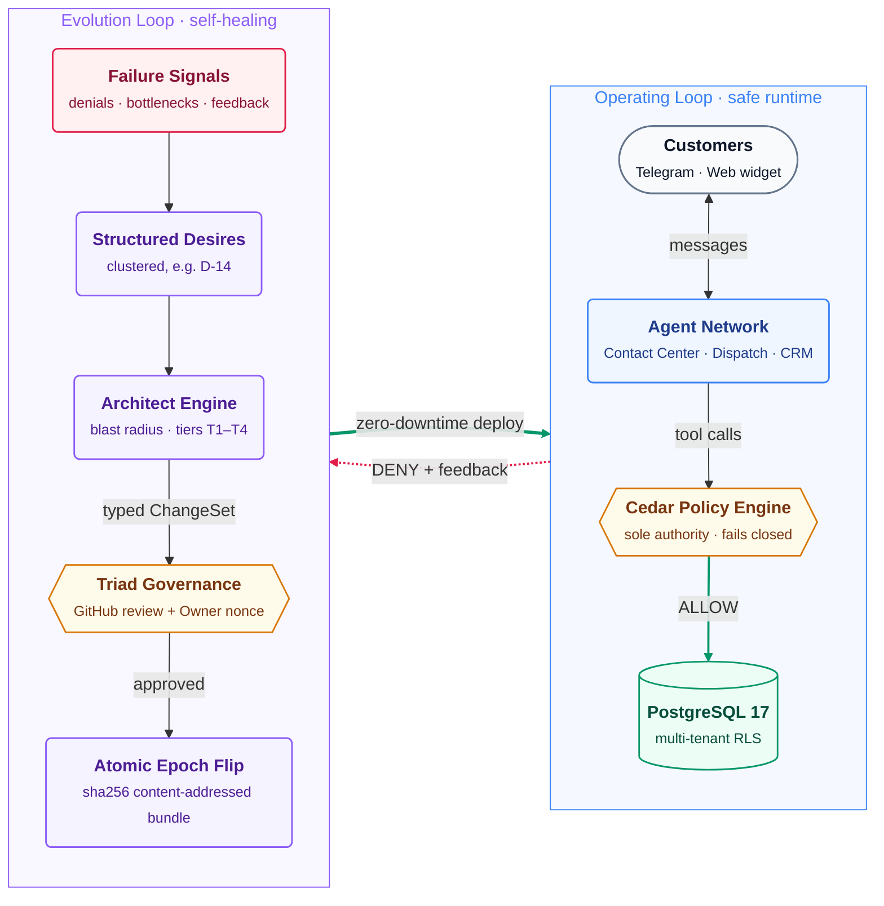

# 🏛️ Archable — Self-Evolving Business Operating System Compiler

> **Turn any real-world business into an autonomous, policy-guarded Operating System in 60 seconds.**

---

### 1. The Operating Loop (Safe Runtime)

### 1. The Operating Loop (Safe Runtime)
- **Omnichannel Ingress:** Customers interact strictly via **Telegram Bot**, **Telegram Business** (with automated Secretary mode), and embedded web widgets.
- **Agent-to-Agent (A2A) Network:** Specialized agents (*Contact Center*, *Operations/Dispatch*, *CRM*) collaborate in-process using typed capability contracts.
- **Zero Hallucination Guarantee:** AI models (*Gemini 3.8 Flash, TypeSafe Jev*) are purely evidence producers. **Cedar Policy Engine is the absolute authority**—denying unauthorized discounts, protecting PII egress, and gating financial operations.

### 2. The Evolution Loop (Self-Healing)
- **Automatic Failure Clustering:** Repeated customer requests or operational bottlenecks cluster into **Desires** (e.g. *D-14: Allow cash-on-delivery up to 300 GEL*).
- **Blast Radius Engine:** Computes an AST impact graph and determines change risk tiers (**T1–T4**).
- **Triad Governance:** High-risk changes require human sign-off (Developer review on GitHub + Owner approval via Telegram with single-use capability nonces).
- **Zero-Downtime Epoch Flip:** Approved changes compile deterministically into a content-addressed bundle (`sha256:...`) and deploy live with an atomic pointer flip without reloading the client.

---

## 🖥️ The Web OS Experience

Business owners manage their enterprise through an ultra-clean, minimalist **Desktop Web OS**:

* 🎧 **Contact Center:** Unified live customer conversations and staff handoff.
* 🔀 **Operations (QuickShipper):** Real-time order dispatch, Kanban pipeline, and courier tracking.
* 👥 **CRM:** Customer database, lifetime value metrics, and automated segmentation.
* ☁️ **Storage:** Centralized media, catalogs, and operational assets.
* 📈 **Analytics:** Real-time revenue telemetry and delivery performance.
* 🗺️ **Developer Console:** Real-time A2A topology map with live telemetry pulses, edge inspection, and system evolution feeds.

---

## 🛡️ Core Platform Invariants

1. **Git for Definitions, Postgres for Facts:** Business logic, Cedar policies, and schemas live versioned in Git. Orders, customers, prices, and messages live strictly in Postgres with multi-tenant RLS.
2. **Deterministic Lowering:** The compiler is a pure function: same input tree $\to$ identical RFC 8785 canonical digest.
3. **One Authority Per Decision:** Cedar decides every tool call and outbound dispatch. Safety fails closed.
4. **Hardware/Capability Bound Approvals:** Approvals cryptographically bind to exact head SHA, delta digest, and summary text.

---

## 🛠️ Tech Stack

- **Runtime & API:** Hono on Vercel Functions (Fluid Compute in `fra1`), TypeScript 5.9.
- **Database & State:** Supabase (PostgreSQL 17, Row-Level Security, `pg_jsonschema`, `pgmq`, `pg_cron`, Vault).
- **Policy Engine:** `@cedar-policy/cedar-wasm` (Amazon Cedar in-process verification).
- **AI & Systems-1/2:** Gemini 3.8 Flash (Dialogue & Patching), TypeSafe Jev (Grounding & Classification).
- **Frontend OS Shell:** React, Vite, Tailwind CSS (Single-writer architecture via Lovable).

---

## 🚀 Live Verification & Status

- **API Health:** `GET https://archable.vercel.app/healthz` $\to$ `{"ok":true}`
- **Test Suite:** Over **260+ workspace tests** passing across compiler, runtime, gateway, governance, and web shell.
- **Reference Tenant:** Live compiled bundle verified for **Marani OS** (`marani`).

## 🔗 Repositories & Key Documentation

| Resource | Link / Path | Description |
| :--- | :--- | :--- |
| 📂 **Backend Monorepo** | [github.com/Luka-Dumbadze/archable](https://github.com/Luka-Dumbadze/archable) | Core Platform: Hono API, Compiler, Cedar Gateway, Runtime & Migrations |
| 💻 **Frontend Web Shell** | [github.com/Luka-Dumbadze/archable-web](https://github.com/Luka-Dumbadze/archable-web) | Desktop Web OS: Apps, Live Telemetry A2A Map, Owner Mode & Lovable UI |
| 📄 **Master Architecture Blueprint** | [`ARCHABLE_MASTER_BLUEPRINT_v3.md`](./ARCHABLE_MASTER_BLUEPRINT_v3.md) | Authoritative platform architecture, blast-radius engine, and invariants |
| 📋 **Implementation & Verification Plan** | [`ARCHABLE_IMPLEMENTATION_PLAN.md`](./ARCHABLE_IMPLEMENTATION_PLAN.md) | v3.1 execution roadmap, customer ingress, and automated test proofs |
| 🌐 **Live API Deployment** | [archable.vercel.app/healthz](https://archable.vercel.app/healthz) | Live Vercel Functions runtime (`fra1`) |
